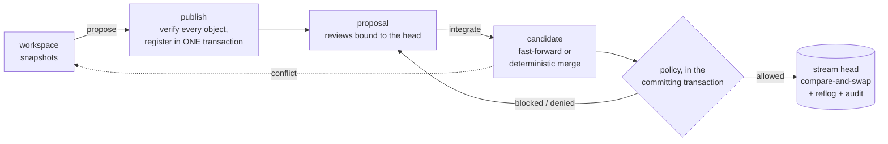

<div align="center">

# AgentGit

**Source control for a world where agents write code too.**

An agent-native SCM with its own deterministic version-control core:
crash-safe concurrent integration, validation bound to the *exact tree* that was checked,
policy-bound autonomy for agents, and a tamper-evident audit trail.

[](https://github.com/Paffin/AgentGit/actions/workflows/ci.yml)
[](LICENSE)
[](Cargo.toml)
[](#status-and-honest-limits)

**English** · [Русский](README.ru.md) · [Docs](docs/README.md) · [Roadmap](ROADMAP.md) · [Architecture](docs/architecture/overview.md)

</div>

---

## Why

Git was built for one human at one keyboard. When ten agents and three people change one codebase at the
same time, you need answers Git does not give you:

- **Who** — exactly — made this change, and was it an agent's run or a person?
- **What was actually tested?** *This* tree, or the one from before somebody else merged?
- **May an agent land code on its own?** Which files? How many?
- If two agents race, **can an update be lost?** If the process dies mid-merge, **what state is the repository in?**
- Can I **prove later** what happened and who allowed it?

AgentGit makes those first-class. The core that stores, merges and recovers is deterministic and never
needs a language model; everything "intelligent" sits on top and can only *propose*.

## See it work

A human, two agents and a CI service share one stream. (Output trimmed from
[`examples/quickstart.sh`](examples/quickstart.sh), which CI runs on every push.)

```text
$ ag integrate prop_6eed…                  # as agent:refactor-bot — an agent tries to land code on its own
Denied by policy; the stream was not changed:
  - actor not allowed to integrate: agents may not integrate unless agent_autonomy.auto_integrate is on …

$ ag integrate prop_6eed…                  # as user:alice
Blocked (policy v1); the stream was not changed:
  - check 'tests' has no trusted passing attestation for this exact tree
  - approvals (default): 0 of 1 required
  - agent-authored change has no signed provenance
  - exclusive lease on 'src/**' held by agent:refactor-bot#run_8f78… (stale_or_missing_token)
candidate tree: 315f74d45183c9e7…

$ ag validate run prop_6eed… --check tests --key ci -- cargo test        # as service:ci
check 'tests' PASSED on tree 315f74d45183 (policy v1); attestation att_0f1a… signed by service:ci
$ ag proposal review prop_6eed… --approve                                # as user:bob
$ ag integrate prop_6eed… --fencing-token 1                              # as user:alice
Integrated (merge): stream is now at 793a03b6da69 (version 3, was 70e31c72a4d0), 1 file(s) changed.

$ ag preview prop_2b19…                                                  # a concurrent edit to the same line
strategy: Merge   (algorithm ag-merge/1+ag-diff/1)
conflict: src/main.rs (content conflict (1 region(s)))                   # exit code 4 — the stream was not touched
```

Every refusal says *what is missing*, and exit codes tell scripts and agents what to do next:
`3` = blocked (provide it and run again), `4` = refused.

## What you get

| | |
|---|---|
| **Crash-safe by construction** | Objects are verified *before* the one transaction that publishes them; the stream head moves by compare-and-swap with mandatory recomputation. Fault injection at every protocol step. |
| **Reproducible merges** | A pure, versioned function of base/ours/theirs. Typed conflicts; nothing is guessed. |
| **Validation that cannot be reused for the wrong code** | Signed attestations name the exact *tree*, policy version and environment. The stream moved? The candidate changed? Validate again. |
| **Policy-bound agents** | Per-stream policy: trusted issuers, required checks, approvals bound to the reviewed head, protected paths, and an *autonomy envelope* (which paths/how many files an agent may land alone). |
| **Agent coordination** | Agent identities per run, tasks with dependencies, soft and exclusive **leases with fencing tokens**, signed **provenance** beside immutable history, conflict **prediction**, an ordered integration **queue**. |
| **Trustworthy history** | Content-addressed immutable changesets, verified on every read; append-only reflog; hash-chained audit log; `ag verify` for the whole repository. |
| **Safe operations** | GC that fails closed and cannot delete what a writer just referenced; consistent verified backups; disposable, rebuildable indexes. |
| **Git as an adapter** | `ag git import` / `export` — trees round-trip with identical Git SHAs. |

## Install

You need Rust **1.89+** and a C compiler (SQLite is built in). `git` and `python3` are optional.

```bash
git clone https://github.com/Paffin/AgentGit && cd AgentGit
cargo install --path crates/ag-cli          # installs the `ag` binary
```

## Quick start

```bash
mkdir demo && cd demo
ag init --namespace me/demo                 # creates .ag/ and the stream "main"
echo "# demo" > README.md
ag snapshot -m "first"                      # record the directory (not yet visible to others)
ag propose -t "Initial import"              # verify + publish + open a proposal
ag integrate <proposal-id>                  # atomically move "main"; any unique id prefix works
ag log
```

Then add a [policy](docs/guides/policy.md), start an [agent](docs/guides/agents.md), or run the whole story:
`./examples/quickstart.sh`. Full walkthrough: [Getting started](docs/getting-started.md).

## How it works



A change goes through four **independent** checks — none implies another:

| | Question | Decided by |
|---|---|---|
| **Mergeable** | Is there one unambiguous result tree? | the merge engine (`ag preview`) |
| **Validated** | Did *trusted* checks pass on *that tree*? | signed attestations |
| **Approved** | Did enough eligible people approve *that head*? | reviews + policy |
| **Integrated** | Was the stream updated atomically? | one CAS transaction |

Details: [Concepts](docs/concepts.md) · [Architecture](docs/architecture/overview.md) ·
[Publication & integration](docs/architecture/publication-and-integration.md) ·
[Merge semantics](docs/architecture/merge-semantics.md).

## Guarantees — and the tests behind them

Claims are only worth what proves them. Each links to a test in this repository.

| Guarantee | Evidence |
|---|---|
| A crash at **any** step of publication or integration recovers to exactly one update | `crash_at_every_step_recovers_to_exactly_one_integration` — failures injected at 7 protocol points |
| No lost update under parallel integrators; the reflog is one contiguous chain | `concurrent_integrations_never_lose_an_update`, `concurrent_cas_from_many_connections_never_loses_an_update` |
| A lost response never causes a double apply | `idempotent_replay_and_unknown_outcome_recovery` |
| Validation of an old candidate is never reused after the stream moves | `attestation_cannot_be_reused_after_the_stream_moves` |
| A stale lock holder cannot land into a scope someone else now holds | `fencing_tokens_are_strictly_increasing_and_reject_stale_holders` |
| The byte formats match an **independent Python implementation** | `tests/conformance/` (blob IDs, changesets, trees, attestations, audit chain) |
| Git history round-trips with identical tree SHAs | `history_survives_a_round_trip_with_identical_git_trees` |
| GC never deletes reachable data and never loses a concurrently re-referenced object | `gc_fails_closed_when_a_reachable_object_is_damaged`, `rewriting_an_old_unreachable_object_saves_it_from_a_concurrent_gc` |
| A checkout cannot escape its directory or plant `.git` | `checkout_refuses_to_write_through_symlinked_directories`, `hostile_git_content_cannot_escape_or_plant_dot_git` |
| Tampering with the audit log or objects is detected | `audit_chain_detects_tampering`, `fsck_reports_a_healthy_repository_and_finds_each_kind_of_damage` |

All of it: `cargo test --workspace` (more than 200 tests, a few seconds). The threat model, controls and
known limits: [Security](docs/architecture/security.md).

## Documentation

| | |
|---|---|
| Start | [Getting started](docs/getting-started.md) · [Concepts](docs/concepts.md) |
| Guides | [Agents](docs/guides/agents.md) · [Policy](docs/guides/policy.md) · [Validation](docs/guides/validation.md) · [Git bridge](docs/guides/git-bridge.md) |
| Reference | [CLI](docs/reference/cli.md) *(generated)* · [Object formats](docs/architecture/object-format.md) · [Protocol status](docs/protocol/README.md) |
| Operations | [Durability & backup](docs/operations/durability.md) · [GC & retention](docs/operations/gc-and-retention.md) · [Troubleshooting](docs/operations/troubleshooting.md) |
| Design | [Overview](docs/architecture/overview.md) · [ADRs](docs/adr/) · [ADR traceability](docs/architecture/adr-traceability.md) |

The docs are checked, not just written: the CLI reference is generated from `--help`, the demo above is
executed in CI, test names and commands mentioned in docs are verified against the code
(`scripts/check_docs.py`), and byte-level claims are backed by the conformance vectors.

## Project layout

| Crate | Role |
|---|---|
| `ag-types` `ag-object` `ag-changeset` `ag-tree` `ag-dag` `ag-diff` `ag-merge` | the deterministic core: formats, content IDs, history, merge |
| `ag-storage` | object store + transactional metadata (SQLite) |
| `ag-policy` · `ag-agent` | policy evaluation and signed attestations · agent coordination |
| `ag-integrate` | the engine: publication, integration, workspaces, queue, GC, verify, backup |
| `ag-git` · `ag-cli` | Git bridge · the `ag` binary |

## Status and honest limits

**Alpha (0.1).** The core and the guarantees above are implemented and tested; the surrounding platform is
not built yet. Read this before relying on it:

- **Local mode trusts the local user.** Identities are labels, not authentication; anyone who can write
  `.ag/` can bypass policy (tampering is *detectable* through `ag verify` and the audit chain). Enforcing
  identities across users needs the planned server.
- **No network server, AGWP protocol, PostgreSQL/S3 backends, Web UI or SDKs yet** —
  see the [roadmap](ROADMAP.md) and [ADR-0002](docs/adr/0002-embedded-engine-first.md) for why the engine
  came first.
- **`ag validate run` is not a sandbox.** Use it for trusted code; isolated execution is planned.
- Flat tree manifests (fine for thousands of files — a 3 000-file, 1 500-commit repository integrates in
  under a second — not yet for millions), no rename detection, no external security audit.

Good for: a team and its agents on one machine or shared volume, CI-gated workflows, experimenting with
policy-bound agent autonomy, and building on a small deterministic core. Not (yet) for: hosting many
untrusting users, or as your only copy of irreplaceable data — keep `ag backup`s and a Git mirror.

## Contributing

Contributions are welcome — see [CONTRIBUTING.md](CONTRIBUTING.md). Because correctness is the product,
changes to formats, hashing, merge semantics or the publication protocol start with an ADR. Security
issues: [SECURITY.md](SECURITY.md). Everyone participating follows the [Code of Conduct](CODE_OF_CONDUCT.md).

## License

Licensed under the [Apache License, Version 2.0](LICENSE). Copyright 2026 The AgentGit Authors.
Unless you state otherwise, any contribution you intentionally submit is licensed under the same terms
(Apache-2.0 §5), without additional terms or conditions.
