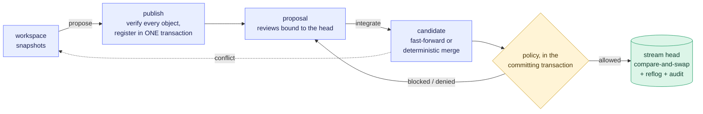

<div align="center">


<br>

[](https://github.com/Paffin/AgentGit/actions/workflows/ci.yml)
[](LICENSE)
[](Cargo.toml)
[](https://github.com/Paffin/AgentGit/actions/workflows/security.yml)
[](https://github.com/Paffin/AgentGit/actions/workflows/codeql.yml)
[](https://github.com/Paffin/AgentGit/actions/workflows/fuzz.yml)
[](https://github.com/Paffin/AgentGit/actions/workflows/quality.yml)
[](https://github.com/Paffin/AgentGit/actions/workflows/windows.yml)
[](docs/protocol/agwp-v1.md)
[](#status-and-honest-limits)

**English** · [Русский](README.ru.md) · [Docs](docs/README.md) · [Roadmap](ROADMAP.md) · [Architecture](docs/architecture/overview.md)

[**See it work**](#see-it-work) ·
[**Install**](#install) ·
[**Quick start**](#quick-start) ·
[**Server**](#run-it-as-a-server) ·
[**How it works**](#how-it-works) ·
[**Honest limits**](#status-and-honest-limits)

</div>

<br>

**AgentGit is an agent-native SCM** with its own deterministic version-control core: crash-safe concurrent
integration, validation bound to the *exact tree* that was checked, policy-bound autonomy for agents, and a
tamper-evident audit trail. The core that stores, merges and recovers never needs a language model;
everything "intelligent" sits on top of it and can only *propose*.

## Why

Git was built for one human at one keyboard. When ten agents and three people change one codebase at the
same time, these questions stop being academic:

| When agents and people share a codebase… | …AgentGit's answer |
|---|---|
| 🪪 **Who** — exactly — made this change? An agent's run, or a person? | An identity per actor *and per run*, with signed **provenance** kept beside the immutable history. |
| 🧪 **What was actually tested?** *This* tree, or the one from before somebody else merged? | **Attestations** name the exact tree, policy version and environment. The stream moved? The check no longer counts. |
| 🤖 **May an agent land code on its own?** Which files? How many? | A per-stream **policy** with an *autonomy envelope*. Agents cannot integrate unless the policy says so. |
| 💥 Two agents race: **can an update be lost?** The process dies mid-merge: **what state is the repository in?** | The head moves by **compare-and-swap**; failures are injected at every protocol step. The result is exactly one outcome. |
| 🔍 Can I **prove later** what happened and who allowed it? | An append-only reflog, a **hash-chained audit log**, and `ag verify` for the whole repository. |

## See it work

A human, two agents and a CI service share one stream. (Output trimmed from
[`examples/quickstart.sh`](examples/quickstart.sh), which CI runs on every push.)

```text
$ ag integrate prop_6eed…                  # as agent:refactor-bot — an agent tries to land code on its own
Denied by policy; the stream was not changed:
  - actor not allowed to integrate: agents may not integrate unless agent_autonomy.auto_integrate is on …

$ ag integrate prop_6eed…                  # as user:alice
Blocked (policy v1); the stream was not changed:
  - check 'tests' has no trusted passing attestation for this exact tree
  - approvals (default): 0 of 1 required
  - agent-authored change has no signed provenance
  - exclusive lease on 'src/**' held by agent:refactor-bot#run_8f78… (stale_or_missing_token)
candidate tree: 315f74d45183c9e7…

$ ag validate run prop_6eed… --check tests --key ci -- cargo test        # as service:ci
check 'tests' PASSED on tree 315f74d45183 (policy v1); attestation att_0f1a… signed by service:ci
$ ag proposal review prop_6eed… --approve                                # as user:bob
$ ag integrate prop_6eed… --fencing-token 1                              # as user:alice
Integrated (merge): stream is now at 793a03b6da69 (version 3, was 70e31c72a4d0), 1 file(s) changed.

$ ag preview prop_2b19…                                                  # a concurrent edit to the same line
strategy: Merge   (algorithm ag-merge/2+ag-diff/1)
conflict: src/main.rs (content conflict (1 region(s)))                   # exit code 4 — the stream was not touched
```

> [!TIP]
> Every refusal says *what is missing*, and exit codes tell scripts and agents what to do next:
> `3` = blocked (provide it and run again), `4` = refused.

## What you get

<table>
<tr>
<td width="33%" valign="top">

#### 🛡️ Crash-safe by construction

Objects are verified *before* the one transaction that publishes them; the stream head moves by
compare-and-swap with mandatory recomputation. Fault injection at every protocol step.

</td>
<td width="33%" valign="top">

#### 🔀 Reproducible merges

A pure, versioned function of base, ours and theirs. Typed conflicts; nothing is guessed. Moves are followed:
a file renamed on one side and edited on the other just merges.

</td>
<td width="33%" valign="top">

#### ✅ Validation tied to the exact tree

Signed attestations name the *tree*, the policy version and the environment. The stream moved or the
candidate changed? Validate again.

</td>
</tr>
<tr>
<td valign="top">

#### 🤖 Policy-bound agents

Trusted issuers, required checks, approvals bound to the reviewed head, protected paths, and an *autonomy
envelope*: which paths, and how many files, an agent may land alone.

</td>
<td valign="top">

#### 🤝 Agent coordination

An identity per run, tasks with dependencies, soft and exclusive **leases with fencing tokens**, conflict
**prediction** and an ordered integration **queue**.

</td>
<td valign="top">

#### 🧱 Isolated execution

`ag-worker` claims validation jobs, runs the policy's command in an `ag-sandbox` sandbox (rootless namespaces,
or a container; checked from inside against real Docker and Podman in CI) and signs the result for the exact tree.

</td>
</tr>
<tr>
<td valign="top">

#### 📜 History you can trust

Immutable content-addressed changesets, verified on every read; append-only reflog; hash-chained audit log.
Line-level `ag blame` that follows renames.

</td>
<td valign="top">

#### 🧰 Safe operations

GC that fails closed and cannot delete what a writer just referenced; consistent, verified backups; indexes
that are disposable and rebuildable.

</td>
<td valign="top">

#### 🔁 Git as an adapter

`ag git import` / `export`: trees round-trip with identical Git SHAs. Plus `clone` / `fetch` / `pull` / `push`
and a fully local, offline workflow.

</td>
</tr>
<tr>
<td valign="top">

#### 🌐 A network server

One protocol (AGWP v1) over gRPC and HTTP/JSON on **one port**: OIDC or scoped, expiring credentials,
per-repository RBAC, quotas, live events (SSE). Credentials can be bound to one agent *run*. Policy is enforced
against clients you do not control. Several replicas on PostgreSQL and S3 are supported and tested.

</td>
<td valign="top">

#### 🗄️ PostgreSQL, S3, observability

Per-repository PostgreSQL metadata and S3-compatible objects; Prometheus metrics, OpenTelemetry traces and
ready-made alerts and dashboards.

</td>
<td valign="top">

#### 🧩 Clients

A [Web UI](docs/guides/web-ui.md) that `ag-server` serves itself, [TypeScript and Python SDKs](docs/guides/sdks.md),
an [MCP server](docs/guides/mcp.md) (`ag-mcp`) that gives an agent AgentGit as tools, and a Go
[agent platform](docs/guides/orchestrator.md) that can propose but never integrate.

</td>
</tr>
</table>

### The Web UI

A live board of runs, leases, tasks and the merge queue, with four independent verdicts per proposal.
(Real screenshots of the UI running against a real server, captured by the end-to-end suite.)

<p align="center">
  <picture>
    <source media="(prefers-color-scheme: dark)" srcset="docs/assets/ui-board-dark.png">
    
  </picture>
</p>

<table>
<tr>
<td width="34%" align="center" valign="top">

<br><sub><b>A proposal</b>: four verdicts, what blocks it, the diff</sub>
</td>
<td width="33%" align="center" valign="top">

<br><sub><b>Policy</b>: versioned, append-only, with diffs</sub>
</td>
<td width="33%" align="center" valign="top">

<br><sub><b>Blame</b>: line-level, follows renames</sub>
</td>
</tr>
</table>

## Install

You need Rust **1.89+** and a C compiler (SQLite is built in). `git` and `python3` are optional. Linux, macOS and
Windows are built and tested in CI (the sandbox and `ag-worker` are Linux-only; see [Windows](docs/operations/windows.md)).

```bash
git clone https://github.com/Paffin/AgentGit && cd AgentGit
cargo install --path crates/ag-cli          # installs the `ag` binary
```

Release archives (`ag`, `ag-server`, `ag-worker`, `ag-mcp`; Linux and macOS), `scripts/install.sh`, container images
and a Homebrew formula exist as files and have been **rehearsed end to end by the release workflow, but nothing is
published yet**: no release tag exists, so none of them can be downloaded. [Install options](docs/getting-started.md#install)
says exactly what is and is not proven.

## Quick start

```bash
mkdir demo && cd demo
ag init --namespace me/demo                 # creates .ag/ and the stream "main"
echo "# demo" > README.md
ag snapshot -m "first"                      # record the directory (not yet visible to others)
ag propose -t "Initial import"              # verify + publish + open a proposal
ag integrate <proposal-id>                  # atomically move "main"; any unique id prefix works
ag log
```

Then add a [policy](docs/guides/policy.md), start an [agent](docs/guides/agents.md), or run the whole story:
`./examples/quickstart.sh`. Full walkthrough: [Getting started](docs/getting-started.md).

## Run it as a server

```bash
cargo install --path crates/ag-server
export AG_BOOTSTRAP_TOKEN=$(openssl rand -hex 32)          # the first administrator's credential
ag-server admin --data-dir ./ag-data create-repo acme/web
ag-server admin --data-dir ./ag-data grant --subject user:alice --repo 'acme/*' --role admin
export AG_TOKEN=$(ag-server admin --data-dir ./ag-data mint --subject user:alice --ttl 86400 | tail -n 1)
ag-server serve --data-dir ./ag-data &                      # 127.0.0.1:8080, gRPC + HTTP/JSON
ag clone http://127.0.0.1:8080/acme/web web && cd web      # then edit, `ag snapshot`, `ag push`
```

| I want to… | Read |
|---|---|
| 🚢 **Run it** | [Deployment](docs/operations/deployment.md): Docker, Compose (with PostgreSQL and SeaweedFS), Kubernetes, TLS, secrets · [Observability](docs/operations/observability.md): metrics, alerts, dashboards, traces · [Hardening checklist](docs/operations/hardening.md) |
| 🧬 **Run several replicas** | [High availability](docs/operations/high-availability.md): control plane on PostgreSQL, guarantees with the tests that prove them, failure modes, upgrade |
| 🔌 **Use it** | [Remote guide](docs/guides/remote.md) (the CLI workflow) · [AGWP reference](docs/protocol/agwp-v1.md) · [`openapi.json`](docs/protocol/openapi.json) · [MCP guide](docs/guides/mcp.md) (give an agent AgentGit as tools) |

The server also serves the [Web UI](docs/guides/web-ui.md) on the same port. What has and has not been exercised in a
real deployment is stated on the deployment page.

## How it works



### Four verdicts, four kinds of evidence

A change goes through four **independent** checks. None implies another, and each flips on its own, live:

| Verdict | Question | Decided by | Flips when |
|---|---|---|---|
| 🔀 **Mergeable** | Is there one unambiguous result tree? | the merge engine (`ag preview`) | a change on either side leaves no single result |
| 🧪 **Validated** | Did *trusted* checks pass on *that tree*? | signed attestations | the candidate tree or the policy changes |
| 👍 **Approved** | Did enough eligible people approve *that head*? | reviews + policy | the author pushes again (approvals are bound to a head), or the policy's bar moves |
| 🏁 **Integrated** | Was the stream updated atomically? | one CAS transaction | never: it is a fact in history |

<p align="center">
  
  <br><sub>The same four verdicts in the Web UI, and what stands in the way, in words.</sub>
</p>

An approval cannot argue away a failed check, a policy change flips Approved or Validated without touching
Mergeable, and an integrator who tries to land a blocked change gets the reasons in words and an unmoved
stream. All of this is exercised end to end in the Web UI's test suite.

### The whole system

<p align="center">
  
</p>

Three things in that picture are **trust boundaries** rather than boxes: the core makes every decision without
a model, a clock or randomness; the engine runs inside the server, so policy is enforced where untrusted
clients connect; and untrusted code runs only in the separate execution plane, which can *report* a result
but never decides whether it counts.

Details: [Concepts](docs/concepts.md) · [Architecture](docs/architecture/overview.md) ·
[Publication & integration](docs/architecture/publication-and-integration.md) ·
[Merge semantics](docs/architecture/merge-semantics.md).

## Guarantees — and the tests behind them

Claims are only worth what proves them. Each links to a test in this repository.

| Guarantee | Evidence |
|---|---|
| A crash at **any** step of publication or integration recovers to exactly one update | `crash_at_every_step_recovers_to_exactly_one_integration` — failures injected at 7 protocol points |
| No lost update under parallel integrators; the reflog is one contiguous chain | `concurrent_integrations_never_lose_an_update`, `concurrent_cas_from_many_connections_never_loses_an_update` |
| A lost response never causes a double apply | `idempotent_replay_and_unknown_outcome_recovery` |
| Validation of an old candidate is never reused after the stream moves | `attestation_cannot_be_reused_after_the_stream_moves` |
| A stale lock holder cannot land into a scope someone else now holds | `fencing_tokens_are_strictly_increasing_and_reject_stale_holders` |
| The byte formats match an **independent Python implementation** | `tests/conformance/` (blob IDs, changesets, trees, attestations, audit chain) |
| Git history round-trips with identical tree SHAs | `history_survives_a_round_trip_with_identical_git_trees` |
| GC never deletes reachable data and never loses a concurrently re-referenced object | `gc_fails_closed_when_a_reachable_object_is_damaged`, `rewriting_an_old_unreachable_object_saves_it_from_a_concurrent_gc` |
| A checkout cannot escape its directory or plant `.git` | `checkout_refuses_to_write_through_symlinked_directories`, `hostile_git_content_cannot_escape_or_plant_dot_git` |
| Tampering with the audit log or objects is detected | `audit_chain_detects_tampering`, `fsck_reports_a_healthy_repository_and_finds_each_kind_of_damage` |

All of it: `cargo test --workspace` (more than 1,000 tests), plus the SDK, Web UI and orchestrator suites, which run
against a real `ag-server`, plus fuzzing, coverage and mutation gates ([Testing](docs/architecture/testing.md)). The threat model, controls and known limits:
[Security](docs/architecture/security.md).

## Documentation

| I want to… | Start here |
|---|---|
| 🧪 **Try it** | [Getting started](docs/getting-started.md) · [Tutorials](docs/tutorials/README.md) · [Concepts](docs/concepts.md) · [FAQ](docs/faq.md) · [Agents](docs/guides/agents.md) · [Policy](docs/guides/policy.md) |
| 🚢 **Run it** | [Deployment](docs/operations/deployment.md) · [High availability](docs/operations/high-availability.md) · [Observability](docs/operations/observability.md) · [PostgreSQL & S3](docs/operations/postgres-and-s3.md) · [Durability & backup](docs/operations/durability.md) · [Hardening](docs/operations/hardening.md) · [Troubleshooting](docs/operations/troubleshooting.md) |
| 🧩 **Build on it** | [AGWP v1](docs/protocol/agwp-v1.md) · [OpenAPI](docs/protocol/openapi.json) · [SDKs](docs/guides/sdks.md) · [MCP](docs/guides/mcp.md) · [Orchestrator](docs/guides/orchestrator.md) · [Web UI](docs/guides/web-ui.md) |
| 🔬 **Understand it** | [Architecture](docs/architecture/overview.md) · [ADRs](docs/adr/) · [ADR traceability](docs/architecture/adr-traceability.md) · [Object formats](docs/architecture/object-format.md) · [Security](docs/architecture/security.md) · [Testing](docs/architecture/testing.md) · [Comparison with Git and others](docs/comparison.md) |

<details>
<summary><b>Every page, by topic</b></summary>

<br>

| Topic | Pages |
|---|---|
| Start | [Getting started](docs/getting-started.md) · [Tutorials](docs/tutorials/README.md) · [Concepts](docs/concepts.md) · [Glossary](docs/glossary.md) · [FAQ](docs/faq.md) · [Comparison](docs/comparison.md) |
| Guides | [Agents](docs/guides/agents.md) · [Policy](docs/guides/policy.md) · [Validation](docs/guides/validation.md) · [Workers](docs/guides/workers.md) · [Remote](docs/guides/remote.md) · [History](docs/guides/history.md) · [Git bridge](docs/guides/git-bridge.md) |
| Clients | [Web UI](docs/guides/web-ui.md) · [SDKs](docs/guides/sdks.md) · [MCP](docs/guides/mcp.md) · [Orchestrator](docs/guides/orchestrator.md) |
| Reference | [CLI](docs/reference/cli.md), [help topics](docs/reference/help-topics.md), [`--json` shapes](docs/reference/cli-json.md), [completions](docs/reference/completions.md) *(generated)* · [Configuration](docs/reference/configuration.md) · [AGWP v1](docs/protocol/agwp-v1.md) · [OpenAPI](docs/protocol/openapi.json) · [Object formats](docs/architecture/object-format.md) |
| Operations | [Deployment](docs/operations/deployment.md) · [High availability](docs/operations/high-availability.md) · [Observability](docs/operations/observability.md) · [Performance](docs/operations/performance.md) · [Releasing](docs/operations/releasing.md) · [PostgreSQL & S3](docs/operations/postgres-and-s3.md) · [Durability & backup](docs/operations/durability.md) · [GC & retention](docs/operations/gc-and-retention.md) · [Hardening](docs/operations/hardening.md) · [Supply chain](docs/operations/supply-chain.md) · [Windows](docs/operations/windows.md) · [Troubleshooting](docs/operations/troubleshooting.md) |
| Design | [Overview](docs/architecture/overview.md) · [ADRs](docs/adr/) · [ADR traceability](docs/architecture/adr-traceability.md) · [Security](docs/architecture/security.md) · [Sandbox](docs/architecture/sandbox.md) · [Testing](docs/architecture/testing.md) · [Compatibility](docs/architecture/compatibility.md) · [Performance](docs/architecture/performance.md) |

</details>

The docs are checked, not just written: the CLI reference, help topics, `--json` shapes, completions and man pages
are generated from the binary (CI fails when stale); the demo above is executed in CI and compared line by line; every
command in the tutorials is run against the real binaries (not on Windows); test names, `ag` commands and `AG_*`
variables mentioned in docs are verified against the code (`scripts/check_docs.py`); the site builds with
`mkdocs build --strict` (a broken link or anchor fails); the OpenAPI document is checked against the router; and
byte-level claims are backed by the conformance vectors. The site has never been deployed: GitHub Pages is not
enabled for the repository.

<details>
<summary><b>Project layout</b></summary>

<br>

| Crate | Role |
|---|---|
| `ag-types` `ag-object` `ag-changeset` `ag-tree` `ag-dag` `ag-diff` `ag-merge` `ag-crypto` | the deterministic core: formats, content IDs, history, rename-aware merge, signatures |
| `ag-storage` | object store (files or S3) + transactional metadata (SQLite or PostgreSQL) |
| `ag-policy` · `ag-agent` | policy evaluation and signed attestations · agent coordination |
| `ag-integrate` | the engine: publication, integration, workspaces, queue, GC, verify, backup, blame |
| `ag-protocol` · `ag-server` · `ag-client` · `ag-ui-assets` | AGWP v1 (protobuf + JSON mapping) · the network server · the Rust gRPC client · the embedded Web UI |
| `ag-mcp` · `ag-bench` | the MCP server for agents (stdio) · engine and server benchmarks |
| `ag-sandbox` · `ag-worker` | isolated execution of untrusted checks · the execution-plane worker that runs them and signs the result |
| `ag-git` · `ag-cli` | Git bridge · the `ag` binary (local and remote) |

| Directory | What |
|---|---|
| `apps/web` | the Web UI (Vue 3 + TypeScript) |
| `sdk/typescript` · `sdk/python` | client SDKs generated from the OpenAPI document and tested against a real server |
| `services/agent-orchestrator` | the agent platform (Go) |
| `deploy/` | Dockerfile, Compose, Kubernetes, Prometheus / Grafana / OpenTelemetry files |

</details>

## Status and honest limits

> [!WARNING]
> **Alpha.** The core and the guarantees above are implemented and tested, and so is the platform around it
> (server, storage backends, workers, Web UI, SDKs, orchestrator). It has not been run in production by
> anyone but its authors. Read this section before relying on it.

| Area | The honest picture |
|---|---|
| 🔓 **Local mode** | Trusts the local user. Identities are labels, not authentication; anyone who can write `.ag/` can bypass policy (tampering is *detectable* through `ag verify` and the audit chain). Against clients you do not control, run `ag-server`: it authenticates every request and policy is enforced there. |
| 🖥️ **Server replicas** | The default is one process with a SQLite control database. Several replicas on one PostgreSQL and one S3 bucket are supported and **tested with real processes in CI** (no lost update, `kill -9`, exactly-once job claims, events and replay across replicas, bounded revocation, rolling restart; [guide](docs/operations/high-availability.md)). Not proven: mixed builds during a rolling upgrade, a PostgreSQL failover (PostgreSQL stays a single point of failure unless you run it highly available), load, the Kubernetes `ha` overlay on a cluster. Rate limits are per replica; `remote` in logs is the proxy's address behind one (no `X-Forwarded-For` support). |
| 🪪 **Credentials and runs** | A credential can be bound to one run and dies with it (`scope.run_id`, [ADR-0010](docs/adr/0010-run-bound-credentials.md)); the orchestrator and `ag-mcp` do this for every run. It is opt-in per client: a hand-minted agent token is still the agent for every run, and a writer can still start, heartbeat or finish another agent's run (attributed in the audit log, not prevented). |
| 📊 **Server limits** | Object bytes are charged atomically on every write path. Open-stream and open-proposal counts are checked just before the insert, so concurrent creates can overshoot by the number in flight. Idempotency records have no TTL. There is no global budget for request bytes in flight; [Security](docs/architecture/security.md) states the worst case. |
| 🚢 **Deployment and release** | The container image, the Compose stack (PostgreSQL + SeaweedFS) and a kind deployment run end to end in the `Containers` workflow, and the release workflow has been rehearsed to the end from a work branch (archives, SBOMs, both image arches, `install.sh` on three OSes). **Nothing is published**: no tag, no registry, npm, PyPI or crates.io release. Not run: a real cluster (ingress, storage class), the `ha` and Prometheus Operator overlays on one, the rehearsal from `main`. [Deployment](docs/operations/deployment.md) and [Releasing](docs/operations/releasing.md) list exactly what is proven. |
| 🧱 **Sandboxing** | `ag validate run` is **not** a sandbox: use it for trusted code. Untrusted code goes through an [`ag-worker`](docs/guides/workers.md) and its [sandbox](docs/architecture/sandbox.md), which shares the host kernel (it is not a VM). Proven in CI from inside: real Docker and Podman (rootful and rootless) and a delegated cgroup v2. **Not verified**: microVM backends (gVisor, Kata), Windows (the worker refuses to run), macOS beyond a limits-only fallback, runtimes other than Docker 28.0.4 and Podman 4.9.3, images other than BusyBox, SELinux-enforcing hosts. |
| 🗄️ **Storage backends** | PostgreSQL metadata and S3 objects are tested in CI against a real PostgreSQL and a real S3 server (SeaweedFS, signature-checking, HTTP and HTTPS with a private CA) and against moto. **Not** tested against Amazon S3, MinIO, Ceph, R2 or other PostgreSQL versions. |
| 📏 **Scale and speed** | Flat tree manifests: measured at 100 000 files, an integration takes a few hundred milliseconds ([ADR-0006](docs/adr/0006-flat-trees-measured.md)). Numbers come from one shared 4-vCPU VM, not targets ([engine](docs/architecture/performance.md), [server under load](docs/operations/performance.md)): write throughput on the default SQLite metadata is bound by fsync (about 80 integrations/s across 16 streams) and same-stream contention yields retryable `aborted` answers (about 11-14% at 16 writers). No PostgreSQL, S3, TLS or multi-replica numbers. Rename detection is per file (no directory renames, no copies). |
| 🪟 **Platforms** | Linux and macOS are tested in CI; Windows builds and passes the test suite and the README demo (PowerShell 7 and 5.1) in CI. Windows has no sandbox or worker, no release archive yet, and the owner-only ACL on key files is set at creation but not read back. Whether a clean Windows machine needs NASM or the VC++ runtime is not verified. |
| 🖼️ **Clients** | The Web UI is served by `ag-server` and tested in Chromium, Firefox and WebKit (CI), plus tablet and phone layouts by emulation; OIDC sign-in is verified against a real Keycloak 26 (dev mode, HTTP), not against Entra, Okta or Auth0. No screen-reader pass, no real phones. `ag-mcp` is stdio only; its host configurations (Claude Code, Claude Desktop, Agent SDKs) are written from the hosts' documentation and were not run in the hosts; a real model drove it once by hand. The SDKs are not published to npm or PyPI. |
| 🧠 **Orchestrator** | Advisor, reviewers and semantic index are deterministic heuristics by default; an optional `model` mode calls any OpenAI-compatible endpoint you configure (nothing bundled, models only propose comments). It was run live once with one cheap model through one provider; the opt-in live CI step has never run in Actions. It ships no simulated agent. |
| 🛡️ **Security gates** | Supply-chain scans, CodeQL (four languages), 20 fuzz targets, coverage floors (79.1% of lines) and mutation testing of five core crates run in CI; local fuzzing ran 4.3 hours without a crash. The nightly fuzz job and the weekly mutation run have **never run on GitHub**; the repository's dependency graph is off and the state of private vulnerability reporting is unknown (owner settings); 18 Dependabot pull requests are untriaged. **No external security audit.** |

<table>
<tr>
<td width="50%" valign="top">

**✅ Good for**

- a team and its agents on one machine, one server (or a few replicas on PostgreSQL and S3) or one shared volume
- CI-gated workflows
- experimenting with policy-bound agent autonomy
- building on a small deterministic core

</td>
<td width="50%" valign="top">

**⛔ Not (yet) for**

- hosting many mutually untrusting tenants
- a failover-proven high-availability setup (replicas are tested; PostgreSQL failover is not)
- being your only copy of irreplaceable data. Keep `ag backup`s and a Git mirror.

</td>
</tr>
</table>

## Contributing

Contributions are welcome — see [CONTRIBUTING.md](CONTRIBUTING.md). Because correctness is the product,
changes to formats, hashing, merge semantics or the publication protocol start with an ADR. Security
issues: [SECURITY.md](SECURITY.md). Everyone participating follows the [Code of Conduct](CODE_OF_CONDUCT.md).

## License

Licensed under the [Apache License, Version 2.0](LICENSE). Copyright 2026 The AgentGit Authors.
Unless you state otherwise, any contribution you intentionally submit is licensed under the same terms
(Apache-2.0 §5), without additional terms or conditions.
