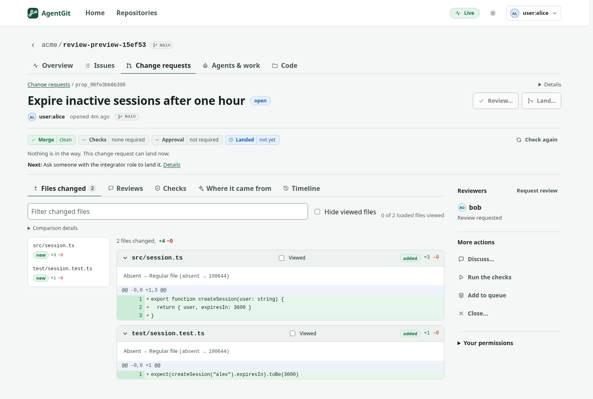

# AgentGit

**Source control for people and coding agents.**

Give agents bounded work, review the exact result, and land changes under rules your repository enforces.
AgentGit brings a local CLI, a self-hosted Web UI, agent tools and CI together around one review workflow.

[](https://github.com/Paffin/AgentGit/actions/workflows/ci.yml)
[](https://github.com/Paffin/AgentGit/releases)
[](LICENSE)

[Get started](#try-agentgit) · [Documentation](docs/README.md) · [Roadmap](ROADMAP.md) · [Русский](README.ru.md)

## Try AgentGit

Install the published **v0.3.0-beta.7** for Linux (glibc) or macOS, then open a ready-to-use demo.
No Rust toolchain, Node.js or database setup is needed.

```sh
curl -fsSL https://raw.githubusercontent.com/Paffin/AgentGit/main/scripts/install.sh | sh -s -- --version 0.3.0-beta.7
export PATH="$HOME/.local/bin:$PATH"
ag-server dev --open
```

The installer verifies the archive checksum and puts the programs in `~/.local/bin`. The server creates a demo
repository, opens the browser and signs you in. If a browser cannot open automatically, use the link it prints.
Keep the terminal running; stop with **Ctrl-C**. Restarting preserves the demo data in `./ag-dev-data`.

**In the browser:** open a file, choose **Edit**, propose your change, then review and land it.
The demo's rules protect `SECURITY.md`, so changing that file shows how a required review blocks landing.

This demo listens on your machine only and uses temporary development credentials. For a shared server, follow
[Deployment](docs/operations/deployment.md). For Windows, containers, source builds, a custom install directory or
manual download verification, see [Install options](docs/getting-started.md#install).

## Your first change from the terminal

With the demo server running, open another terminal in the same starting directory:

```sh
export PATH="$HOME/.local/bin:$PATH"
ag login http://127.0.0.1:8080 --token-file ./ag-dev-data/dev/token
ag clone http://127.0.0.1:8080/demo/welcome
cd welcome
printf '\nA change from AgentGit.\n' >> README.md
ag snapshot -m "Update the readme"
ag push -t "Update the readme"
```

`ag push` prints the proposal ID and opens the change for review. To land it, use the returned ID:

```sh
ag remote integrate PROPOSAL_ID
ag pull
```

If policy blocks a change, `ag remote explain PROPOSAL_ID` names what is missing and the commands that address it.
The [guided walkthrough](docs/getting-started.md) covers review, agent access and policy rules.

## One workflow, four clear answers

A **snapshot** records your work. A **proposal** publishes it for review. **Integration** lands the checked result
on a **stream** (the shared branch). Each proposal answers four independent questions:

| | Question |
|---|---|
| **Mergeable** | Can this change combine with the current branch? |
| **Validated** | Did trusted checks pass on the exact result that would land? |
| **Approved** | Did eligible reviewers approve the revision being landed? |
| **Integrated** | Has the shared branch been updated? |

Passing tests does not imply approval. Approval of an old revision does not approve a new one. The server checks
policy in the transaction that updates the branch; moving code cannot slip between the check and the update.



*Development preview: the simplified review workspace above is not yet in beta.7. Published-release details and
unreleased work are kept separate in the [changelog](CHANGELOG.md) and [roadmap](ROADMAP.md).*

## Use the tools you already work with

| Start here | What it gives you |
|---|---|
| [Web UI](docs/guides/web-ui.md) | Browse code, edit files, review diffs, discuss changes and manage work. |
| [CLI](docs/guides/remote.md) | Local repositories, offline snapshots and the same server workflow from your terminal. |
| [MCP](docs/guides/mcp.md) | Let an agent read, propose and review through explicitly enabled tools. |
| [TypeScript and Python SDKs](docs/guides/sdks.md) | Build integrations with typed clients for the server API. |
| [Agents and task execution](docs/guides/agents.md) | Assign scoped work, track runs and control who may land their results. |
| [CI and workers](docs/guides/validation.md) | Produce signed validation results for the exact candidate tree. |

Agent runs have distinct identities. Stream rules control required checks, reviewers, protected paths and how much
an agent may change autonomously. An append-only audit trail records decisions. The core merge and policy engine
does not call a language model. [Concepts](docs/concepts.md) explains the model; [Security](docs/architecture/security.md)
explains its trust boundaries.

## Bring an existing repository

Create a complete Git bundle, then choose **Repositories → Import from GitHub / GitLab** in the Web UI.
You can also import locally:

```sh
git bundle create repository.bundle --all
ag migrate repository.bundle ./project --namespace team/project
```

The import previews branch and tag mappings and retains the original bundle. Git export gives you a way back.
Code and history migrate; issues, comments, pull-request metadata, LFS payloads and CI setup need separate handling.
Read the [migration guide](docs/guides/migrate-from-git.md) before moving a team.

AgentGit is an early alternative for teams experimenting with policy-controlled agent work. GitHub and GitLab have
much broader hosting, project management and production experience. [Compare the trade-offs](docs/comparison.md).

## Status and limits

**Early public beta.** The current release is [v0.3.0-beta.7](https://github.com/Paffin/AgentGit/releases/tag/v0.3.0-beta.7).
There is no stable release or published crates.io, npm or PyPI package yet. Native release archives cover Linux and
macOS on x86_64 and ARM64; the worker sandbox is Linux-only. Windows builds are tested in CI, but a native Windows
release archive is not yet shipped.

**Back up before upgrading.** Beta.7 uses metadata schema **8**. The unreleased development code uses schema **11**,
adding requested reviewers and private account-backed review and comment drafts. Opening a repository with a development build
can upgrade it; returning to an older binary requires restoring the pre-upgrade backup. See
[backup and recovery](docs/operations/durability.md) and [release notes](CHANGELOG.md).

**Use it with recoverable data first.** External production qualification and an independent security audit remain
open. Local mode trusts whoever can write the repository directory. For untrusted clients use the server, and for
untrusted checks use the [worker sandbox](docs/guides/workers.md), not `ag validate run` on your own shell.
Keep backups and a Git mirror for data you cannot lose. [Known limits](ROADMAP.md) include hosting-metadata migration,
LFS and submodules, and qualification on real installations and assistive technology.

## Build and contribute

To work on the CLI, install Rust 1.89 or newer and a C compiler, then:

```sh
git clone https://github.com/Paffin/AgentGit.git
cd AgentGit
cargo install --path crates/ag-cli --locked
```

See [Contributing](CONTRIBUTING.md) for the server, Web UI, checks and repository conventions.
For architecture and correctness evidence, start with [the overview](docs/architecture/overview.md),
[the test strategy](docs/architecture/testing.md) and [the decision records](docs/adr/README.md).

<details>
<summary>A policy-controlled change, from proposal to integration</summary>

## See it work

This transcript comes from [`examples/quickstart.sh`](examples/quickstart.sh), which CI runs against the CLI.
It shows an agent being denied, a person being blocked by missing evidence, and the checked change landing:

```text
$ ag integrate prop_6eed…                  # as agent:refactor-bot — an agent tries to land code on its own
Denied by policy; the stream was not changed:
  - actor not allowed to integrate: agents may not integrate unless agent_autonomy.auto_integrate is on …

$ ag integrate prop_6eed…                  # as user:alice
Blocked (policy v1); the stream was not changed:
  - check 'tests' has no trusted passing attestation for this exact tree
  - approvals (default): 0 of 1 required
  - agent-authored change has no signed provenance
  - exclusive lease on 'src/**' held by agent:refactor-bot#run_8f78… (stale_or_missing_token)
candidate tree: 315f74d45183c9e7…

$ ag validate run prop_6eed… --check tests --key ci -- cargo test        # as service:ci
check 'tests' PASSED on tree 315f74d45183 (policy v1); attestation att_0f1a… signed by service:ci
$ ag proposal review prop_6eed… --approve                                # as user:bob
$ ag integrate prop_6eed… --fencing-token 1                              # as user:alice
Integrated (merge): stream is now at 793a03b6da69 (version 3, was 70e31c72a4d0), 1 file(s) changed.

$ ag preview prop_2b19…                                                  # a concurrent edit to the same line
strategy: Merge   (algorithm ag-merge/3+ag-diff/1)
conflict: src/main.rs (content conflict (1 region(s)))                   # exit code 4 — the stream was not touched
```

Exit code `3` means blocked: supply the missing evidence and retry. Exit code `4` means refused.

</details>

## Documentation and community

- [Getting started](docs/getting-started.md) · [Tutorials](docs/tutorials/README.md) · [FAQ](docs/faq.md)
- [Policy](docs/guides/policy.md) · [CLI reference](docs/reference/cli.md) · [Configuration](docs/reference/configuration.md)
- [Deployment](docs/operations/deployment.md) · [Troubleshooting](docs/operations/troubleshooting.md) · [API](docs/protocol/agwp-v1.md)
- [Join the beta](docs/community/start-here.md) · [Report an issue](https://github.com/Paffin/AgentGit/issues) · [Roadmap](ROADMAP.md)

Report vulnerabilities through [Security](SECURITY.md). Everyone taking part follows the [Code of Conduct](CODE_OF_CONDUCT.md).

## License

[Apache 2.0](LICENSE). Copyright 2026 The AgentGit Authors.
