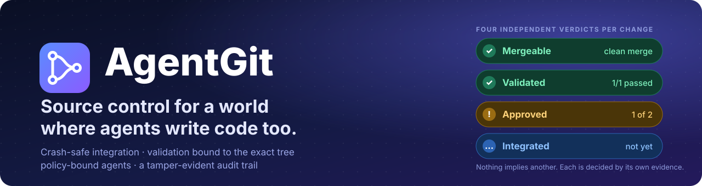
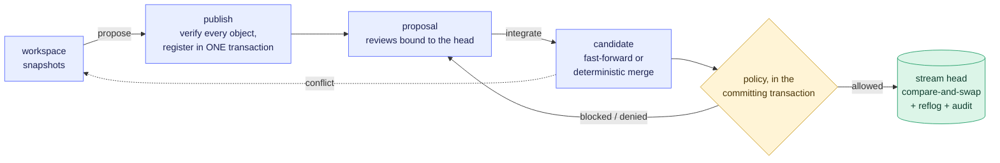

<div align="center">



<br>

[](https://github.com/Paffin/AgentGit/actions/workflows/ci.yml)
[](docs/README.md)
[](LICENSE)
[](#status-and-limits)

**English** · [Русский](README.ru.md) · [Docs](docs/README.md) · [Roadmap](ROADMAP.md) · [Comparison](docs/comparison.md)

</div>

<br>

AgentGit is a version control system for repositories that people, coding agents and CI all write to.

A change lands only when the repository's policy says it may, and the policy is checked in the same transaction that
moves the branch, so nothing can change between "checked" and "merged". Test results are signed and tied to the exact
tree they ran on. The final transaction also rechecks the proposal head and open state. Every agent run has its own identity, and every decision ends up in an audit log you can verify.
The core that stores, merges and recovers never calls a language model; anything smart sits on top and can only propose.

This is an early public beta: [status and limits](#status-and-limits) are below, and nobody but its authors has run it in production.

**Available in beta.5:** repository issues with comments, close/reopen, conflict-safe edits and an atomic handoff to agent tasks with an expected result and explicit file scope. See the [Web UI guide](docs/guides/web-ui.md#repository-issues). Labels, milestones, attachments and provider issue import remain unfinished. Operators can pause and resume new task-bound runs without interrupting existing sessions, and inspect current or historical runs through permanent links. Task creators can reserve a registered agent at creation or reassign queued work; the server and orchestrator enforce the choice. A registered agent still needs a configured executor. The registered-agent view shows expiring executor connection reports and last reported capacity. Its setup wizard prepares repository-scoped credentials and a task executor configuration; host installation remains a separate step. Optional bounded executor output can be viewed, downloaded and deleted from a run page. This release uses schema 6; take a database backup before upgrading. Older binaries require restoring the pre-upgrade backup.

**Review in beta.5:** revision-bound line discussions, replies and conflict-safe resolution are shared by Web UI, CLI and MCP. Filter open or resolved threads without losing reply drafts; source anchors retain the exact reviewed revision. CLI JSON response shapes are documented for automation. [Upgrade and rollback guidance](docs/adr/0025-line-review-threads.md).

**Development (`main`):** operators can disable or re-enable new runs for an individual agent from the browser or `ag agent disable NAME --remote origin` (`enable` to restore admission). Existing sessions, keys and history are retained. This is not included in the beta.5 archives; see [ADR-0026](docs/adr/0026-agent-run-admission.md).

**Unreleased execution progress:** the executor setup wizard can enable bounded output updates while an agent runs. Heartbeats remain independent, known incomplete credential prefixes are withheld, and deleting output prevents later uploads. [Live output](docs/guides/orchestrator.md#live-executor-output-unreleased).

**Unreleased CLI:** inspect remote run history with task/active filters and read or delete captured output using `ag agent runs --remote` and `ag agent output RUN --remote`. [Execution inspection](docs/guides/agents.md#14-inspect-execution-history-and-output-from-the-cli-unreleased).

Development: validation workers can be required to present their current job claim on every mutation; see the [worker rollout guide](docs/guides/workers.md#requiring-current-job-claims).

**Development core:** Tasks can carry a server-enforced attempt limit. `ag task attempts TASK --max 5 --expected 3` lets an operator extend an exhausted task without losing its history; restart recovery uses durable run records. Zero keeps the existing repository retry policy. Concurrent operator policy changes are protected from stale automatic cancellation, and late results cannot finish a newer task attempt. [Execution limits](docs/adr/0033-task-attempt-limits.md).

**Development upgrade:** persistent follow-up task links and durable task execution limits require metadata schema 8. Back up before opening existing repositories with this development build; rollback uses the pre-upgrade backup. [Source-link semantics](docs/adr/0027-task-source-links.md).

Development conflict resolution compares the inspected proposal head before updating it; concurrent edits are refused instead of overwritten.


Development stream rules can require every line discussion to be resolved before integration, including feedback on earlier revisions.

Development review threads support proposed line replacements, with explicit author preview and head-checked application.

Development rules also expose protected-path approvers and check timing without editing JSON; runner settings survive form edits.

## Coming from GitHub or GitLab?

Open **Repositories → Import from GitHub / GitLab** to upload a full Git bundle, inspect the branch/tag mapping and publish the verified result. Or run `ag migrate repository.bundle ./project --namespace team/project`. The source stays unchanged, and its original bundle is retained in backups. [Migration guide and metadata limitations](docs/guides/migrate-from-git.md).

The beta also supports keyboard-driven file finding, recoverable file drafts, and review drafts that stay while you inspect the diff. Web reviews are bound to the exact head you inspected; an author update rejects a stale submission and preserves your text. These changes are included in beta.2 and documented in the [changelog](CHANGELOG.md) and [Web UI guide](docs/guides/web-ui.md).

Development also supports editing task instructions before the first run through Web UI, CLI and API, with concurrent-edit protection. This is not in beta.5 archives. [Task editing](docs/guides/web-ui.md#refine-queued-task-instructions-development).

Development Home keeps queue filters in bookmarkable links and can follow a selected repository live; event bursts share one refresh, while the aggregate view retains bounded polling.

Next priorities are complete review workflows and hosting-metadata migration.
The [roadmap](ROADMAP.md#next) separates delivered features, published releases and remaining qualification.

## See it work

A person, two agents and a CI service share one stream. The output is trimmed from
[`examples/quickstart.sh`](examples/quickstart.sh), which CI runs on every push and compares line by line with this block.

```text
$ ag integrate prop_6eed…                  # as agent:refactor-bot — an agent tries to land code on its own
Denied by policy; the stream was not changed:
  - actor not allowed to integrate: agents may not integrate unless agent_autonomy.auto_integrate is on …

$ ag integrate prop_6eed…                  # as user:alice
Blocked (policy v1); the stream was not changed:
  - check 'tests' has no trusted passing attestation for this exact tree
  - approvals (default): 0 of 1 required
  - agent-authored change has no signed provenance
  - exclusive lease on 'src/**' held by agent:refactor-bot#run_8f78… (stale_or_missing_token)
candidate tree: 315f74d45183c9e7…

$ ag validate run prop_6eed… --check tests --key ci -- cargo test        # as service:ci
check 'tests' PASSED on tree 315f74d45183 (policy v1); attestation att_0f1a… signed by service:ci
$ ag proposal review prop_6eed… --approve                                # as user:bob
$ ag integrate prop_6eed… --fencing-token 1                              # as user:alice
Integrated (merge): stream is now at 793a03b6da69 (version 3, was 70e31c72a4d0), 1 file(s) changed.

$ ag preview prop_2b19…                                                  # a concurrent edit to the same line
strategy: Merge   (algorithm ag-merge/3+ag-diff/1)
conflict: src/main.rs (content conflict (1 region(s)))                   # exit code 4 — the stream was not touched
```

Every refusal says what is missing. Exit code `3` means blocked (supply what is missing and run it again), `4` means refused.

## Install

You need Rust 1.89 or newer and a C compiler (SQLite is built in). Linux, macOS and Windows are built and tested in CI;
the sandbox and `ag-worker` are Linux-only ([Windows](docs/operations/windows.md)).

```bash
git clone https://github.com/Paffin/AgentGit && cd AgentGit
cargo install --path crates/ag-cli          # installs the `ag` binary
```

The public beta is [`v0.3.0-beta.5`](https://github.com/Paffin/AgentGit/releases/tag/v0.3.0-beta.5). It includes the following archives and install commands. Archives contain `ag`, `ag-server`, `ag-worker`, `ag-mcp` and `orchestrator` for Linux and macOS; release verification is tracked by the [Release workflow](https://github.com/Paffin/AgentGit/actions/workflows/release.yml).

```bash
curl -fsSL https://raw.githubusercontent.com/Paffin/AgentGit/main/scripts/install.sh | sh -s -- --version 0.3.0-beta.5
docker pull ghcr.io/paffin/agentgit-cli:0.3.0-beta.5
```

`--version` is needed while only pre-releases exist. For an existing rc.2 installation, see the [previous rc.2 procedure](docs/getting-started.md#on-020-rc2-until-the-next-release). The [rc.2 verification record](docs/operations/releasing.md) describes that release's checks and limitations; it is not evidence for rc.3. [Install options](docs/getting-started.md#install) has the details.

## Quick start

```bash
mkdir demo && cd demo
ag init --namespace me/demo                 # creates .ag/ and the stream "main"
echo "# demo" > README.md
ag snapshot -m "first"                      # record the directory (not yet visible to others)
ag propose -t "Initial import"              # verify, publish and open a proposal
ag integrate <proposal-id>                  # move "main" atomically; any unique id prefix works
ag log
```

Next, add a [policy](docs/guides/policy.md), start an [agent](docs/guides/agents.md), or run the whole story with
`./examples/quickstart.sh`. The full walkthrough is [Getting started](docs/getting-started.md).

### Five minutes with a server, nothing to build

```bash
ag-server dev                                            # data directory, administrator, demo repository, a sign-in link
ag login http://127.0.0.1:8080 --token-file ./ag-dev-data/dev/token
ag clone http://127.0.0.1:8080/demo/welcome              # edit, `ag snapshot`, `ag push -t "my change"`, `ag explain` if refused
```

`ag-server dev` prints a link that signs you in to the Web UI and the exact commands above. It is an evaluation mode
(loopback only, plain HTTP, an 8-hour credential), not a deployment. It is included in `v0.3.0-beta.5`. For the previous `v0.2.0-rc.2` archive, [Getting started](docs/getting-started.md#on-020-rc2-until-the-next-release) has the same
start on rc.2 in a few more lines.

### As a server

```bash
cargo install --path crates/ag-server
export AG_BOOTSTRAP_TOKEN=$(openssl rand -hex 32)          # the first administrator's credential
ag-server admin --data-dir ./ag-data create-repo acme/web
ag-server admin --data-dir ./ag-data grant --subject user:alice --repo 'acme/*' --role admin
export AG_TOKEN=$(ag-server admin --data-dir ./ag-data mint --subject user:alice --ttl 86400 | tail -n 1)
ag-server serve --data-dir ./ag-data &                      # 127.0.0.1:8080, gRPC + HTTP/JSON
ag clone http://127.0.0.1:8080/acme/web web && cd web      # then edit, `ag snapshot`, `ag push -t "my change"`
```

The server speaks one protocol, [AGWP v1](docs/protocol/agwp-v1.md), over gRPC and HTTP/JSON on a single port, and serves
the [Web UI](docs/guides/web-ui.md) on it. Compose, Kubernetes, TLS and PostgreSQL with S3 are covered in
[Deployment](docs/operations/deployment.md).

## What it does

- Publishes a change in one verified transaction and moves the stream head by compare-and-swap. A crash at any step
  leaves exactly one outcome; failures are injected at every protocol step in the tests.
- Merges with a pure, versioned function of base, ours and theirs. Conflicts are typed results reported before anything
  changes, and a file renamed on one side and edited on the other merges cleanly.
- Binds validation to the candidate tree. An attestation names the tree, the policy version and the environment, and is
  signed by an issuer the policy trusts. When the stream moves, the old result stops counting.
- Keeps a policy per stream: required checks, approvals bound to the reviewed head, protected paths, and an autonomy
  envelope that says which paths, and how many files, an agent may land without a person.
- Coordinates agents: an identity per run, tasks, soft and exclusive leases with fencing tokens, conflict prediction and
  an ordered integration queue.
- Runs untrusted checks in `ag-worker` inside a sandbox (rootless namespaces or a container) and signs the result.
- Records an append-only reflog and a hash-chained audit log; `ag verify` checks the whole repository.
- Imports from and exports to Git with identical tree SHAs, and works fully offline.
- Ships a [Web UI](docs/guides/web-ui.md), [TypeScript and Python SDKs](docs/guides/sdks.md), an
  [MCP server](docs/guides/mcp.md) that exposes AgentGit to an agent as tools, and a Go
  [agent platform](docs/guides/orchestrator.md) that can propose changes but never integrate them.

## How it compares

GitHub, GitLab and Bitbucket are mature hosting platforms with broader project management,
hosted CI, security scanning, permissions at scale and support. AgentGit has repository issues and
agent-task handoff; labels, milestones, attachments and hosting-metadata import remain open. The table covers only the question AgentGit is built around:
how a change lands when several untrusted actors write to one codebase. Cells about the platforms describe their
public documentation; the page linked below has the sources, the access date and the much longer list of what they do better.

| | GitHub | GitLab | Bitbucket | AgentGit |
|---|---|---|---|---|
| Unit of review | pull request | merge request | pull request | proposal |
| Where merge rules are enforced | the platform: branch protection and rulesets | the platform: protected branches, approval rules, push rules (several need Premium) | the platform: branch permissions, merge checks (enforced on Premium in Cloud) | the stream's policy, evaluated in the transaction that moves the head |
| A passing check is bound to the exact tree that lands | in the merge queue, which tests a temporary merge of the queue; otherwise to a commit | with merged results pipelines and merge trains (Premium); otherwise to a pipeline | required builds on the head commit; merge queues build a merge result (paid plans, Pipelines) | always: a signed attestation names the tree, policy version and environment |
| Identity of automated actors | accounts, GitHub Apps, tokens | service accounts, access tokens | accounts, tokens | an identity per agent and per run; credentials can be bound to one run |
| Policy-bound autonomy for agents | built from branch rules and bot permissions | built from the same pieces | built from the same pieces | built in: allowed paths and a file limit per stream |
| Tamper-evident audit | an audit log with export; the docs make no integrity claim | audit events (Ultimate); the docs make no integrity claim | an audit log; not compared | hash-chained, checked by `ag audit` and `ag verify` |
| Self-contained and offline | hosted; Enterprise Server for self-managed | SaaS or self-managed | Cloud or Data Center | local mode needs no server; the server is one binary |
| Ecosystem | very large | very large, CI and security built in | large, Jira and Pipelines | small: CLI, SDKs (unpublished), MCP, Web UI |
| Maturity | very high | very high | very high | beta |

The full comparison, including Git, Gerrit and Jujutsu: [AgentGit compared](docs/comparison.md).

## The Web UI

A new user starts on a home page that says what needs attention, with plain labels (the AgentGit word is in a tooltip),
blockers that come with their fix as a button, guided flows to start a repository or give an agent work, rules presets
instead of raw JSON, and editing a file and proposing it from the browser. These are included in beta.2.
What is still missing is on the [roadmap](ROADMAP.md).

Beta.3 adds file-by-file review progress, reload recovery for review drafts, permanent task pages with prerequisite management and confirmed completion/cancellation, and server-side code search with links to matching lines. See the [changelog](CHANGELOG.md) for details and limitations.

A live board of runs, leases, tasks and the merge queue, with four independent verdicts per proposal. These are real
screenshots of the UI running against a real server, captured by the end-to-end suite.

<p align="center">
  <picture>
    <source media="(prefers-color-scheme: dark)" srcset="docs/assets/ui-board-dark.png">
    
  </picture>
</p>

<table>
<tr>
<td width="34%" align="center" valign="top">

<br><sub>A proposal: four verdicts, what blocks it, the diff</sub>
</td>
<td width="33%" align="center" valign="top">

<br><sub>Policy: versioned, append-only, with diffs</sub>
</td>
<td width="33%" align="center" valign="top">

<br><sub>Blame: line-level, follows renames</sub>
</td>
</tr>
</table>

## How it works



A proposal has four verdicts. They are independent: none implies another, and each changes on its own.

| Verdict | Question | Decided by | Changes when |
|---|---|---|---|
| Mergeable | Is there one unambiguous result tree? | the merge engine (`ag preview`) | a change on either side leaves no single result |
| Validated | Did trusted checks pass on that tree? | signed attestations | the candidate tree or the policy changes |
| Approved | Did enough eligible people approve that head? | reviews and policy | the author pushes again, or the policy's bar moves |
| Integrated | Was the stream updated atomically? | one compare-and-swap transaction | never; it is a fact in history |

<p align="center">
  
</p>

<p align="center">
  
</p>

Three trust boundaries matter more than the boxes. The core decides without a model, a clock or randomness. The engine runs
inside the server, so policy is enforced where untrusted clients connect. Untrusted code runs only in a separate
execution plane, which can report a result but never decides whether it counts. Read more in
[Concepts](docs/concepts.md), the [architecture overview](docs/architecture/overview.md) and
[publication and integration](docs/architecture/publication-and-integration.md).

## Guarantees and their tests

Each row names a test in this repository. More than 1,000 Rust tests run in CI, together with the SDK, Web UI and
orchestrator suites against a real `ag-server`, fuzzing, coverage and mutation gates ([Testing](docs/architecture/testing.md)).

| Guarantee | Test |
|---|---|
| A crash at any step of publication or integration recovers to exactly one update | `crash_at_every_step_recovers_to_exactly_one_integration` |
| No lost update under parallel integrators | `concurrent_integrations_never_lose_an_update` |
| A lost response never causes a double apply | `idempotent_replay_and_unknown_outcome_recovery` |
| A check on an old candidate is not reused after the stream moves | `attestation_cannot_be_reused_after_the_stream_moves` |
| A stale lock holder cannot land into a scope someone else now holds | `fencing_tokens_are_strictly_increasing_and_reject_stale_holders` |
| Byte formats match an independent Python implementation | `tests/conformance/` |
| Git history round-trips with identical tree SHAs | `history_survives_a_round_trip_with_identical_git_trees` |
| Tampering with the audit log or objects is detected | `audit_chain_detects_tampering` |

The threat model and its known limits are in [Security](docs/architecture/security.md).

## Documentation

| | |
|---|---|
| Start | [Getting started](docs/getting-started.md), [tutorials](docs/tutorials/README.md), [concepts](docs/concepts.md), [FAQ](docs/faq.md), [comparison](docs/comparison.md) |
| Guides | [agents](docs/guides/agents.md), [policy](docs/guides/policy.md), [validation](docs/guides/validation.md), [workers](docs/guides/workers.md), [remote](docs/guides/remote.md), [history](docs/guides/history.md), [Git bridge](docs/guides/git-bridge.md) |
| Clients | [Web UI](docs/guides/web-ui.md), [SDKs](docs/guides/sdks.md), [MCP](docs/guides/mcp.md), [orchestrator](docs/guides/orchestrator.md) |
| Reference | [CLI](docs/reference/cli.md), [configuration](docs/reference/configuration.md), [AGWP v1](docs/protocol/agwp-v1.md), [OpenAPI](docs/protocol/openapi.json), [object formats](docs/architecture/object-format.md) |
| Operations | [deployment](docs/operations/deployment.md), [high availability](docs/operations/high-availability.md), [observability](docs/operations/observability.md), [backup](docs/operations/durability.md), [hardening](docs/operations/hardening.md), [troubleshooting](docs/operations/troubleshooting.md) |
| Design | [architecture](docs/architecture/overview.md), [ADRs](docs/adr/), [ADR traceability](docs/architecture/adr-traceability.md), [security](docs/architecture/security.md), [sandbox](docs/architecture/sandbox.md) |

The docs are checked in CI: the CLI reference is generated from the binary, tutorial commands are run against real
binaries, and `scripts/check_docs.py` verifies links, test names, `ag` commands and `AG_*` variables. The site builds with
`mkdocs build --strict` and deploys to GitHub Pages from `main`.

## Status and limits

AgentGit is an early public beta for a single Linux server with SQLite and filesystem storage. The core and the guarantees above are implemented and tested, and so is the platform around it. It has
not been run in production by anyone but its authors, and there has been no external security audit. The full list is in
[ROADMAP.md](ROADMAP.md) and [CHANGELOG.md](CHANGELOG.md); the ones that decide whether you can use it today:

- Local mode trusts the local user. Identities are labels, and anyone who can write `.ag/` can bypass policy; tampering
  is detectable with `ag verify`, not prevented. Against clients you do not control, run `ag-server`.
- Several server replicas on one PostgreSQL and one S3 bucket are tested with real processes in CI. A PostgreSQL
  failover, mixed versions during a rolling upgrade, load, and the Kubernetes `ha` overlay on a real cluster are not
  proven ([high availability](docs/operations/high-availability.md)).
- Credentials can be bound to one agent run ([ADR-0010](docs/adr/0010-run-bound-credentials.md)), but that is opt-in
  per client; acting on another agent's run needs `agent.operate`, which a plain writer does not have. Fencing tokens for
  job claims are optional per request ([ADR-0012](docs/adr/0012-job-claim-fencing.md)).
- Only prereleases are available; the current beta is `v0.3.0-beta.5`. No stable release, and no
  crates.io, npm or PyPI package; the 21 `agentgit-<x>` crates are only dry-run
  ([releasing](docs/operations/releasing.md)). Metadata schema 6 requires a pre-upgrade backup; rollback restores that backup with the older binary.
- `ag validate run` is not a sandbox. Untrusted code goes through [`ag-worker`](docs/guides/workers.md), whose sandbox
  shares the host kernel. Verified against real Docker and Podman and cgroup v2; not verified for microVMs, Windows
  (the worker refuses to run) or macOS beyond a limits-only fallback ([sandbox](docs/architecture/sandbox.md)).
- PostgreSQL and S3 are tested against a real PostgreSQL and SeaweedFS, not against Amazon S3, MinIO, Ceph or R2.
- Trees are flat manifests, measured at 100,000 files ([ADR-0006](docs/adr/0006-flat-trees-measured.md)). Performance
  numbers come from one shared 4-vCPU VM and are not targets ([engine](docs/architecture/performance.md),
  [server](docs/operations/performance.md)); PostgreSQL, S3, TLS and multi-replica throughput are not measured. The decoded-tree
  cache and the 3 durable commits per integration were measured on the memory and disk backends only.
- No history rewriting, tags, submodules or LFS; the Git bridge reports what it cannot carry.
- The Web UI is tested in Chromium, Firefox and WebKit; OIDC only against Keycloak. There has been no screen-reader pass.
  `ag-mcp` was not run inside real hosts. The SDKs are unpublished.
- Nightly fuzzing and weekly mutation checks run in GitHub Actions. Inspect the results on the release commit; a successful coverage run alone does not establish passing mutation checks.

Reasonable today: a team and its agents on one machine, one server or a few replicas, with CI-gated workflows, or
experimenting with policy-bound autonomy. Not yet: hosting mutually untrusting tenants, or being the only copy of data you
cannot lose. Keep `ag backup` copies and a Git mirror.

## Try the beta workflow

The public beta is open to small teams: see the
[scope and release gates](docs/community/beta.md), [start here](docs/community/start-here.md), and the
[beta milestone](https://github.com/Paffin/AgentGit/milestone/1). Installation problems and confusing workflows are useful feedback.

## Contributing

See [CONTRIBUTING.md](CONTRIBUTING.md). Changes to formats, hashing, merge semantics or the publication protocol start
with an ADR. Report security issues as described in [SECURITY.md](SECURITY.md). Everyone taking part follows the
[Code of Conduct](CODE_OF_CONDUCT.md).

## License

Apache License 2.0, see [LICENSE](LICENSE). Copyright 2026 The AgentGit Authors.
