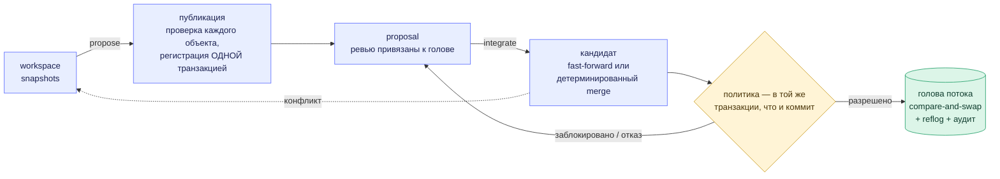

<div align="center">


<br>

[](https://github.com/Paffin/AgentGit/actions/workflows/ci.yml)
[](LICENSE)
[](Cargo.toml)
[](https://github.com/Paffin/AgentGit/actions/workflows/security.yml)
[](https://github.com/Paffin/AgentGit/actions/workflows/codeql.yml)
[](https://github.com/Paffin/AgentGit/actions/workflows/fuzz.yml)
[](https://github.com/Paffin/AgentGit/actions/workflows/quality.yml)
[](https://github.com/Paffin/AgentGit/actions/workflows/windows.yml)
[](docs/protocol/agwp-v1.md)
[](#статус-и-честные-ограничения)

[English](README.md) · **Русский** · [Документация](docs/README.md) · [Roadmap](ROADMAP.md) · [Архитектура](docs/architecture/overview.md)

[**Как это выглядит**](#как-это-выглядит) ·
[**Установка**](#установка) ·
[**Быстрый старт**](#быстрый-старт) ·
[**Сервер**](#запуск-как-сервера) ·
[**Как это работает**](#как-это-работает) ·
[**Честные ограничения**](#статус-и-честные-ограничения)

</div>

<br>

> Документация в `docs/` написана на английском; ADR-0001 (исходное архитектурное решение) — на русском:
> [`docs/adr/0001-final-architecture.md`](docs/adr/0001-final-architecture.md).

**AgentGit — agent-native SCM** с собственным детерминированным VCS-ядром: безопасная при сбоях конкурентная
интеграция, валидация, привязанная к *точному дереву*, которое проверяли, политики автономности агентов и
аудит, в котором видна любая подмена. Ядро, которое хранит, сливает и восстанавливает, никогда не требует
языковой модели; всё «умное» — надстройка над ним, и она может только *предлагать*.

## Зачем

Git создавался для одного человека за одной клавиатурой. Когда десять агентов и три человека одновременно
меняют один код, эти вопросы перестают быть академическими:

| Когда агенты и люди делят один код… | …ответ AgentGit |
|---|---|
| 🪪 **Кто именно** сделал изменение: запуск агента или человек? | Идентичность на каждого участника *и на каждый запуск* и подписанный **provenance** рядом с неизменяемой историей. |
| 🧪 **Что на самом деле проверяли?** *Это* дерево или то, что было до чужого merge? | **Аттестации** называют точное дерево, версию политики и окружение. Поток сдвинулся — проверка больше не засчитывается. |
| 🤖 **Может ли агент сам влить код?** В какие файлы? Сколько? | **Политика** потока с *конвертом автономности*. Агенты не могут интегрировать, пока политика этого не разрешит. |
| 💥 Два агента гонятся: **может ли обновление потеряться?** Процесс упал посреди merge: **в каком состоянии репозиторий?** | Голова двигается через **compare-and-swap**; сбои внедряются на каждом шаге протокола. Результат — ровно один исход. |
| 🔍 Можно ли **потом доказать**, что произошло и кто это разрешил? | Append-only reflog, **аудит с хеш-цепочкой** и `ag verify` для всего репозитория. |

## Как это выглядит

Человек, два агента и CI-сервис работают с одним потоком. (Вывод сокращён из
[`examples/quickstart.sh`](examples/quickstart.sh) — CI запускает этот сценарий при каждом push.)

```text
$ ag integrate prop_6eed…                  # as agent:refactor-bot — агент пытается сам влить код
Denied by policy; the stream was not changed:
  - actor not allowed to integrate: agents may not integrate unless agent_autonomy.auto_integrate is on …

$ ag integrate prop_6eed…                  # as user:alice
Blocked (policy v1); the stream was not changed:
  - check 'tests' has no trusted passing attestation for this exact tree
  - approvals (default): 0 of 1 required
  - agent-authored change has no signed provenance
  - exclusive lease on 'src/**' held by agent:refactor-bot#run_8f78… (stale_or_missing_token)
candidate tree: 315f74d45183c9e7…

$ ag validate run prop_6eed… --check tests --key ci -- cargo test        # as service:ci
check 'tests' PASSED on tree 315f74d45183 (policy v1); attestation att_0f1a… signed by service:ci
$ ag proposal review prop_6eed… --approve                                # as user:bob
$ ag integrate prop_6eed… --fencing-token 1                              # as user:alice
Integrated (merge): stream is now at 793a03b6da69 (version 3, was 70e31c72a4d0), 1 file(s) changed.

$ ag preview prop_2b19…                                                  # параллельная правка той же строки
strategy: Merge   (algorithm ag-merge/2+ag-diff/1)
conflict: src/main.rs (content conflict (1 region(s)))                   # код выхода 4 — поток не тронут
```

> [!TIP]
> Каждый отказ говорит, *чего не хватает*, а коды выхода подсказывают скриптам и агентам, что делать дальше:
> `3` — заблокировано (предоставьте недостающее и повторите), `4` — отказ.

## Что внутри

<table>
<tr>
<td width="33%" valign="top">

#### 🛡️ Безопасность при сбоях по построению

Объекты проверяются *до* единственной транзакции публикации; голова потока двигается через compare-and-swap
с обязательным пересчётом. Fault injection на каждом шаге протокола.

</td>
<td width="33%" valign="top">

#### 🔀 Воспроизводимые merge

Чистая версионированная функция от base, ours и theirs. Типизированные конфликты, ничего не угадывается.
Перемещения учитываются: файл, переименованный на одной стороне и изменённый на другой, просто сливается.

</td>
<td width="33%" valign="top">

#### ✅ Валидация привязана к точному дереву

Подписанные аттестации называют *дерево*, версию политики и окружение. Поток сдвинулся или кандидат
изменился — проверьте заново.

</td>
</tr>
<tr>
<td valign="top">

#### 🤖 Агенты в рамках политики

Доверенные эмитенты, обязательные проверки, одобрения, привязанные к ревьюенной голове, защищённые пути и
*конверт автономности*: какие пути и сколько файлов агент вправе влить сам.

</td>
<td valign="top">

#### 🤝 Координация агентов

Идентичность на каждый запуск, задачи с зависимостями, мягкие и эксклюзивные **lease с fencing-токенами**,
**предсказание** конфликтов и упорядоченная **очередь** интеграции.

</td>
<td valign="top">

#### 🧱 Изолированное исполнение

`ag-worker` забирает задания на валидацию, запускает команду из политики в песочнице `ag-sandbox`
(rootless-namespaces или контейнер; изнутри проверено в CI на настоящих Docker и Podman) и подписывает результат
для точного дерева.

</td>
</tr>
<tr>
<td valign="top">

#### 📜 История, которой можно верить

Неизменяемые content-addressed changesets с проверкой хеша при каждом чтении; append-only reflog; аудит с
хеш-цепочкой. Построчный `ag blame` с переходом через переименования.

</td>
<td valign="top">

#### 🧰 Безопасная эксплуатация

GC, который не удаляет достижимое и не теряет только что упомянутый объект; согласованные проверенные бэкапы;
одноразовые, пересобираемые индексы.

</td>
<td valign="top">

#### 🔁 Git как адаптер

`ag git import` / `export`: деревья проходят round-trip с идентичными Git SHA. Плюс `clone` / `fetch` / `pull` /
`push` и полностью локальная офлайн-работа.

</td>
</tr>
<tr>
<td valign="top">

#### 🌐 Сетевой сервер

Один протокол (AGWP v1) по gRPC и HTTP/JSON на **одном порту**: OIDC или scoped-credentials с коротким сроком
жизни, RBAC на репозиторий, квоты, живые события (SSE). Credentials можно привязать к одному *запуску* агента. Политика
действует и против клиентов, которых вы не контролируете. Несколько реплик на PostgreSQL и S3 поддерживаются и
протестированы.

</td>
<td valign="top">

#### 🗄️ PostgreSQL, S3, наблюдаемость

Метаданные PostgreSQL на репозиторий и S3-совместимые объекты; метрики Prometheus, трейсы OpenTelemetry,
готовые алерты и дашборды.

</td>
<td valign="top">

#### 🧩 Клиенты

[Web UI](docs/guides/web-ui.md), который раздаёт сам `ag-server`, SDK на [TypeScript и Python](docs/guides/sdks.md),
[MCP-сервер](docs/guides/mcp.md) (`ag-mcp`), дающий агенту AgentGit как набор инструментов, и
[платформа агентов](docs/guides/orchestrator.md) на Go, которая может предлагать, но не интегрировать.

</td>
</tr>
</table>

### Web UI

Живая доска запусков, lease, задач и очереди слияния, по четыре независимых вердикта на каждое предложение.
(Настоящие скриншоты UI, работающего против настоящего сервера; их снимает сквозной набор тестов.)

<p align="center">
  <picture>
    <source media="(prefers-color-scheme: dark)" srcset="docs/assets/ui-board-dark.png">
    
  </picture>
</p>

<table>
<tr>
<td width="34%" align="center" valign="top">

<br><sub><b>Предложение</b>: четыре вердикта, что мешает, diff</sub>
</td>
<td width="33%" align="center" valign="top">

<br><sub><b>Политика</b>: версии, только добавление, diff</sub>
</td>
<td width="33%" align="center" valign="top">

<br><sub><b>Blame</b>: построчный, через переименования</sub>
</td>
</tr>
</table>

## Установка

Нужен Rust **1.89+** и C-компилятор (SQLite собирается внутри). `git` и `python3` — по желанию. Linux, macOS и
Windows собираются и тестируются в CI (песочница и `ag-worker` — только Linux; см. [Windows](docs/operations/windows.md)).

```bash
git clone https://github.com/Paffin/AgentGit && cd AgentGit
cargo install --path crates/ag-cli          # установит бинарник `ag`
```

Релизные архивы (`ag`, `ag-server`, `ag-worker`, `ag-mcp`; Linux и macOS), `scripts/install.sh`, образы контейнеров
и формула Homebrew существуют как файлы и **прогнаны релизным workflow целиком в режиме репетиции, но пока ничего
не опубликовано**: релизного тега нет, скачать их нельзя. Что именно доказано, сказано на странице
[Install](docs/getting-started.md#install) (на английском).

## Быстрый старт

```bash
mkdir demo && cd demo
ag init --namespace me/demo                 # создаёт .ag/ и поток "main"
echo "# demo" > README.md
ag snapshot -m "first"                      # записать каталог (пока невидимо для других)
ag propose -t "Initial import"              # проверить + опубликовать + открыть proposal
ag integrate <id-предложения>               # атомарно сдвинуть "main"; достаточно уникального префикса id
ag log
```

Дальше: [политика](docs/guides/policy.md), [агенты](docs/guides/agents.md) или вся история целиком:
`./examples/quickstart.sh`. Подробно: [Getting started](docs/getting-started.md).

## Запуск как сервера

```bash
cargo install --path crates/ag-server
export AG_BOOTSTRAP_TOKEN=$(openssl rand -hex 32)          # учётные данные первого администратора
ag-server admin --data-dir ./ag-data create-repo acme/web
ag-server admin --data-dir ./ag-data grant --subject user:alice --repo 'acme/*' --role admin
export AG_TOKEN=$(ag-server admin --data-dir ./ag-data mint --subject user:alice --ttl 86400 | tail -n 1)
ag-server serve --data-dir ./ag-data &                      # 127.0.0.1:8080, gRPC + HTTP/JSON
ag clone http://127.0.0.1:8080/acme/web web && cd web      # дальше: правки, `ag snapshot`, `ag push`
```

| Хочу… | Читать |
|---|---|
| 🚢 **Развернуть** | [Развёртывание](docs/operations/deployment.md): Docker, Compose (с PostgreSQL и SeaweedFS), Kubernetes, TLS, секреты · [Наблюдаемость](docs/operations/observability.md): метрики, алерты, дашборды, трейсы · [Чек-лист укрепления](docs/operations/hardening.md) |
| 🧬 **Несколько реплик** | [Высокая доступность](docs/operations/high-availability.md): контрольная база в PostgreSQL, гарантии с тестами, которые их доказывают, сбои, обновление |
| 🔌 **Пользоваться** | [Работа с сервером из CLI](docs/guides/remote.md) · [справочник AGWP](docs/protocol/agwp-v1.md) · [`openapi.json`](docs/protocol/openapi.json) · [MCP](docs/guides/mcp.md) (дать агенту AgentGit как инструменты) |

Сервер раздаёт и [Web UI](docs/guides/web-ui.md) на том же порту. Что из этого проверено в реальном развёртывании, а
что нет, сказано на странице про развёртывание (на английском).

## Как это работает



### Четыре вердикта — четыре вида доказательств

Изменение проходит четыре **независимые** проверки. Ни одна не подразумевает другую, и каждая меняется сама по
себе, в реальном времени:

| Вердикт | Вопрос | Кто решает | Меняется, когда |
|---|---|---|---|
| 🔀 **Mergeable** | Есть ли одно однозначное результирующее дерево? | движок merge (`ag preview`) | правка на любой стороне не оставляет единого результата |
| 🧪 **Validated** | Прошли ли *доверенные* проверки на *этом дереве*? | подписанные аттестации | меняется дерево-кандидат или политика |
| 👍 **Approved** | Одобрили ли *эту голову* достаточно допустимых ревьюеров? | ревью + политика | автор делает новый push (одобрения привязаны к голове) или меняется планка в политике |
| 🏁 **Integrated** | Поток обновлён атомарно? | одна CAS-транзакция | никогда: это факт истории |

<p align="center">
  
  <br><sub>Те же четыре вердикта в Web UI и, словами, что стоит на пути.</sub>
</p>

Одобрение не отменяет проваленную проверку, смена политики переключает Approved или Validated, не трогая
Mergeable, а интегратор, пытающийся влить заблокированное изменение, получает причины словами и неподвижный
поток. Всё это проверяется сквозными тестами Web UI.

### Вся система

<p align="center">
  
  <br><sub>Подписи на схеме — на английском: это имена из кода и протокола.</sub>
</p>

Три вещи на этой схеме — **границы доверия**, а не просто блоки: ядро принимает любое решение без модели, часов и
случайности; движок работает внутри сервера, поэтому политика действует там, где подключаются недоверенные
клиенты; а недоверенный код выполняется только в отдельной плоскости исполнения, которая может *сообщить*
результат, но не решает, засчитают ли его.

Подробнее: [Concepts](docs/concepts.md) · [Architecture](docs/architecture/overview.md) ·
[Publication & integration](docs/architecture/publication-and-integration.md) ·
[Merge semantics](docs/architecture/merge-semantics.md).

## Гарантии — и тесты, которые их доказывают

Утверждение стоит ровно столько, сколько его доказательство. У каждого есть тест в этом репозитории.

| Гарантия | Доказательство |
|---|---|
| Сбой на **любом** шаге публикации или интеграции восстанавливается ровно в одно обновление | `crash_at_every_step_recovers_to_exactly_one_integration` — сбои на 7 точках протокола |
| Нет потерянных обновлений при параллельных интеграторах; reflog — непрерывная цепочка | `concurrent_integrations_never_lose_an_update`, `concurrent_cas_from_many_connections_never_loses_an_update` |
| Потерянный ответ не приводит к повторному применению | `idempotent_replay_and_unknown_outcome_recovery` |
| Проверка старого кандидата не переиспользуется после сдвига потока | `attestation_cannot_be_reused_after_the_stream_moves` |
| «Протухший» держатель lock не может влить код в область, которой владеет другой | `fencing_tokens_are_strictly_increasing_and_reject_stale_holders` |
| Бинарные форматы совпадают с **независимой реализацией на Python** | `tests/conformance/` (blob ID, changeset, деревья, аттестации, цепочка аудита) |
| История Git проходит round-trip с идентичными SHA деревьев | `history_survives_a_round_trip_with_identical_git_trees` |
| GC не удаляет достижимое и не теряет объект, на который только что сослались | `gc_fails_closed_when_a_reachable_object_is_damaged`, `rewriting_an_old_unreachable_object_saves_it_from_a_concurrent_gc` |
| Checkout не выходит за свой каталог и не подсаживает `.git` | `checkout_refuses_to_write_through_symlinked_directories`, `hostile_git_content_cannot_escape_or_plant_dot_git` |
| Подмена аудита или объектов обнаруживается | `audit_chain_detects_tampering`, `fsck_reports_a_healthy_repository_and_finds_each_kind_of_damage` |

Всё вместе: `cargo test --workspace` (более 1000 тестов), плюс наборы SDK, Web UI и оркестратора, которые идут
против настоящего `ag-server`, плюс гейты фаззинга, покрытия и мутационного тестирования
([Testing](docs/architecture/testing.md)). Модель угроз, меры защиты и известные ограничения:
[Security](docs/architecture/security.md).

## Документация

| Хочу… | Начать отсюда |
|---|---|
| 🧪 **Попробовать** | [Getting started](docs/getting-started.md) · [Туториалы](docs/tutorials/README.md) · [Concepts](docs/concepts.md) · [FAQ](docs/faq.md) · [Агенты](docs/guides/agents.md) · [Политики](docs/guides/policy.md) |
| 🚢 **Развернуть** | [Развёртывание](docs/operations/deployment.md) · [Высокая доступность](docs/operations/high-availability.md) · [Наблюдаемость](docs/operations/observability.md) · [PostgreSQL и S3](docs/operations/postgres-and-s3.md) · [Надёжность и бэкап](docs/operations/durability.md) · [Укрепление](docs/operations/hardening.md) · [Диагностика](docs/operations/troubleshooting.md) |
| 🧩 **Строить поверх** | [AGWP v1](docs/protocol/agwp-v1.md) · [OpenAPI](docs/protocol/openapi.json) · [SDK](docs/guides/sdks.md) · [MCP](docs/guides/mcp.md) · [Оркестратор](docs/guides/orchestrator.md) · [Web UI](docs/guides/web-ui.md) |
| 🔬 **Разобраться** | [Архитектура](docs/architecture/overview.md) · [ADR](docs/adr/) · [Соответствие ADR реализации](docs/architecture/adr-traceability.md) · [Форматы объектов](docs/architecture/object-format.md) · [Security](docs/architecture/security.md) · [Testing](docs/architecture/testing.md) · [Сравнение с Git и другими](docs/comparison.md) |

<details>
<summary><b>Все страницы по темам</b></summary>

<br>

| Тема | Страницы |
|---|---|
| Начало | [Getting started](docs/getting-started.md) · [Туториалы](docs/tutorials/README.md) · [Concepts](docs/concepts.md) · [Глоссарий](docs/glossary.md) · [FAQ](docs/faq.md) · [Сравнение](docs/comparison.md) |
| Руководства | [Агенты](docs/guides/agents.md) · [Политики](docs/guides/policy.md) · [Валидация](docs/guides/validation.md) · [Воркеры](docs/guides/workers.md) · [Сервер из CLI](docs/guides/remote.md) · [История](docs/guides/history.md) · [Git-мост](docs/guides/git-bridge.md) |
| Клиенты | [Web UI](docs/guides/web-ui.md) · [SDK](docs/guides/sdks.md) · [MCP](docs/guides/mcp.md) · [Оркестратор](docs/guides/orchestrator.md) |
| Справочник | [CLI](docs/reference/cli.md), [темы help](docs/reference/help-topics.md), [формы `--json`](docs/reference/cli-json.md), [автодополнение](docs/reference/completions.md) *(генерируются)* · [Конфигурация](docs/reference/configuration.md) · [AGWP v1](docs/protocol/agwp-v1.md) · [OpenAPI](docs/protocol/openapi.json) · [Форматы объектов](docs/architecture/object-format.md) |
| Эксплуатация | [Развёртывание](docs/operations/deployment.md) · [Высокая доступность](docs/operations/high-availability.md) · [Наблюдаемость](docs/operations/observability.md) · [Производительность](docs/operations/performance.md) · [Релизы](docs/operations/releasing.md) · [PostgreSQL и S3](docs/operations/postgres-and-s3.md) · [Надёжность и бэкап](docs/operations/durability.md) · [GC и хранение](docs/operations/gc-and-retention.md) · [Укрепление](docs/operations/hardening.md) · [Цепочка поставки](docs/operations/supply-chain.md) · [Windows](docs/operations/windows.md) · [Диагностика](docs/operations/troubleshooting.md) |
| Дизайн | [Обзор](docs/architecture/overview.md) · [ADR](docs/adr/) · [Соответствие ADR реализации](docs/architecture/adr-traceability.md) · [Security](docs/architecture/security.md) · [Песочница](docs/architecture/sandbox.md) · [Testing](docs/architecture/testing.md) · [Совместимость](docs/architecture/compatibility.md) · [Производительность](docs/architecture/performance.md) |

</details>

Документацию не только пишут, но и проверяют: справочник CLI, темы help, формы `--json`, автодополнение и man-страницы
генерируются из бинарника (устаревшие ломают CI); демо выше выполняется в CI и сверяется построчно; каждая команда
из туториалов запускается на настоящих бинарниках (кроме Windows); имена тестов, команды `ag` и переменные `AG_*`
из документов сверяются с кодом (`scripts/check_docs.py`); сайт собирается с `mkdocs build --strict` (битая ссылка
или якорь ломают сборку); документ OpenAPI сверяется с роутером, а утверждения о байтовых форматах подкреплены
conformance-векторами. Сайт ни разу не публиковался: GitHub Pages для репозитория не включён.

<details>
<summary><b>Состав проекта</b></summary>

<br>

| Крейт | Роль |
|---|---|
| `ag-types` `ag-object` `ag-changeset` `ag-tree` `ag-dag` `ag-diff` `ag-merge` `ag-crypto` | детерминированное ядро: форматы, content ID, история, merge с учётом переименований, подписи |
| `ag-storage` | хранилище объектов (файлы или S3) + транзакционные метаданные (SQLite или PostgreSQL) |
| `ag-policy` · `ag-agent` | вычисление политик и подписанные аттестации · координация агентов |
| `ag-integrate` | движок: публикация, интеграция, workspaces, очередь, GC, verify, backup, blame |
| `ag-protocol` · `ag-server` · `ag-client` · `ag-ui-assets` | AGWP v1 (protobuf + JSON-отображение) · сетевой сервер · gRPC-клиент на Rust · встроенный Web UI |
| `ag-mcp` · `ag-bench` | MCP-сервер для агентов (stdio) · бенчмарки движка и сервера |
| `ag-sandbox` · `ag-worker` | изолированное исполнение недоверенных проверок · воркер, который их запускает и подписывает результат |
| `ag-git` · `ag-cli` | Git-мост · бинарник `ag` (локальный и удалённый режим) |

| Каталог | Что |
|---|---|
| `apps/web` | Web UI (Vue 3 + TypeScript) |
| `sdk/typescript` · `sdk/python` | SDK, сгенерированные из документа OpenAPI и проверенные против настоящего сервера |
| `services/agent-orchestrator` | платформа агентов (Go) |
| `deploy/` | Dockerfile, Compose, Kubernetes, файлы Prometheus / Grafana / OpenTelemetry |

</details>

## Статус и честные ограничения

> [!WARNING]
> **Alpha.** Ядро и перечисленные гарантии реализованы и протестированы; так же — окружающая платформа
> (сервер, бэкенды хранилищ, воркеры, Web UI, SDK, оркестратор). В продакшене проект не использовал никто, кроме
> его авторов. Прочитайте этот раздел, прежде чем полагаться на проект.

| Область | Честная картина |
|---|---|
| 🔓 **Локальный режим** | Доверяет локальному пользователю. Идентичности — метки, а не аутентификация; кто может писать в `.ag/`, тот может обойти политику (подмена *обнаруживается* через `ag verify` и цепочку аудита). Против клиентов, которых вы не контролируете, запускайте `ag-server`: он аутентифицирует каждый запрос, и политика действует там. |
| 🖥️ **Реплики сервера** | По умолчанию — один процесс с контрольной базой SQLite. Несколько реплик на одном PostgreSQL и одном S3-бакете поддерживаются и **протестированы настоящими процессами в CI** (нет потерянных обновлений, `kill -9`, ровно одна выдача задания, события и replay между репликами, отзыв credentials за ограниченное время, rolling restart; [руководство](docs/operations/high-availability.md), на английском). Не доказано: смешанные сборки при rolling-обновлении, отказоустойчивость PostgreSQL (он остаётся единой точкой отказа, пока вы не сделаете его HA), нагрузка, оверлей `ha` для Kubernetes на кластере. Лимиты запросов — на реплику; `remote` в логах — адрес прокси за ним (`X-Forwarded-For` не поддерживается). |
| 🪪 **Credentials и запуски** | Credential можно привязать к одному запуску, и он умирает вместе с ним (`scope.run_id`, [ADR-0010](docs/adr/0010-run-bound-credentials.md)); оркестратор и `ag-mcp` делают это для каждого запуска. Это включается клиентом: выданный вручную токен агента по-прежнему действует как агент во всех запусках, а writer всё ещё может стартовать, продлевать и завершать чужой запуск (это попадает в аудит с атрибуцией, но не предотвращается). |
| 📊 **Лимиты сервера** | Байты объектов учитываются атомарно на каждом пути записи. Число открытых потоков и proposals проверяется прямо перед вставкой, поэтому параллельные запросы могут превысить лимит на число запросов «в полёте». У записей идемпотентности нет TTL. Общего бюджета байт запросов «в полёте» нет; худший случай описан в [Security](docs/architecture/security.md). |
| 🚢 **Развёртывание и релиз** | Образ контейнера, Compose (PostgreSQL + SeaweedFS) и развёртывание в kind целиком проходят в workflow `Containers`, а релизный workflow прогнан до конца в режиме репетиции с рабочей ветки (архивы, SBOM, оба архитектурных образа, `install.sh` на трёх ОС). **Ничего не опубликовано**: нет тега, нет релиза в реестрах, npm, PyPI и crates.io. Не запускалось: настоящий кластер (ingress, storage class), оверлеи `ha` и Prometheus Operator на нём, репетиция с `main`. [Развёртывание](docs/operations/deployment.md) и [Releasing](docs/operations/releasing.md) перечисляют, что именно доказано. |
| 🧱 **Песочница** | `ag validate run` — **не** песочница: только для доверенного кода. Недоверенный код запускается через [`ag-worker`](docs/guides/workers.md) и его [песочницу](docs/architecture/sandbox.md): она делит ядро с хостом (это не виртуальная машина). В CI изнутри доказано: настоящие Docker и Podman (rootful и rootless) и делегированный cgroup v2. **Не проверено**: microVM-бэкенды (gVisor, Kata), Windows (воркер отказывается запускаться), macOS кроме запасного варианта «только лимиты», рантаймы кроме Docker 28.0.4 и Podman 4.9.3, образы кроме BusyBox, хосты с SELinux enforcing. |
| 🗄️ **Бэкенды хранилищ** | Метаданные PostgreSQL и объекты S3 тестируются в CI на настоящем PostgreSQL и настоящем S3-сервере (SeaweedFS с проверкой подписей, HTTP и HTTPS с приватным CA) и на moto. **Не** тестировались на Amazon S3, MinIO, Ceph, R2 и других версиях PostgreSQL. |
| 📏 **Масштаб и скорость** | Плоские манифесты деревьев: на 100 000 файлов интеграция занимает несколько сотен миллисекунд ([ADR-0006](docs/adr/0006-flat-trees-measured.md)). Цифры получены на одной общей VM с 4 vCPU и не являются целями ([движок](docs/architecture/performance.md), [сервер под нагрузкой](docs/operations/performance.md)): запись на SQLite по умолчанию упирается в fsync (около 80 интеграций/с на 16 потоках), а конкуренция за один поток даёт повторяемые ответы `aborted` (около 11–14% при 16 писателях). Цифр по PostgreSQL, S3, TLS и нескольким репликам нет. Определение переименований — по файлам (без переименований каталогов и копий). |
| 🪟 **Платформы** | Linux и macOS тестируются в CI; Windows собирается и проходит набор тестов и демо из README (PowerShell 7 и 5.1) в CI. На Windows нет песочницы и воркера, нет релизного архива, а ACL «только владелец» на файлах ключей выставляется при создании, но не читается обратно. Нужны ли чистой машине Windows NASM или среда выполнения VC++, не проверено. |
| 🖼️ **Клиенты** | Web UI раздаёт `ag-server`; он проверен в Chromium, Firefox и WebKit (CI), а планшетная и телефонная раскладки — эмуляцией; вход через OIDC проверен на настоящем Keycloak 26 (dev-режим, HTTP), но не на Entra, Okta или Auth0. Проверки со скринридером и на реальных телефонах не было. `ag-mcp` — только stdio; конфигурации для хостов (Claude Code, Claude Desktop, Agent SDK) написаны по документации хостов и в самих хостах не запускались; настоящая модель управляла им один раз вручную. SDK не опубликованы в npm и PyPI. |
| 🧠 **Оркестратор** | Советник, ревьюеры и семантический индекс по умолчанию — детерминированные эвристики; необязательный режим `model` обращается к любому OpenAI-совместимому эндпоинту, который вы настроите (ничего не поставляется, модели только предлагают комментарии). Он запускался вживую один раз с одной дешёвой моделью через одного провайдера; необязательный live-шаг CI в Actions ни разу не выполнялся. Имитирующего агента в поставке нет. |
| 🛡️ **Гейты безопасности** | В CI идут сканирование цепочки поставки, CodeQL (четыре языка), 20 fuzz-целей, пороги покрытия (79,1% строк) и мутационное тестирование пяти базовых крейтов; локальный фаззинг шёл 4,3 часа без падений. Ночной fuzz и еженедельный прогон мутаций **ни разу не запускались на GitHub**; граф зависимостей репозитория выключен, а состояние приватных сообщений об уязвимостях неизвестно (настройки владельца); 18 pull request'ов Dependabot не разобраны. **Внешнего аудита безопасности не было.** |

<table>
<tr>
<td width="50%" valign="top">

**✅ Подходит для**

- команды и её агентов на одной машине, одном сервере (или нескольких репликах на PostgreSQL и S3) или общем томе
- процессов с CI-гейтами
- экспериментов с автономностью агентов под политикой
- разработки на небольшом детерминированном ядре

</td>
<td width="50%" valign="top">

**⛔ Пока не подходит для**

- хостинга многих недоверяющих друг другу арендаторов
- настройки высокой доступности с доказанным failover (реплики протестированы, отказоустойчивость PostgreSQL — нет)
- роли единственной копии незаменимых данных. Делайте `ag backup` и держите Git-зеркало.

</td>
</tr>
</table>

## Участие

Контрибьюции приветствуются — см. [CONTRIBUTING.md](CONTRIBUTING.md) (на английском). Поскольку корректность и
есть продукт, изменения форматов, хеширования, семантики merge и протокола публикации начинаются с ADR.
Уязвимости — [SECURITY.md](SECURITY.md). Все участники следуют [Кодексу поведения](CODE_OF_CONDUCT.md).

## Лицензия

[Apache License 2.0](LICENSE). Copyright 2026 The AgentGit Authors. Если вы не указали иное, любой вклад,
сознательно отправленный вами в проект, лицензируется на тех же условиях (Apache-2.0 §5) без дополнительных
условий.
