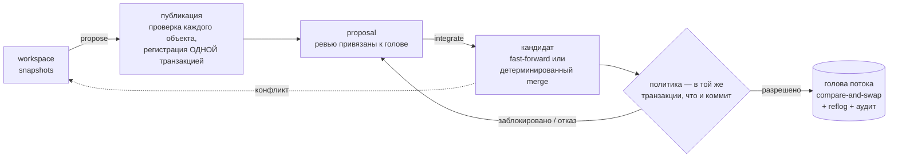

<div align="center">

# AgentGit

**Система контроля версий для мира, в котором код пишут и агенты.**

Agent-native SCM с собственным детерминированным VCS-ядром: безопасная при сбоях конкурентная интеграция,
валидация, привязанная к *точному дереву*, которое проверяли, политики автономности агентов и аудит,
в котором видна любая подмена.

[](https://github.com/Paffin/AgentGit/actions/workflows/ci.yml)
[](LICENSE)
[](Cargo.toml)
[](#статус-и-честные-ограничения)

[English](README.md) · **Русский** · [Документация](docs/README.md) · [Roadmap](ROADMAP.md) · [Архитектура](docs/architecture/overview.md)

</div>

---

> Документация в `docs/` написана на английском; ADR-0001 (исходное архитектурное решение) — на русском:
> [`docs/adr/0001-final-architecture.md`](docs/adr/0001-final-architecture.md).

## Зачем

Git создавался для одного человека за одной клавиатурой. Когда десять агентов и три человека одновременно
меняют один код, нужны ответы, которых Git не даёт:

- **Кто именно** сделал изменение: запуск агента или человек?
- **Что на самом деле проверяли?** *Это* дерево или то, что было до чужого merge?
- **Может ли агент сам влить код?** В какие файлы? Сколько?
- Если два агента гонятся, **может ли обновление потеряться?** Если процесс упал посреди merge — **в каком
  состоянии репозиторий?**
- Можно ли **потом доказать**, что произошло и кто это разрешил?

В AgentGit это — часть модели. Ядро, которое хранит, сливает и восстанавливает, детерминировано и никогда
не требует языковой модели; всё «умное» — надстройка, которая может только *предлагать*.

## Как это выглядит

Человек, два агента и CI-сервис работают с одним потоком. (Вывод сокращён из
[`examples/quickstart.sh`](examples/quickstart.sh) — CI запускает этот сценарий при каждом push.)

```text
$ ag integrate prop_6eed…                  # as agent:refactor-bot — агент пытается сам влить код
Denied by policy; the stream was not changed:
  - actor not allowed to integrate: agents may not integrate unless agent_autonomy.auto_integrate is on …

$ ag integrate prop_6eed…                  # as user:alice
Blocked (policy v1); the stream was not changed:
  - check 'tests' has no trusted passing attestation for this exact tree
  - approvals (default): 0 of 1 required
  - agent-authored change has no signed provenance
  - exclusive lease on 'src/**' held by agent:refactor-bot#run_8f78… (stale_or_missing_token)
candidate tree: 315f74d45183c9e7…

$ ag validate run prop_6eed… --check tests --key ci -- cargo test        # as service:ci
check 'tests' PASSED on tree 315f74d45183 (policy v1); attestation att_0f1a… signed by service:ci
$ ag proposal review prop_6eed… --approve                                # as user:bob
$ ag integrate prop_6eed… --fencing-token 1                              # as user:alice
Integrated (merge): stream is now at 793a03b6da69 (version 3, was 70e31c72a4d0), 1 file(s) changed.

$ ag preview prop_2b19…                                                  # параллельная правка той же строки
strategy: Merge   (algorithm ag-merge/2+ag-diff/1)
conflict: src/main.rs (content conflict (1 region(s)))                   # код выхода 4 — поток не тронут
```

Каждый отказ говорит, *чего не хватает*, а коды выхода подсказывают скриптам и агентам, что делать дальше:
`3` — заблокировано (предоставьте недостающее и повторите), `4` — отказ.

## Что внутри

| | |
|---|---|
| **Безопасность при сбоях по построению** | Объекты проверяются *до* единственной транзакции публикации; голова потока двигается через compare-and-swap с обязательным пересчётом. Fault injection на каждом шаге протокола. |
| **Воспроизводимые merge** | Чистая версионированная функция от base/ours/theirs. Типизированные конфликты, ничего не угадывается. |
| **Валидацию нельзя применить к чужому коду** | Подписанные аттестации называют точное *дерево*, версию политики и окружение. Поток сдвинулся — кандидат изменился — проверьте заново. |
| **Агенты в рамках политики** | Политика потока: доверенные эмитенты, обязательные проверки, одобрения, привязанные к ревьюенной голове, защищённые пути и *конверт автономности* (какие пути и сколько файлов агент вправе влить сам). |
| **Координация агентов** | Идентичность на каждый запуск, задачи с зависимостями, мягкие и эксклюзивные **lease с fencing-токенами**, подписанный **provenance** рядом с неизменяемой историей, **предсказание** конфликтов, упорядоченная **очередь** интеграции. |
| **История, которой можно верить** | Неизменяемые content-addressed changesets, проверка хеша при каждом чтении; append-only reflog; аудит с хеш-цепочкой; `ag verify` для всего репозитория. |
| **Безопасная эксплуатация** | GC, который не удаляет достижимое и не теряет только что упомянутый объект; согласованные проверенные бэкапы; одноразовые, пересобираемые индексы. |
| **Git как адаптер** | `ag git import` / `export` — деревья проходят round-trip с идентичными Git SHA. |

## Установка

Нужен Rust **1.89+** и C-компилятор (SQLite собирается внутри). `git` и `python3` — по желанию.

```bash
git clone https://github.com/Paffin/AgentGit && cd AgentGit
cargo install --path crates/ag-cli          # установит бинарник `ag`
```

## Быстрый старт

```bash
mkdir demo && cd demo
ag init --namespace me/demo                 # создаёт .ag/ и поток "main"
echo "# demo" > README.md
ag snapshot -m "first"                      # записать каталог (пока невидимо для других)
ag propose -t "Initial import"              # проверить + опубликовать + открыть proposal
ag integrate <id-предложения>               # атомарно сдвинуть "main"; достаточно уникального префикса id
ag log
```

Дальше: [политика](docs/guides/policy.md), [агенты](docs/guides/agents.md) или вся история целиком:
`./examples/quickstart.sh`. Подробно: [Getting started](docs/getting-started.md).

## Как это работает



Изменение проходит четыре **независимые** проверки — ни одна не подразумевает другую:

| | Вопрос | Кто решает |
|---|---|---|
| **Mergeable** | Есть ли одно однозначное результирующее дерево? | движок merge (`ag preview`) |
| **Validated** | Прошли ли *доверенные* проверки на *этом дереве*? | подписанные аттестации |
| **Approved** | Одобрили ли *эту голову* достаточно допустимых ревьюеров? | ревью + политика |
| **Integrated** | Поток обновлён атомарно? | одна CAS-транзакция |

Подробнее: [Concepts](docs/concepts.md) · [Architecture](docs/architecture/overview.md) ·
[Publication & integration](docs/architecture/publication-and-integration.md) ·
[Merge semantics](docs/architecture/merge-semantics.md).

## Гарантии — и тесты, которые их доказывают

Утверждение стоит ровно столько, сколько его доказательство. У каждого есть тест в этом репозитории.

| Гарантия | Доказательство |
|---|---|
| Сбой на **любом** шаге публикации или интеграции восстанавливается ровно в одно обновление | `crash_at_every_step_recovers_to_exactly_one_integration` — сбои на 7 точках протокола |
| Нет потерянных обновлений при параллельных интеграторах; reflog — непрерывная цепочка | `concurrent_integrations_never_lose_an_update`, `concurrent_cas_from_many_connections_never_loses_an_update` |
| Потерянный ответ не приводит к повторному применению | `idempotent_replay_and_unknown_outcome_recovery` |
| Проверка старого кандидата не переиспользуется после сдвига потока | `attestation_cannot_be_reused_after_the_stream_moves` |
| «Протухший» держатель lock не может влить код в область, которой владеет другой | `fencing_tokens_are_strictly_increasing_and_reject_stale_holders` |
| Бинарные форматы совпадают с **независимой реализацией на Python** | `tests/conformance/` (blob ID, changeset, деревья, аттестации, цепочка аудита) |
| История Git проходит round-trip с идентичными SHA деревьев | `history_survives_a_round_trip_with_identical_git_trees` |
| GC не удаляет достижимое и не теряет объект, на который только что сослались | `gc_fails_closed_when_a_reachable_object_is_damaged`, `rewriting_an_old_unreachable_object_saves_it_from_a_concurrent_gc` |
| Checkout не выходит за свой каталог и не подсаживает `.git` | `checkout_refuses_to_write_through_symlinked_directories`, `hostile_git_content_cannot_escape_or_plant_dot_git` |
| Подмена аудита или объектов обнаруживается | `audit_chain_detects_tampering`, `fsck_reports_a_healthy_repository_and_finds_each_kind_of_damage` |

Всё вместе: `cargo test --workspace` (больше 200 тестов, несколько секунд). Модель угроз, меры защиты и
известные ограничения: [Security](docs/architecture/security.md).

## Документация

| | |
|---|---|
| Начало | [Getting started](docs/getting-started.md) · [Concepts](docs/concepts.md) |
| Руководства | [Агенты](docs/guides/agents.md) · [Политики](docs/guides/policy.md) · [Валидация](docs/guides/validation.md) · [Git-мост](docs/guides/git-bridge.md) |
| Справочник | [CLI](docs/reference/cli.md) *(генерируется)* · [Форматы объектов](docs/architecture/object-format.md) · [Статус протокола](docs/protocol/README.md) |
| Эксплуатация | [Надёжность и бэкап](docs/operations/durability.md) · [GC и хранение](docs/operations/gc-and-retention.md) · [Диагностика](docs/operations/troubleshooting.md) |
| Дизайн | [Обзор](docs/architecture/overview.md) · [ADR](docs/adr/) · [Соответствие ADR реализации](docs/architecture/adr-traceability.md) |

Документацию не только пишут, но и проверяют: справочник CLI генерируется из `--help`, демо выше выполняется
в CI, имена тестов и команд из документов сверяются с кодом (`scripts/check_docs.py`), а утверждения о
байтовых форматах подкреплены conformance-векторами.

## Состав проекта

| Крейт | Роль |
|---|---|
| `ag-types` `ag-object` `ag-changeset` `ag-tree` `ag-dag` `ag-diff` `ag-merge` | детерминированное ядро: форматы, content ID, история, merge |
| `ag-storage` | хранилище объектов + транзакционные метаданные (SQLite) |
| `ag-policy` · `ag-agent` | вычисление политик и подписанные аттестации · координация агентов |
| `ag-integrate` | движок: публикация, интеграция, workspaces, очередь, GC, verify, backup |
| `ag-git` · `ag-cli` | Git-мост · бинарник `ag` |

## Статус и честные ограничения

**Alpha (0.1).** Ядро и перечисленные гарантии реализованы и протестированы; окружающая платформа ещё не
построена. Прочитайте это, прежде чем полагаться на проект:

- **Локальный режим доверяет локальному пользователю.** Идентичности — метки, а не аутентификация; кто может
  писать в `.ag/`, тот может обойти политику (подмена *обнаруживается* через `ag verify` и цепочку аудита).
  Для принуждения между пользователями нужен запланированный сервер.
- **Пока нет** сетевого сервера, протокола AGWP, бэкендов PostgreSQL/S3, Web UI и SDK — см. [roadmap](ROADMAP.md)
  и [ADR-0002](docs/adr/0002-embedded-engine-first.md) о том, почему сначала движок.
- **`ag validate run` — не песочница.** Только для доверенного кода. Недоверенный код запускается через
  [`ag-worker`](docs/guides/workers.md) и его [песочницу](docs/architecture/sandbox.md): она делит ядро с хостом
  (это не виртуальная машина), и часть её не проверена — прочитайте эту страницу (на английском) до того, как
  на неё полагаться.
- Плоские манифесты деревьев (тысячи файлов — нормально: репозиторий на 3 000 файлов и 1 500 коммитов
  интегрируется быстрее секунды; миллионы — пока нет), нет определения переименований, внешнего аудита
  безопасности не было.

Подходит для: команды и её агентов на одной машине или общем томе, процессов с CI-гейтами, экспериментов с
автономностью агентов под политикой, разработки на небольшом детерминированном ядре. Пока не подходит для:
хостинга многих недоверяющих друг другу пользователей и как единственная копия незаменимых данных — делайте
`ag backup` и держите Git-зеркало.

## Участие

Контрибьюции приветствуются — см. [CONTRIBUTING.md](CONTRIBUTING.md) (на английском). Поскольку корректность и
есть продукт, изменения форматов, хеширования, семантики merge и протокола публикации начинаются с ADR.
Уязвимости — [SECURITY.md](SECURITY.md). Все участники следуют [Кодексу поведения](CODE_OF_CONDUCT.md).

## Лицензия

[Apache License 2.0](LICENSE). Copyright 2026 The AgentGit Authors. Если вы не указали иное, любой вклад,
сознательно отправленный вами в проект, лицензируется на тех же условиях (Apache-2.0 §5) без дополнительных
условий.
