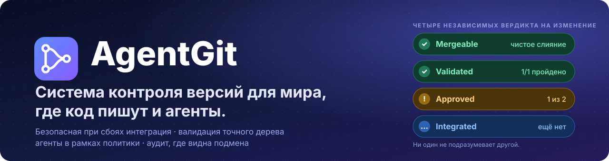
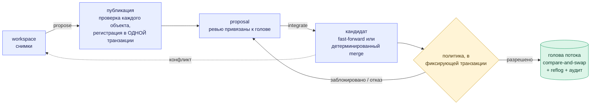
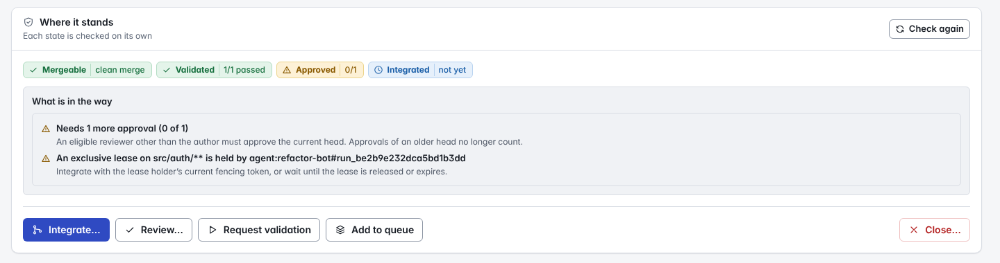
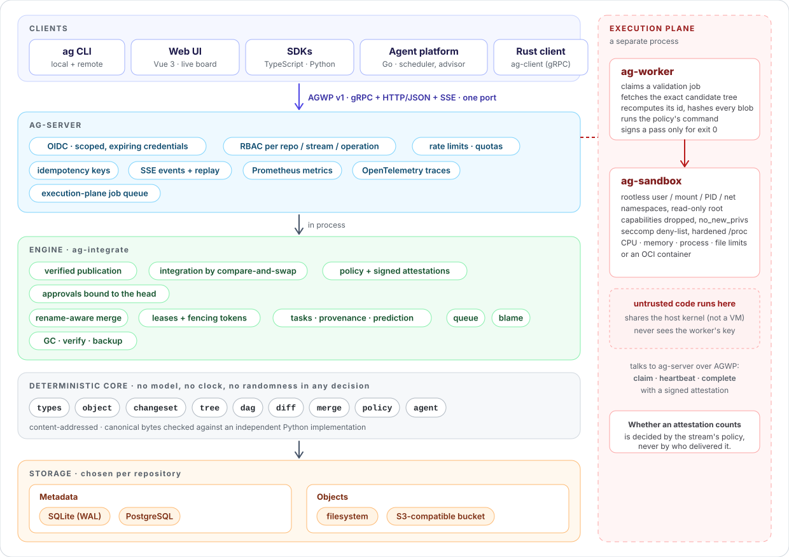

<div align="center">



<br>

[](https://github.com/Paffin/AgentGit/actions/workflows/ci.yml)
[](docs/README.md)
[](LICENSE)
[](#статус-и-ограничения)

[English](README.md) · **Русский** · [Документация](docs/README.md) · [Roadmap](ROADMAP.md) · [Сравнение](docs/comparison.md)

</div>

<br>

> Документация в `docs/` написана на английском; ADR-0001 (исходное архитектурное решение) на русском:
> [`docs/adr/0001-final-architecture.md`](docs/adr/0001-final-architecture.md).

AgentGit — система контроля версий для репозиториев, в которые пишут люди, coding-агенты и CI.

Изменение попадает в ветку, только если это разрешает политика репозитория, и политика проверяется в той же транзакции,
которая двигает ветку, поэтому между «проверили» и «влили» ничего не успевает измениться. Результаты тестов подписаны и
привязаны к тому дереву, на котором они запускались. У каждого запуска агента своя идентичность, а каждое решение
попадает в журнал аудита, который можно проверить. Ядро, которое хранит, сливает и восстанавливает данные, никогда не
обращается к языковой модели; всё «умное» живёт поверх него и может только предлагать.

Открытая ранняя бета: [статус и ограничения](#статус-и-ограничения) ниже, и в продакшене его не запускал никто,
кроме авторов.

**В beta.5:** задачи из issues, выбор исполнителя, подключение оркестратора через Web UI, управление запуском и постоянные страницы запусков. Сохранение ограниченного вывода stdout/stderr включается отдельно; известные секреты маскируются, запись можно удалить. Для обновления потребуется резервная копия: используется схема метаданных 6. Для отката к старому бинарнику восстановите резервную копию до обновления.

Установка исполнителя и доступ к модели остаются задачами владельца его хоста. Labels, milestones, вложения и импорт обсуждений пока не готовы. [Руководство Web UI](docs/guides/web-ui.md#repository-issues).

**Ревью в beta.5:** обсуждения по строкам доступны в Web UI, CLI и MCP. Ответы и разрешение замечаний сохраняются на сервере; фильтры открытых и решённых обсуждений не теряют черновики. Привязки сохраняют точную просмотренную ревизию. JSON-контракты CLI документированы для автоматизации. [Обновление и откат](docs/adr/0025-line-review-threads.md).

**В разработке (`main`):** оператор может отключить или снова разрешить новые запуски отдельного агента из браузера или через `ag agent disable NAME --remote origin` (`enable` для включения). Ключ, история и работающие сессии сохраняются. В архивы beta.5 эта функция не включена; [ADR-0026](docs/adr/0026-agent-run-admission.md).

**Обновление разработки:** постоянные связи задач-продолжений используют схему метаданных 7. Перед запуском этой сборки на существующих данных сделайте резервную копию; для отката восстановите её. [Семантика связей](docs/adr/0027-task-source-links.md).

В разработке также доступно редактирование инструкций задачи до первого запуска через Web UI, CLI и API с защитой от одновременных правок. В beta.5 этой функции нет. [Редактирование задач](docs/guides/web-ui.md#refine-queued-task-instructions-development).

В разработке главная страница обновляет выбранный репозиторий по событиям; серия событий объединяется в одно обновление, общий обзор сохраняет периодический опрос.

Ближайшие приоритеты — завершение сценариев ревью и перенос метаданных GitHub/GitLab. [Roadmap](ROADMAP.md#next) разделяет готовые возможности, опубликованные выпуски и оставшуюся квалификацию.

## Переезд с GitHub или GitLab

В **Repositories → Import from GitHub / GitLab** загрузите полный Git bundle, проверьте соответствие веток и тегов и подтвердите публикацию. Либо выполните `ag migrate repository.bundle ./project --namespace team/project`. Источник не изменяется, оригинальный bundle сохраняется в резервных копиях. [Руководство и ограничения переноса метаданных](docs/guides/migrate-from-git.md).

В бета-версии доступны поиск файлов с клавиатуры, восстановление файловых черновиков и сохранение текста ревью при просмотре diff. Веб-ревью привязано к просмотренному head: если автор изменил код, сервер отклонит устаревшую отправку, сохранив ваш текст. Эти изменения включены в beta.2 и отражены в [журнале изменений](CHANGELOG.md) и [руководстве Web UI](docs/guides/web-ui.md).

В beta.3 добавлены отметки просмотренных файлов, восстановление черновика ревью после перезагрузки, отдельные страницы задач с зависимостями и подтверждением завершения или отмены, а также поиск по содержимому с переходом к найденной строке. Возможности и ограничения описаны в [журнале изменений](CHANGELOG.md).

## Как это выглядит

Человек, два агента и CI-сервис работают с одним потоком. Вывод сокращён из
[`examples/quickstart.sh`](examples/quickstart.sh): CI запускает этот сценарий при каждом push и построчно сверяет его
с английским README.

```text
$ ag integrate prop_6eed…                  # as agent:refactor-bot — агент пытается сам влить код
Denied by policy; the stream was not changed:
  - actor not allowed to integrate: agents may not integrate unless agent_autonomy.auto_integrate is on …

$ ag integrate prop_6eed…                  # as user:alice
Blocked (policy v1); the stream was not changed:
  - check 'tests' has no trusted passing attestation for this exact tree
  - approvals (default): 0 of 1 required
  - agent-authored change has no signed provenance
  - exclusive lease on 'src/**' held by agent:refactor-bot#run_8f78… (stale_or_missing_token)
candidate tree: 315f74d45183c9e7…

$ ag validate run prop_6eed… --check tests --key ci -- cargo test        # as service:ci
check 'tests' PASSED on tree 315f74d45183 (policy v1); attestation att_0f1a… signed by service:ci
$ ag proposal review prop_6eed… --approve                                # as user:bob
$ ag integrate prop_6eed… --fencing-token 1                              # as user:alice
Integrated (merge): stream is now at 793a03b6da69 (version 3, was 70e31c72a4d0), 1 file(s) changed.

$ ag preview prop_2b19…                                                  # параллельная правка той же строки
strategy: Merge   (algorithm ag-merge/3+ag-diff/1)
conflict: src/main.rs (content conflict (1 region(s)))                   # код выхода 4 — поток не тронут
```

Каждый отказ объясняет, чего не хватает. Код выхода `3` — заблокировано (добавьте недостающее и повторите), `4` — отказ.

## Установка

Нужен Rust 1.89 или новее и компилятор C (SQLite собирается вместе с проектом). Linux, macOS и Windows собираются и
тестируются в CI; песочница и `ag-worker` работают только на Linux ([Windows](docs/operations/windows.md)).

```bash
git clone https://github.com/Paffin/AgentGit && cd AgentGit
cargo install --path crates/ag-cli          # ставит бинарник `ag`
```

Опубликованный кандидат — [`v0.3.0-beta.5`](https://github.com/Paffin/AgentGit/releases/tag/v0.3.0-beta.5). Архивы доступны для установки. Они содержат `ag`, `ag-server`, `ag-worker`, `ag-mcp` и `orchestrator` для Linux и macOS; проверки выпуска отражены в [Release workflow](https://github.com/Paffin/AgentGit/actions/workflows/release.yml).

```bash
curl -fsSL https://raw.githubusercontent.com/Paffin/AgentGit/main/scripts/install.sh | sh -s -- --version 0.3.0-beta.5
docker pull ghcr.io/paffin/agentgit-cli:0.3.0-beta.5
```

Пока есть только пре-релизы, `--version` обязателен. Если у вас установлена rc.2, используйте [инструкцию для rc.2](docs/getting-started.md#on-020-rc2-until-the-next-release). [Отчёт о проверке rc.2](docs/operations/releasing.md) относится только к тому выпуску и не подтверждает готовность rc.3. Подробности — в [вариантах установки](docs/getting-started.md#install).

## Быстрый старт

```bash
mkdir demo && cd demo
ag init --namespace me/demo                 # создаёт .ag/ и поток "main"
echo "# demo" > README.md
ag snapshot -m "first"                      # записать каталог (другим пока не виден)
ag propose -t "Initial import"              # проверить, опубликовать и открыть proposal
ag integrate <proposal-id>                  # атомарно сдвинуть "main"; достаточно уникального префикса id
ag log
```

Дальше можно добавить [политику](docs/guides/policy.md), запустить [агента](docs/guides/agents.md) или прогнать всю
историю целиком: `./examples/quickstart.sh`. Подробный разбор: [Getting started](docs/getting-started.md).

### Пять минут с сервером, ничего не собирая

```bash
ag-server dev                                            # каталог данных, администратор, демо-репозиторий, ссылка для входа
ag login http://127.0.0.1:8080 --token-file ./ag-dev-data/dev/token
ag clone http://127.0.0.1:8080/demo/welcome              # правьте, `ag snapshot`, `ag push -t "my change"`, при отказе `ag remote explain <id>`
```

`ag-server dev` печатает ссылку, которая входит в Web UI, и те же команды. Это режим для знакомства (только loopback,
обычный HTTP, учётные данные на 8 часов), а не развёртывание. Он включён в `v0.3.0-beta.5`. Для прежних архивов `v0.2.0-rc.2` [Getting started](docs/getting-started.md#on-020-rc2-until-the-next-release) описывает тот же старт на
rc.2 несколькими строками длиннее.

### Как сервер

```bash
cargo install --path crates/ag-server
export AG_BOOTSTRAP_TOKEN=$(openssl rand -hex 32)          # учётные данные первого администратора
ag-server admin --data-dir ./ag-data create-repo acme/web
ag-server admin --data-dir ./ag-data grant --subject user:alice --repo 'acme/*' --role admin
export AG_TOKEN=$(ag-server admin --data-dir ./ag-data mint --subject user:alice --ttl 86400 | tail -n 1)
ag-server serve --data-dir ./ag-data &                      # 127.0.0.1:8080, gRPC + HTTP/JSON
ag clone http://127.0.0.1:8080/acme/web web && cd web      # дальше правьте, `ag snapshot`, `ag push -t "my change"`
```

Сервер говорит на одном протоколе, [AGWP v1](docs/protocol/agwp-v1.md), по gRPC и HTTP/JSON на одном порту и отдаёт на
нём же [Web UI](docs/guides/web-ui.md). Compose, Kubernetes, TLS и PostgreSQL с S3 описаны в
[Развёртывании](docs/operations/deployment.md).

## Что умеет

- Публикует изменение одной проверенной транзакцией и двигает голову потока через compare-and-swap. Сбой на любом шаге
  оставляет ровно один исход; в тестах сбои внедряются на каждом шаге протокола.
- Сливает чистой версионированной функцией от base, ours и theirs. Конфликты — типизированный результат, о котором
  сообщается до любых изменений; файл, переименованный на одной стороне и изменённый на другой, сливается без конфликта.
- Привязывает валидацию к дереву-кандидату. Аттестация называет дерево, версию политики и окружение и подписана
  издателем, которому доверяет политика. Когда поток сдвинулся, старый результат перестаёт засчитываться.
- Хранит политику на каждый поток: обязательные проверки, одобрения, привязанные к просмотренной голове, защищённые пути
  и конверт автономности: в какие пути и сколько файлов агент может влить без человека.
- Координирует агентов: идентичность на каждый запуск, задачи, мягкие и эксклюзивные lease с fencing-токенами,
  предсказание конфликтов и упорядоченная очередь интеграции.
- Запускает недоверенные проверки в `ag-worker` внутри песочницы (rootless namespaces или контейнер) и подписывает
  результат.
- Ведёт append-only reflog и журнал аудита с хеш-цепочкой; `ag verify` проверяет весь репозиторий.
- Импортирует из Git и экспортирует в него с теми же SHA деревьев и целиком работает офлайн.
- Поставляется с [Web UI](docs/guides/web-ui.md), [SDK для TypeScript и Python](docs/guides/sdks.md),
  [MCP-сервером](docs/guides/mcp.md), который отдаёт агенту AgentGit как набор инструментов, и
  [платформой агентов](docs/guides/orchestrator.md) на Go, которая может предлагать изменения, но не интегрировать их.

## Сравнение с GitHub, GitLab и Bitbucket

GitHub, GitLab и Bitbucket — зрелые платформы с более широкими возможностями управления проектами,
хостируемым CI, сканированием безопасности, правами доступа в большом масштабе и поддержкой. В AgentGit уже
есть issues репозитория и передача задач агентам; labels, milestones, вложения и импорт метаданных хостинга ещё не готовы. В таблице только тот вопрос,
вокруг которого построен AgentGit: как попадает в кодовую базу изменение, когда пишут несколько недоверенных
участников. Ячейки про платформы описывают их публичную документацию; на странице по ссылке ниже есть источники, дата
обращения и куда более длинный список того, в чём они сильнее.

| | GitHub | GitLab | Bitbucket | AgentGit |
|---|---|---|---|---|
| Единица ревью | pull request | merge request | pull request | proposal |
| Где применяются правила слияния | платформа: защита веток и rulesets | платформа: защищённые ветки, правила одобрения, push rules (многое требует Premium) | платформа: права на ветки, merge checks (в Cloud принудительно на Premium) | политика потока, вычисляется в транзакции, которая двигает голову |
| Успешная проверка привязана к точному дереву, которое вливается | в merge queue, где тестируется временное слияние очереди; иначе к коммиту | через merged results pipelines и merge trains (Premium); иначе к пайплайну | required builds на головном коммите; merge queues собирают результат слияния (платные планы, Pipelines) | всегда: подписанная аттестация называет дерево, версию политики и окружение |
| Идентичность автоматических участников | аккаунты, GitHub Apps, токены | сервисные аккаунты, access tokens | аккаунты, токены | идентичность на агента и на запуск; учётные данные можно привязать к одному запуску |
| Автономность агентов в рамках политики | собирается из правил веток и прав ботов | собирается из тех же частей | собирается из тех же частей | встроена: разрешённые пути и лимит файлов на поток |
| Аудит, в котором видна подмена | журнал аудита с экспортом; в документации нет утверждений о целостности | события аудита (Ultimate); утверждений о целостности нет | журнал аудита; не сравнивали | хеш-цепочка, проверяется `ag audit` и `ag verify` |
| Самодостаточность и офлайн | облако; для своей установки Enterprise Server | SaaS или своя установка | Cloud или Data Center | локальному режиму сервер не нужен; сервер — один бинарник |
| Экосистема | очень большая | очень большая, CI и безопасность встроены | большая, Jira и Pipelines | небольшая: CLI, SDK (не опубликованы), MCP, Web UI |
| Зрелость | очень высокая | очень высокая | очень высокая | beta |

Полное сравнение, включая Git, Gerrit и Jujutsu: [AgentGit compared](docs/comparison.md) (на английском).

## Web UI

Новый пользователь попадает на главную страницу, где сказано, что требует внимания; подписи простыми словами (термин
AgentGit в подсказке), у блокировок есть кнопка с исправлением, есть пошаговые сценарии (создать репозиторий, дать
агенту работу), пресеты правил вместо сырого JSON и правка файла с предложением изменения прямо в браузере. Всё это в
`main`, а не в архивах rc.2. Чего ещё нет, написано в [дорожной карте](ROADMAP.md).

Живая доска запусков, lease, задач и очереди слияния с четырьмя независимыми вердиктами на каждый proposal. Это
настоящие скриншоты UI, работающего с настоящим сервером; их снимает сквозной набор тестов.

<p align="center">
  <picture>
    <source media="(prefers-color-scheme: dark)" srcset="docs/assets/ui-board-dark.png">
    
  </picture>
</p>

<table>
<tr>
<td width="34%" align="center" valign="top">

<br><sub>Proposal: четыре вердикта, что блокирует, дифф</sub>
</td>
<td width="33%" align="center" valign="top">

<br><sub>Политика: версии только добавляются, есть диффы</sub>
</td>
<td width="33%" align="center" valign="top">

<br><sub>Blame: построчный, следует за переименованиями</sub>
</td>
</tr>
</table>

## Как это работает



У proposal четыре вердикта. Они независимы: ни один не следует из другого, и каждый меняется сам по себе.

| Вердикт | Вопрос | Кто решает | Меняется, когда |
|---|---|---|---|
| Mergeable | Есть ли один однозначный итоговый результат? | движок слияния (`ag preview`) | изменение с любой стороны лишает результат однозначности |
| Validated | Прошли ли доверенные проверки на этом дереве? | подписанные аттестации | меняется дерево-кандидат или политика |
| Approved | Одобрило ли эту голову достаточно подходящих людей? | ревью и политика | автор запушил снова или изменилась планка политики |
| Integrated | Обновился ли поток атомарно? | одна транзакция compare-and-swap | никогда: это факт истории |

<p align="center">
  
</p>

<p align="center">
  
</p>

Важнее самих блоков три границы доверия. Ядро принимает решения без модели, часов и случайности. Движок работает внутри
сервера, поэтому политика применяется там, где подключаются недоверенные клиенты. Недоверенный код выполняется только
в отдельной плоскости исполнения: она может сообщить результат, но не решает, засчитывается ли он. Подробнее:
[Concepts](docs/concepts.md), [обзор архитектуры](docs/architecture/overview.md) и
[публикация и интеграция](docs/architecture/publication-and-integration.md).

## Гарантии и тесты

В каждой строке назван тест из этого репозитория. В CI идёт более 1000 тестов на Rust, а также наборы SDK, Web UI и
оркестратора против настоящего `ag-server`, фаззинг и гейты покрытия и мутационного тестирования
([Testing](docs/architecture/testing.md)).

| Гарантия | Тест |
|---|---|
| Сбой на любом шаге публикации или интеграции восстанавливается ровно в одно обновление | `crash_at_every_step_recovers_to_exactly_one_integration` |
| Параллельные интеграторы не теряют обновлений | `concurrent_integrations_never_lose_an_update` |
| Потерянный ответ не приводит к повторному применению | `idempotent_replay_and_unknown_outcome_recovery` |
| Проверка старого кандидата не используется повторно после сдвига потока | `attestation_cannot_be_reused_after_the_stream_moves` |
| Держатель устаревшего lock не может влить код в область, которой теперь владеет другой | `fencing_tokens_are_strictly_increasing_and_reject_stale_holders` |
| Бинарные форматы совпадают с независимой реализацией на Python | `tests/conformance/` |
| История Git проходит туда и обратно с теми же SHA деревьев | `history_survives_a_round_trip_with_identical_git_trees` |
| Подмена журнала аудита или объектов обнаруживается | `audit_chain_detects_tampering` |

Модель угроз и её известные пределы: [Security](docs/architecture/security.md).

## Документация

| | |
|---|---|
| Начало | [Getting started](docs/getting-started.md), [туториалы](docs/tutorials/README.md), [Concepts](docs/concepts.md), [FAQ](docs/faq.md), [сравнение](docs/comparison.md) |
| Руководства | [агенты](docs/guides/agents.md), [политики](docs/guides/policy.md), [валидация](docs/guides/validation.md), [воркеры](docs/guides/workers.md), [работа с сервером](docs/guides/remote.md), [история](docs/guides/history.md), [мост с Git](docs/guides/git-bridge.md) |
| Клиенты | [Web UI](docs/guides/web-ui.md), [SDK](docs/guides/sdks.md), [MCP](docs/guides/mcp.md), [оркестратор](docs/guides/orchestrator.md) |
| Справочник | [CLI](docs/reference/cli.md), [конфигурация](docs/reference/configuration.md), [AGWP v1](docs/protocol/agwp-v1.md), [OpenAPI](docs/protocol/openapi.json), [форматы объектов](docs/architecture/object-format.md) |
| Эксплуатация | [развёртывание](docs/operations/deployment.md), [высокая доступность](docs/operations/high-availability.md), [наблюдаемость](docs/operations/observability.md), [резервные копии](docs/operations/durability.md), [hardening](docs/operations/hardening.md), [диагностика](docs/operations/troubleshooting.md) |
| Устройство | [архитектура](docs/architecture/overview.md), [ADR](docs/adr/), [соответствие ADR реализации](docs/architecture/adr-traceability.md), [безопасность](docs/architecture/security.md), [песочница](docs/architecture/sandbox.md) |

Документацию проверяет CI: справочник CLI генерируется из бинарника, команды туториалов запускаются на настоящих
бинарниках, а `scripts/check_docs.py` сверяет ссылки, имена тестов, команды `ag` и переменные `AG_*` с кодом. Сайт
собирается через `mkdocs build --strict` и публикуется на GitHub Pages из `main`.

## Статус и ограничения

AgentGit — ранняя публичная бета для одного Linux-сервера с SQLite и файловым хранилищем. Ядро и перечисленные гарантии реализованы и протестированы, как и платформа вокруг него. В продакшене
проект не использовал никто, кроме авторов, внешнего аудита безопасности не было. Полный список — в
[ROADMAP.md](ROADMAP.md) и [CHANGELOG.md](CHANGELOG.md); то, от чего зависит, можно ли пользоваться уже сейчас:

- Локальный режим доверяет локальному пользователю. Идентичности — просто метки, и тот, кто может писать в `.ag/`,
  способен обойти политику; подмену можно обнаружить через `ag verify`, но не предотвратить. Для клиентов, которых вы не
  контролируете, запускайте `ag-server`.
- Несколько реплик сервера на одном PostgreSQL и одном бакете S3 проверены в CI настоящими процессами. Не доказаны:
  отказоустойчивое переключение PostgreSQL, смешанные версии при плавном обновлении, нагрузка и оверлей `ha` для
  Kubernetes на настоящем кластере ([высокая доступность](docs/operations/high-availability.md)).
- Учётные данные можно привязать к одному запуску агента ([ADR-0010](docs/adr/0010-run-bound-credentials.md)), но это
  включается на стороне клиента; действовать в чужом запуске можно только с `agent.operate`, которого у обычного
  writer нет. Токен ограждения (fencing) для захвата заданий передаётся по желанию клиента
  ([ADR-0012](docs/adr/0012-job-claim-fencing.md)).
- Доступны только пре-релизы; текущий кандидат — `v0.3.0-beta.5` (GitHub и GHCR). Стабильного релиза нет, пакетов в
  crates.io, npm и PyPI нет; 21 крейт `agentgit-<x>` проверен только пробной публикацией
  ([релизы](docs/operations/releasing.md)). Схема метаданных 3 не читается старыми сборками: при обновлении реплик
  сначала запускайте новую сборку.
- `ag validate run` не песочница. Недоверенный код идёт через [`ag-worker`](docs/guides/workers.md), чья песочница
  делит с хостом ядро. Проверено на настоящих Docker и Podman и cgroup v2; не проверено для microVM, Windows (воркер
  отказывается запускаться) и macOS, кроме запасного режима с одними лимитами ([песочница](docs/architecture/sandbox.md)).
- PostgreSQL и S3 проверены на настоящем PostgreSQL и SeaweedFS, но не на Amazon S3, MinIO, Ceph и R2.
- Деревья хранятся плоскими манифестами, измерено до 100 000 файлов ([ADR-0006](docs/adr/0006-flat-trees-measured.md)).
  Цифры производительности сняты на одной общей виртуальной машине с 4 vCPU и целями не являются
  ([движок](docs/architecture/performance.md), [сервер](docs/operations/performance.md)); пропускная способность с
  PostgreSQL, S3, TLS и несколькими репликами не измерялась. Кэш декодированных деревьев и 3 долговечных коммита на
  интеграцию измерены только на дисковом и in-memory бэкендах.
- Нет переписывания истории, тегов, submodules и LFS; мост с Git сообщает, что не может перенести.
- Web UI проверен в Chromium, Firefox и WebKit; OIDC только с Keycloak. Проверки со скринридером не было. `ag-mcp` не
  запускали внутри настоящих хостов. SDK не опубликованы.
- Ночной фаззинг и еженедельное мутационное тестирование запускаются на GitHub. Проверяйте результаты на коммите релиза: успешное покрытие само по себе не означает, что все мутации обнаруживаются тестами.

Сейчас подойдёт: команда и её агенты на одной машине, одном сервере или нескольких репликах, процессы с проверками в
CI, эксперименты с автономностью агентов в рамках политики. Пока не подойдёт: хостинг взаимно недоверяющих арендаторов и
роль единственной копии данных, которые нельзя потерять. Делайте копии через `ag backup` и держите зеркало в Git.

## Подготовка беты

Открыт публичный бета-тест. Для беты зафиксированы [поддерживаемый сценарий и критерии готовности](docs/community/beta.md),
создан [milestone](https://github.com/Paffin/AgentGit/milestone/1) и [вход для участников](docs/community/start-here.md).
Нужны внешние проверки установки и реальных задач с агентами; полезны и отчёты о том, где процесс непонятен.
Независимые пилоты ещё нужны; метка beta не означает подтверждённую готовность к критичной эксплуатации.

## Участие

См. [CONTRIBUTING.md](CONTRIBUTING.md). Изменения форматов, хеширования, семантики слияния и протокола публикации
начинаются с ADR. О проблемах безопасности сообщайте, как описано в [SECURITY.md](SECURITY.md). Все участники следуют
[Кодексу поведения](CODE_OF_CONDUCT.md).

## Лицензия

Apache License 2.0, см. [LICENSE](LICENSE). Copyright 2026 The AgentGit Authors.
