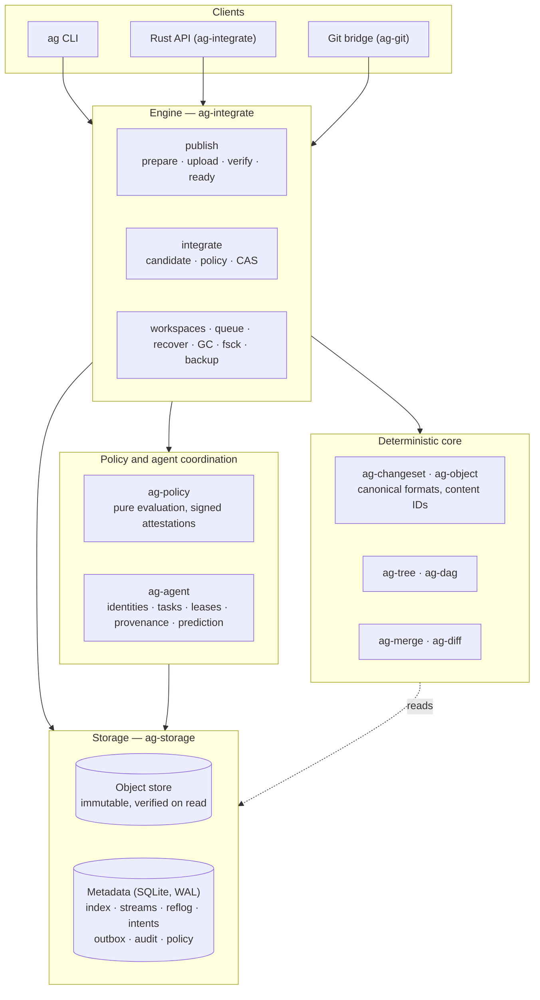

# Architecture overview

AgentGit is an **agent-native source control system with its own version-control core**. Git is an
external adapter ([Git bridge](../guides/git-bridge.md)), never the engine or the source of truth. The
design is recorded in [ADR-0001](../adr/0001-final-architecture.md) (in Russian) and amended by
[ADR-0002](../adr/0002-embedded-engine-first.md); [traceability](adr-traceability.md) maps every ADR
promise to what exists today.

The guiding decision: **correctness of storage and versioning is guaranteed by a deterministic core;
everything intelligent about agents is a replaceable layer on top.** Nothing in storage, merge or recovery
needs a language model.

## Layers

| Crate | Responsibility |
|---|---|
| `ag-types` | validated value types: IDs, `RepoPath`, `Identity`, `Namespace`, `StreamName`, limits; no I/O |
| `ag-crypto` | Ed25519 with domain separation, key files (`0600`), randomness |
| `ag-object` | content addressing, object envelope, strict canonical binary encoding |
| `ag-changeset` | `ChangesetV1`: canonical encode/decode/validate; `ChangesetSource` trait |
| `ag-tree` | trees (derived state), applying operations, diff, tree resolution |
| `ag-dag` | ancestors, merge bases, reachability over any `Graph` |
| `ag-diff` | deterministic Myers line diff and unified output |
| `ag-merge` | deterministic three-way merge of text and trees with typed conflicts |
| `ag-storage` | `ObjectStore` (fs / memory) and `Meta` (SQLite) with all transactional operations |
| `ag-policy` | policy document, attestation signing/verification, pure evaluation |
| `ag-agent` | agent registry and runs, tasks, leases and fencing, provenance, conflict prediction |
| `ag-integrate` | the engine: publication, integration, workspaces, queue, GC, fsck, backup, recovery |
| `ag-sandbox` | isolated execution of untrusted commands: rootless namespaces, OCI containers, a limits-only fallback ([sandbox](sandbox.md)) |
| `ag-worker` | the execution-plane worker: claims validation jobs, runs them in `ag-sandbox`, signs attestations ([guide](../guides/workers.md)) |
| `ag-git` | Git import/export via `git` plumbing |
| `ag-cli` | the `ag` binary |

## Canonical model: a changeset DAG

History is a DAG of **immutable changesets**. Each carries a *delta* against its first parent; the **tree**
(full state) is derived: `tree(c) = apply(tree(first_parent(c)), c.ops)`. This resolves the classic
snapshot-vs-delta tension: deltas are canonical, trees are verifiable projections that can be dropped and
rebuilt (`ag reindex`). Agent provenance lives in separate signed records so code history is not mixed
with mutable orchestration state. See [Object formats](object-format.md).

## Two stores, one ordering rule

The object store (files) and the metadata store (SQLite) cannot share a transaction. The engine therefore
obeys one rule everywhere:

> **Objects first, durably and verified; metadata second, in one transaction.**

An object is written (temp file → `fsync` → atomic rename → directory `fsync`) and re-read before the
transaction that makes it reachable. A crash in between leaves harmless unreferenced objects (collected by
GC); it can never leave a reference to a missing object. Backups invert the order for the same reason
(database snapshot first, then objects). See [Publication & integration](publication-and-integration.md)
and [Storage](storage.md).

## Concurrency model

There is no repository-wide lock. Contention is limited to the stream being updated:

- candidates (fast-forward or merge) are computed **outside** any lock against a snapshot of the stream state;
- a short `BEGIN IMMEDIATE` transaction re-checks `(head, version)`, evaluates policy against facts read in
  that same transaction, and commits the head move together with reflog, proposal state, audit and
  outbox rows;
- if the stream moved, nothing is written and the candidate is **recomputed** — never reused;
- objects are content-addressed and immutable, so writers never conflict with each other.

SQLite serializes writers across threads *and processes*, so several `ag` processes (several agents on
one machine) are safe against one repository. This is tested with parallel workers
(`concurrent_integrations_never_lose_an_update`).

## What is deliberately not here (yet)

A network server, the AGWP protocol, PostgreSQL/S3 backends, a Web UI, SDKs for other languages, rename
detection and blame. They are specified in ADR-0001 and listed with status in the
[roadmap](../../ROADMAP.md) and [traceability](adr-traceability.md). (A sandboxed execution plane exists in a
first version: see the [sandbox](sandbox.md) and the [workers guide](../guides/workers.md).) The engine is a library
with the same operations those layers will expose; see the [protocol mapping](../protocol/README.md).
