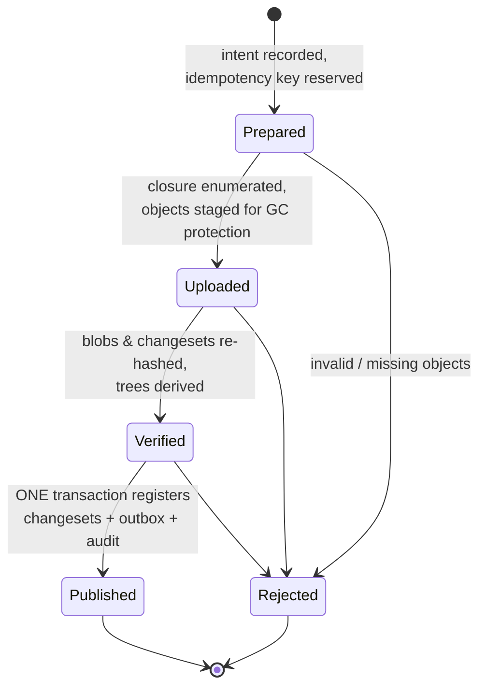
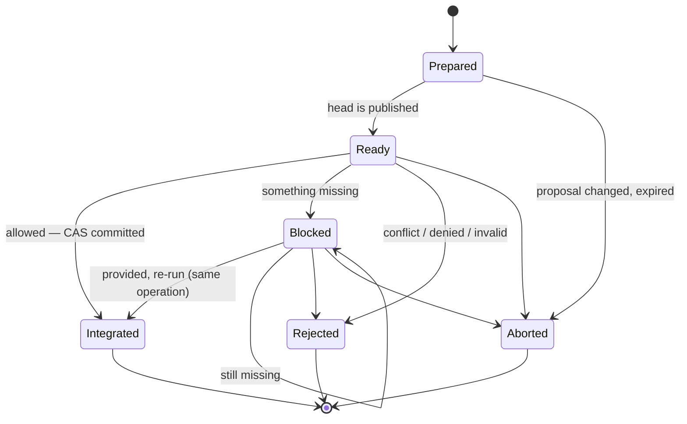

# Publication and integration

The two protocols that make AgentGit safe under crashes and concurrency. Both are implemented in
`crates/ag-integrate` and recorded as **intents** (durable operations with an `operation_id` and an
idempotency key) in the `intents` table.

## Why two protocols

| | Publication (`ag propose`) | Integration (`ag integrate`) |
|---|---|---|
| Question | Is this history *complete and valid*? | May the stream move to include it, right now? |
| Reads | object store (every byte re-hashed) | metadata (stream state, policy, reviews, attestations, leases) |
| Writes | registers changesets as *published* | moves the stream head |
| Idempotency key (default) | `publish:<head>` | `integrate:<proposal>:<head>:<attempt>` |

## Publication



1. **Prepare** — create the intent. A replayed key returns the existing intent; a key reused with a
   *different* request is refused (`IdempotencyKeyReused`).
2. **Upload** — walk the unpublished part of the history below the head (parents first, bounded by
   `max_changesets_per_publication`); check namespace and that every referenced blob exists; record all
   object IDs in `intent_objects`, which **protects them from garbage collection** while the intent is open.
3. **Verify** — re-read and hash every blob (kind must be *blob*); for each changeset in order, apply its
   operations to its first parent's tree (proving the history is structurally valid: deletes hit existing
   entries, no no-op puts, no file/directory clashes, within tree-size limits); symlink targets must stay
   inside the checkout. Trees are kept in memory only as long as a child still needs them.
4. **Ready** — a single `BEGIN IMMEDIATE` transaction registers the changesets (generation numbers, parents,
   touched paths), enqueues `changeset.published` outbox events, appends an audit entry and sets the intent
   to `Published`.
5. **Derive** — asynchronously (the outbox dispatcher), keyframe trees are cached; see [Storage](storage.md).

If any check fails the intent becomes `Rejected` with the reason and **nothing** is registered.

## Integration



For a request the engine loops (at most 8 times):

1. Read the stream state `S = (head, version)`.
2. **Compute the candidate outside any lock**:
   - empty stream, or the stream head is an ancestor of the proposal → *fast-forward* (new head = proposal);
   - the proposal is already an ancestor of the head → *already integrated* (no CAS);
   - otherwise take the **merge base** (`ag-dag`), refuse unrelated or criss-cross histories, run the
     deterministic [three-way tree merge](merge-semantics.md), and build a merge changeset with parents
     `[head, proposal]` and operations relative to the head. Its timestamp and author derive from the
     intent, so retries of one intent produce the same changeset.
   - conflicts → intent `Rejected` with the conflicting paths; the stream is never touched.
3. **Commit in one transaction** (`BEGIN IMMEDIATE`):
   1. re-read the stream; if `S` changed → write nothing, go to step 1 (**the candidate is recomputed**);
   2. read the facts: current policy and version, attestations for the candidate's *tree ID*, reviews, valid
      provenance, active exclusive leases;
   3. evaluate policy (pure function, [`ag-policy`](../guides/policy.md)) plus lease/fencing checks;
   4. *denied* → intent `Rejected`; *blocked* → intent `Blocked` with the missing items and the candidate
      tree ID (what a validator must check out); *allowed* → register the merge changeset, `cas_stream`
      (which also appends the reflog row), mark the proposal integrated, mark the intent `Integrated`, append
      the audit entry and the `stream.updated` outbox event.
   5. COMMIT. Everything above happens or none of it does.

Because policy is evaluated against facts read **inside** the committing transaction, there is no window in
which an approval can be revoked, a policy tightened or an attestation superseded between "checked" and
"committed".

### Unknown commit outcome

If a client loses the connection after the commit, retrying would be wrong. Instead:

```bash
ag op show <operation-id>        # or: re-run `ag integrate <proposal>` — same default key → recorded result
```

`ag integrate` with the default key replays the recorded result of a finished operation (even if the
proposal has since changed state) and resumes an unfinished one. A key reused for a *different* request is
an error. Tested by `idempotent_replay_and_unknown_outcome_recovery` and
`reused_idempotency_key_for_a_different_request_is_refused`.

### Recovery

`ag recover` resumes interrupted `Prepared`/`Uploaded`/`Verified`/`Ready`
operations, leaves `Blocked` ones alone, and aborts anything older than `--max-age` (default 7 days). Every
step is idempotent, which is what makes resuming safe.

## Guarantees and the tests that prove them

| Guarantee | Test(s) |
|---|---|
| Readers never see a head with missing objects; invalid histories are rejected whole | `publish_rejects_unusable_histories`, `publish_makes_history_visible_and_is_idempotent` |
| A crash at **any** step recovers to exactly one integration (one reflog entry, healthy fsck) | `crash_at_every_step_recovers_to_exactly_one_integration` — injects failures at `publish.after_upload`, `publish.after_verify`, `publish.before_commit`, `publish.after_commit`, `integrate.after_ready`, `integrate.before_commit`, `integrate.after_commit` |
| No lost update under parallel integrators; reflog is one contiguous chain | `concurrent_integrations_never_lose_an_update` (12 workers, separate SQLite connections), `concurrent_cas_from_many_connections_never_loses_an_update` (24) |
| Lost response is recoverable without double-applying | `idempotent_replay_and_unknown_outcome_recovery` |
| A conflict never moves the stream | `overlapping_edits_are_reported_as_conflicts_and_nothing_changes` |
| A validation is bound to the exact candidate tree and must be redone when the stream moves | `attestation_cannot_be_reused_after_the_stream_moves`, `validation_gate_blocks_until_a_trusted_attestation_names_the_exact_tree` |
| Approvals bind to the reviewed head; self-approval and run-hopping do not count | `approvals_are_bound_to_the_reviewed_head_and_exclude_the_author` |
| Stale exclusive-lease holders cannot land changes (fencing) | `fencing_tokens_are_strictly_increasing_and_reject_stale_holders` (ag-agent), `exclusive_leases_gate_integration_with_fencing_tokens` |
| Preview == reality | `merge_preview_has_no_side_effects` |
| Staged objects survive GC; GC cannot delete a concurrently re-referenced object | `gc_protects_objects_staged_by_an_in_flight_publication`, `rewriting_an_old_unreachable_object_saves_it_from_a_concurrent_gc`, `reput_refreshes_age_and_delete_if_older_respects_it` |
| GC fails closed | `gc_fails_closed_when_a_reachable_object_is_damaged` |

Failpoints (`Repository::failpoints()`) are one-shot hooks compiled into the engine; they are never armed
outside tests and cost a set lookup.
