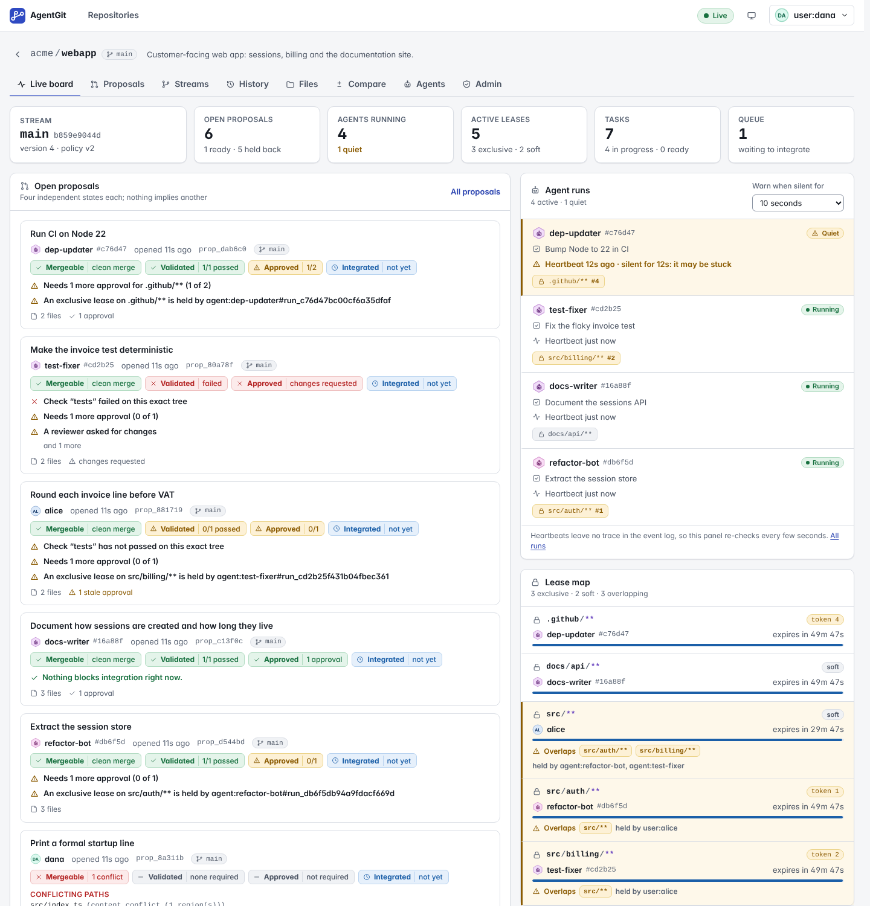
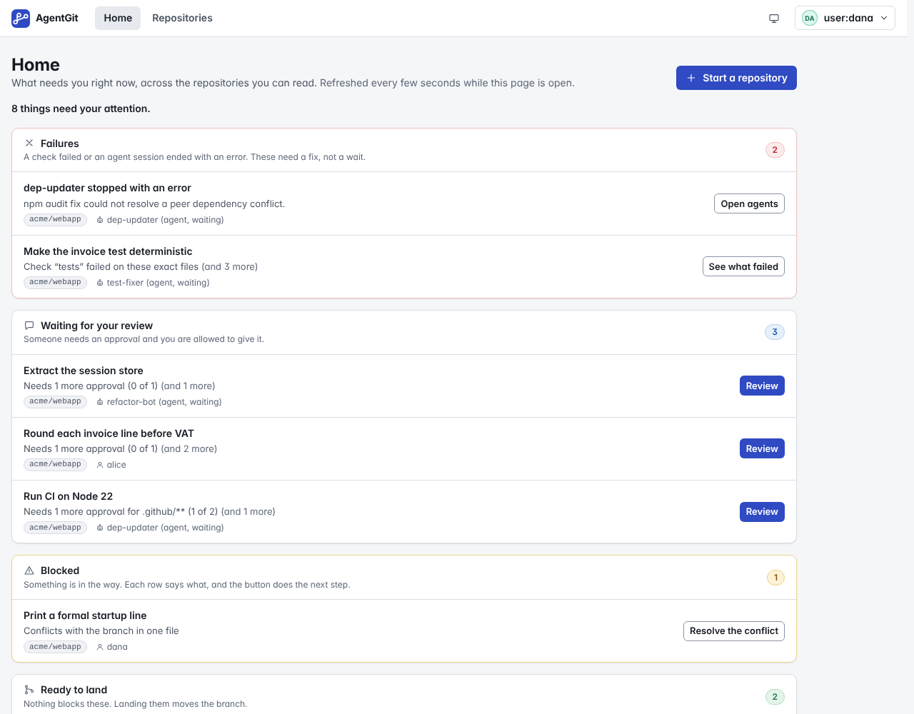
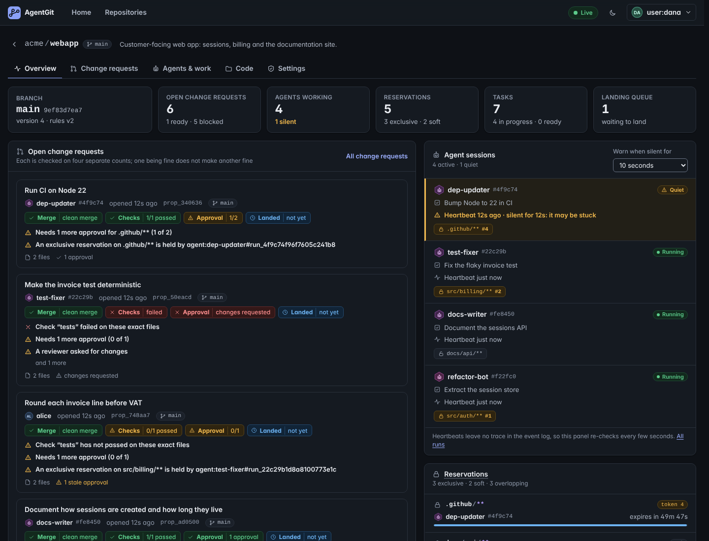
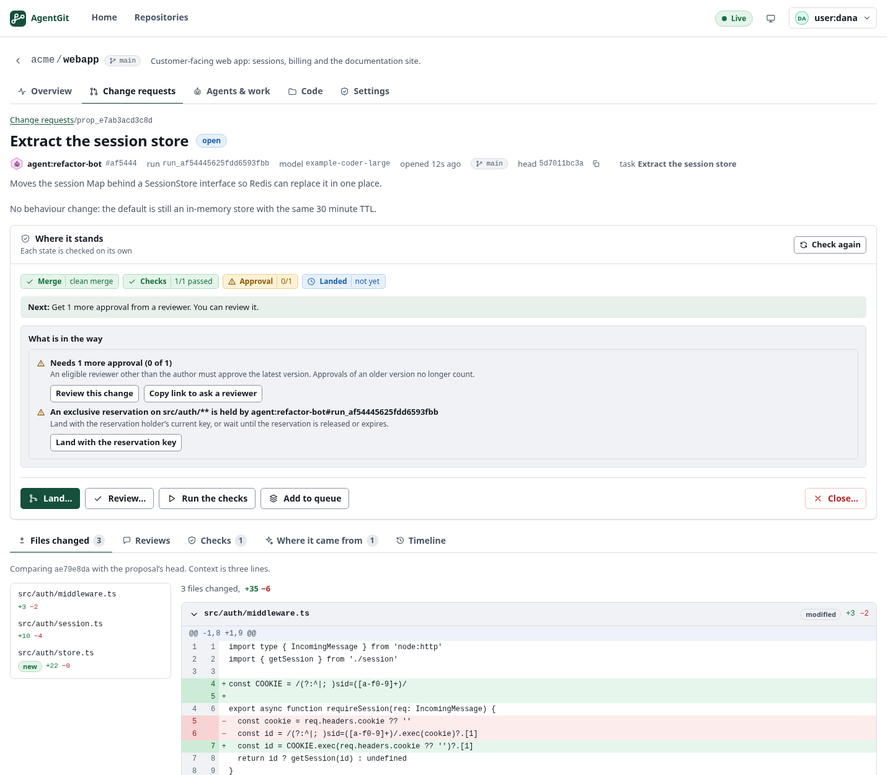
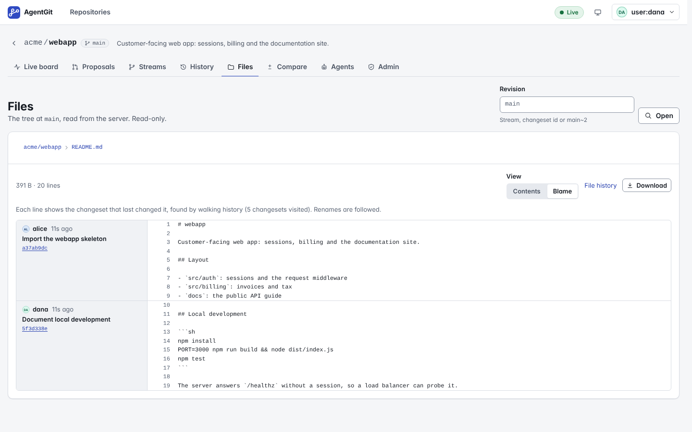
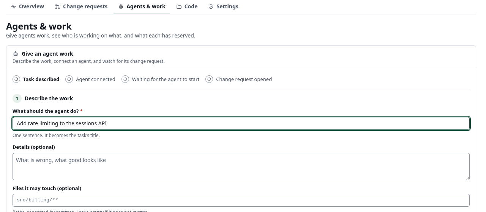
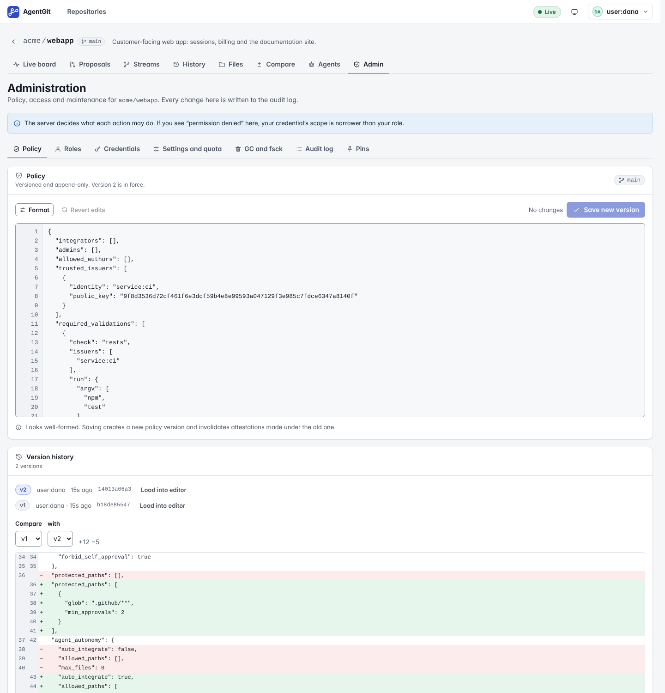
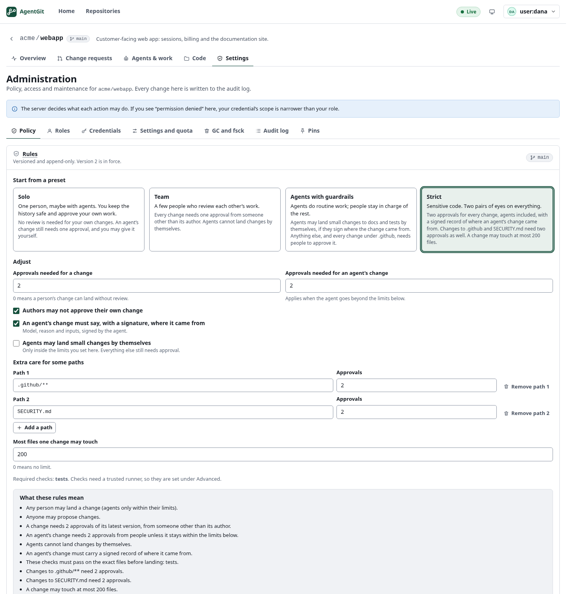
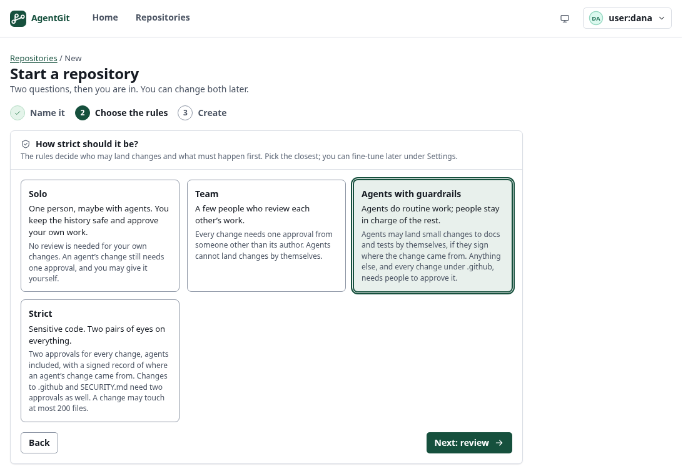

# The Web UI

The Web UI is a browser interface to an AgentGit server. It is made for watching and steering **agents at
work**: who is running, who holds which part of the repository, what is waiting for what, and, for every
proposal, whether it can land and if not, why, in plain language.

You do not need to know AgentGit's vocabulary to use it: the screens say "change request", "land", "branch" and
"reservation", and the AgentGit word is in a tooltip and in [Plain words](#plain-words). The first page after signing
in is **Home**, which lists what needs *you*. The reasoning behind the layout is in the
[Web UI review](../design/web-ux-review.md).

It is a static app. `ag-server` serves it; it talks to the server only through the public
[HTTP/JSON API](../protocol/README.md), with the same credentials and the same permission checks as any other
client. Nothing in the UI can do what the API would refuse.



## Turning it on

`ag-server` serves the UI itself: the build of `apps/web` is compiled into the binary (cargo feature `ui`, on by
default), so one file is the whole product. Release and CI builds run `scripts/build_ui.sh` (Node 22.18 or newer:
`npm ci`, a production build, pre-compressed brotli/gzip copies) and then `cargo build --release -p agentgit-server`. The
container image (`deploy/docker/Dockerfile`: a Node stage runs the script, the Rust stage embeds its output) is built
that way, and CI checks that the image's server serves the app. The release workflow builds the UI before its
binaries too (and its archive smoke test checks the app is served); that part has not been rehearsed since it was
added. A server built without the UI build still compiles and runs; a browser then sees a page that says how to get the
UI (and API clients keep their JSON 404). If you built the UI by hand after a first cargo build, `touch
crates/ag-ui-assets/build.rs` (Cargo cannot watch a directory that did not exist yet; `build_ui.sh` does it for you).

```toml
# ag-server.toml
[ui]
enabled = true                  # default; false leaves only the API
# dir = "/srv/agentgit/web"     # serve a copy of apps/web/dist from disk instead of the embedded build
```

`server.web_dir` is the old spelling of `ui.dir` and still works. Open `http://127.0.0.1:8080/`. Requests under
`/v1/` and `/agwp.`, and `/metrics`, `/healthz`, `/readyz` and `/openapi.json`, always reach the server (a path
under those prefixes that matches nothing is the API's JSON 404, never the page); every other path that is not a
file serves the app, so a bookmarked URL works after a reload. Missing assets are 404s.

Hashed assets are sent `Cache-Control: public, max-age=31536000, immutable`; the page and everything else is
`no-cache` with an `ETag` (304 on revalidation); brotli or gzip is chosen by `Accept-Encoding`. Every UI response
carries `Content-Security-Policy: default-src 'self'; script-src 'self'; style-src 'self' 'unsafe-inline'; img-src 'self' data:;
font-src 'self'; connect-src 'self'; object-src 'none'; base-uri 'self'; form-action 'self'; frame-ancestors
'none'` (no inline script and no eval; inline style attributes are allowed because WebKit refuses the app's styles
under a stricter `style-src`), `X-Content-Type-Options: nosniff`, `Referrer-Policy: no-referrer` and
`X-Frame-Options: DENY`. With redirect sign-in configured, `connect-src` also names exactly the identity providers'
origins. The UI finds the API on its own origin; nothing is configured.

To try it without setting anything up, `npm run demo:server` in `apps/web` starts a throw-away server with a
realistic team and four agents, and prints a token for each of them (see the
[developer README](../../apps/web/README.md)).

## Signing in

**A sign-in link (`ag-server dev`).** The evaluation server prints a link such as
`http://127.0.0.1:8080/repos/demo/welcome#token=agt_…`. The credential is in the *fragment*, the part of a URL after `#`,
which a browser never sends to a server: it is in no access log and no `Referer` (the server also sends
`Referrer-Policy: no-referrer`). The UI reads it before anything else runs, removes it from the address bar and from the
page's history entry (`history.replaceState`), checks it with the server like a pasted token, keeps it in the tab's session
storage like one, and opens the page the link names without the "You are signed in" step. A link that does not work (for
example the one from before a restart) is explained on the sign-in page, and nothing is stored. The trade-offs, which is why
this is for evaluation only and the credential `ag-server dev` issues lives eight hours and is replaced at every start:

- whoever can see the terminal (or its scrollback) where the link was printed can use it until it expires;
- the browser's own history database may keep the address as it was before the page loaded and removed the fragment;
- `ag-server dev --open` passes the link to the browser as a command-line argument, so any user of the same machine can
  read it in the process list for a moment;
- it is plain HTTP on the loopback interface, so nothing crosses a network, and the link is useless from another machine.

A production server uses single sign-on or a token you paste, and never prints a link. The link is not a general feature: only
the `#token=` fragment is read, and only when the page loads.

**Single sign-on (redirect).** When the server lists an identity provider, the sign-in page offers "Sign in with
<name>": OpenID Connect authorization code with PKCE (S256), `state` and `nonce` checked by the browser, then the
code is exchanged at the provider's token endpoint. The server still verifies every token with the provider's keys
(`GET /v1/auth/config`, public, tells the UI which providers exist; see the [protocol](../protocol/agwp-v1.md)).

```toml
[[auth.oidc]]                                  # makes the server accept the provider's tokens
issuer = "https://idp.example.com/realms/acme"
audience = "agentgit-web"                      # = the UI's client_id when the ID token is presented
group_roles = [{ group = "platform", role = "admin", repo = "acme/*" }]
# http_timeout_secs = 10        # discovery and key-set requests to the provider
# jwks_refresh_secs = 30        # an unknown signing key refreshes the key set at most this often
# jwks_max_age_secs = 3600      # how long fetched keys are trusted
# leeway_secs = 30              # clock skew tolerated for exp / nbf

[[ui.login]]                                   # makes the UI offer the button
issuer = "https://idp.example.com/realms/acme"
client_id = "agentgit-web"                     # a public client; redirect URI: <UI origin>/auth/callback
# scopes = ["openid", "profile"]; token = "id_token" | "access_token"
# authorization_endpoint / token_endpoint / end_session_endpoint: otherwise read from discovery
```

The provider must allow requests from the UI's origin (CORS) on its discovery and token endpoints. If its token
endpoint is on another origin than the issuer, set `token_endpoint` so the Content-Security-Policy can allow it.

*Trade-off, on purpose:* the token is kept **in memory only**, never in `localStorage` or `sessionStorage` (only the
short-lived PKCE/state/nonce survive the redirect, deleted when the callback is handled). So a script injected into
the page cannot read a stored credential, but a reload (or a second tab) asks the provider again, silently
(`prompt=none`: instant while the provider's own session lives, otherwise you are asked to sign in). A refresh token,
when the provider issues one, renews the session silently a minute before expiry; without one you are warned and
the session ends at expiry with an explanation. Signing out also ends the provider's session when it offers a
logout endpoint. Redirect sign-in needs a secure context (HTTPS or localhost) for PKCE.

**Paste a token.** Still available next to it, and the way for scoped credentials: `agt_…` tokens minted by an
administrator (`POST /v1/credentials`, or **Admin → Credentials**), an OIDC ID or access token, or the bootstrap token.
A pasted token stays in this tab's session storage (closing the tab signs you out), is sent only in an
`Authorization` header and never appears in a URL. If a credential expires or is revoked while you work, the session
ends with an explanation instead of a page full of errors.

## Home: what needs you

The first page after signing in. It initially summarizes the 30 newest repositories. Selecting a repository loads its work even if it is older; **Load more repositories** expands the combined summary. It lists, most urgent first:

- **Failures**: a required check failed, or an agent session ended with an error in the last day.
- **Waiting for your review**: changes that need an approval you are allowed to give (not your own, not already decided).
- **Blocked**: every other change that cannot land, with the first reason in a sentence and a button for the next
  step (open it, run the check, land with the reservation key, resolve the conflict).
- **Ready to land**: nothing in the way, and you may land it.
- **Agents gone silent**: sessions that are running but have not reported in.

Each row says which repository, who (and whether it is an agent waiting), and for how long. Opening a row's button
takes you to the change request with the review or land dialog already open; it never starts work by itself (running a
check is one click further, on the page). The aggregate view is re-read every 15 seconds while visible.
Select one repository for live updates (development): one event stream refreshes its summary, with the same
15-second fallback. Hidden tabs close that stream; returning to the tab reconnects and refreshes. With nothing to do it says so and suggests where to go; without any repository it says how to get one.



## Finding your way

Inside a repository the navigation is by job: **Overview** (where things stand), **Change requests** (the work to
review), **Agents & work** (give an agent work, sessions, reservations), **Code** (Files, History, Branches, Compare as a
second row) and, for administrators, **Settings** (rules, access, maintenance). Routes are unchanged, so old links work.

## The overview of a repository

Open a repository and you land on its board. It follows the repository over a live event stream; the indicator at
the top right says whether it is **Live**, **Reconnecting** (it retries with backoff and catches up on what it
missed) or has lost access.

- **Agent runs.** Each active run with its task, how long ago it last sent a heartbeat, and the leases it holds. A run
  that has been silent for longer than a threshold you choose (the selector on the panel) is marked **Quiet** with how
  long it has been silent. That is a hint that an agent may be stuck, not a verdict.
- **Lease map.** Every active lease: its path scope, whether it is exclusive or soft, the **fencing token** an
  integrator must present, and a countdown. Leases whose scopes may overlap are called out together with who holds them.
- **Open proposals.** One card per proposal, with the four independent verdicts and the first blockers (below).
- **Tasks and dependencies.** The task graph: what is in progress, what is blocked and by which tasks, what is done.
- **Integration queue and conflict predictions.** What is waiting to be integrated, and where open proposals, leases
  and the stream itself are about to collide: two proposals editing the same files, a proposal editing files inside
  someone else's exclusive lease, a stream that moved under a proposal.
- **Activity.** The event log as sentences ("`alice` took a soft lease on `src/**`"), newest first. Housekeeping events
  are hidden unless you ask.

Agent heartbeats and lease expiry do not appear in the event log, so those two parts re-check every few seconds
(the page says so).

A dark theme is available from the toggle in the header; by default the UI follows your system.



## A change request



The header names who proposed it. For an agent's change it shows the **run**, the **model** and the **task** behind it
(from the agent's signed provenance record).

**Four independent states.** A change is not "ready" or "not ready"; four separate things can each be true or false:

| State          | Question it answers                                                                 |
| -------------- | ----------------------------------------------------------------------------------- |
| **Mergeable**  | Does the change combine with the stream's current head without conflicts?           |
| **Validated**  | Does every check the policy requires have a trusted passing result *for this exact tree*? |
| **Approved**   | Does it have the approvals the policy asks for, *of its current head*?              |
| **Integrated** | Has it landed?                                                                      |

They are shown separately because they change for different reasons: approving a proposal does not make it
mergeable, a moved stream changes the tree that must be validated, and pushing a new commit makes earlier approvals
stale (they are listed as stale, not counted). When something is in the way, **What is in the way** lists each blocker in
plain language with what to do about it, for example *"An exclusive lease on `src/auth/**` is held by
`agent:refactor-bot`. Integrate with the lease holder's current fencing token, or wait until the lease is released or
expires."*

**Tabs.** *Changes* is the diff (files, hunks, line numbers; binary files are named, not shown); *Reviews* shows
each decision with the head it looked at; *Validation* shows each required check, the job that ran it and the signed
attestation (who signed, for which tree, under which policy version, in which environment); *Provenance* shows
what the agent said about itself (rationale, inputs, parameters), always as untrusted text, with whether the signature
verified; *Timeline* is the history of the proposal.

Diff line-number columns fit the largest number in the displayed patch, including when a hunk crosses a digit boundary. Long lines scroll inside the diff; focus that region and use the arrow keys to read across.

**Working through files.** In Files changed, filter the loaded paths by name or folder. Mark each file **Viewed** and turn on **Hide viewed files** to focus on the remainder. These marks are saved in the current browser tab for your account, repository, change request and exact comparison revisions; a changed head or base starts separate progress. They are personal reading aids, not approvals. Filtering never fetches missing files: an oversized server diff keeps its truncation warning even when no loaded files match. **Show all files** clears both filters.

**Review drafts.** Closing the review dialog or reloading the page keeps the comment, decision and inspected head in this browser tab, separately for each account, repository and change request. The draft is removed only after the server accepts the review. Storage failures are shown; in that case copy the comment before leaving. Closing the browser tab still removes this local draft. If the author changes the head, the text stays and submission is blocked until you confirm that you reviewed the updated changes. The server checks the inspected head atomically when saving; a concurrent update rejects the review and keeps your text. Older servers without this capability require an upgrade before this UI submits a review.


**Account review drafts (development).** On supported servers, **Save draft and close** stores
this review's text, decision and inspected revision privately for your current account.
Opening the same review on another device restores it when that tab has no draft. If both
places have different drafts, choose **Use account draft** or **Keep this tab draft** explicitly.
Typing alone does not upload changes. The limit is 64 KiB of UTF-8 notes.

A save refused because another device changed the draft keeps your text. A successful review
clears only the matching saved version; newer notes remain intact. Stored notes do not count
as reviews or approvals and are not shown in the shared proposal or audit. They are part of
repository backups, which administrators can access. Servers without this capability retain
the local-only behavior. File-edit and general-comment drafts remain local to the browser.

**Actions** are *Review*, *Run the checks*, *Land*, *Add to queue* and *Close*. Each is enabled only if your
roles allow it; the buttons that are off are explained in words under the row ("Land: requires the integrator role"),
not only in a tooltip. A **Next:** line picks the one thing to do first (a conflict before checks, checks before approvals).

**Every blocker has its fix next to it.** *Run the check* runs the missing check; *Review this change* opens the review
dialog (not offered to the author); *Copy link to ask a reviewer*; *Land with the reservation key* opens the land
dialog; *Resolve the conflict* opens the resolver (below). A fix is a button only when your role allows it. Otherwise
the row says who to ask ("Ask someone with the reviewer role") instead of showing a button that would fail. *Integrate* shows the strategy (fast-forward or merge), asks for fencing
tokens when a lease is involved, and reports the outcome the server decided: integrated, blocked (nothing changed, with
the blockers), conflict (with the paths) or refused by policy. When resolving conflicts, the editor
retains the proposal revision it opened. A concurrent update refuses the save and keeps your
resolution text available; inspect the updated proposal before starting a new resolution.
This requires a development server advertising `proposals.update_head`.

## Branches and history

- **Branches** lists branches (streams) with their heads and the policy version in force, and the **reflog**, the append-only
  record of every move of a head.
- **History** shows the changesets of a stream as a graph; merge commits show their parents. Opening a changeset shows
  its message, files and the diff it made.
- **Files** browses the tree at any revision, with file sizes, and shows files as text. A **Blame** switch shows, for each
  line, the changeset, author and time that last changed it (renames are followed; lines whose origin is further back
  than the server looked are marked *older than shown*). If a server does not offer blame, the page says so.
- **Compare** shows the diff between any two revisions (`main~3` and `main`, two changeset ids, ...). With **From** empty, it shows the changes introduced by **To**, compared with its first parent. Set both revisions to use **Swap**.

In **Files**, choose **Find file** or press **t** to search paths throughout the repository. Arrow Down and Arrow Up move between the search field and matching files; Home and End jump to the first and last result. Enter opens the focused file. Escape closes the finder and returns focus to its opener. The results remain normal links, including Ctrl/Cmd-click to open another tab.



## Agents & work

At the top, **Give an agent work** walks the whole job with a progress list: describe the task (what to do, which files),
connect an agent (the page grants the writer role on this repository and mints a one-hour credential scoped to it, which
needs the admin role), then copy the commands or the plain-words instruction it shows (the credential is displayed once
and can be hidden). It then watches for the agent to start and for its change request, and links to it. The older
command-line-only version is under *Prefer the command line only?*



Below: *Agent sessions* (active, or the history of finished ones with their summaries), *Tasks* (a board by state, with what each is
waiting for), *Reservations*, and *Registered agents* with their identities and public keys.

**Task details.** Open a task title from the board or an agent session to get a permanent task page. It shows the owner, state, scope, prerequisites and tasks waiting on it. Writers can add a prerequisite through the form; the server refuses cycles. Completing a task may make its dependants ready, but does not approve or land code. Cancelling a task leaves dependants waiting and does not stop an agent session. Both actions require confirmation and the server's owner/operator permissions. The selected coordination tab survives reload and Back to tasks.

Related change requests and agent sessions are explicitly limited to matches in the newest 100 repository results. The page does not claim to show all historical work. Removing dependencies, editing existing task descriptions and a full user-issue tracker remain outside this slice.

## Administration

Visible only where you hold the `admin` role; anyone else sees what the page needs instead of controls.





- **Rules.** Start from a preset (**Solo**, **Team**, **Agents with guardrails**, **Strict**, each described in two
  sentences) and adjust plain fields: approvals needed for a person's and for an agent's change, whether authors may
  approve their own, whether agents may land small changes by themselves (and for which paths and how many files),
  whether an agent's change must say where it came from, extra care for some paths, a file limit. A preset keeps the
  checks, trusted runners and who-may lists the branch already has. Under the fields, **What these rules mean** is the
  document in sentences, and once you change something, **What saving this changes** lists what it now allows and
  asks for more of ("Landing now needs 2 approvals (was 1)", "Agents may now land changes by themselves when…"). The
  form edits the same JSON the server stores; the raw document stays under **Advanced**, with checks while you type
  (JSON errors, unknown fields with a suggestion, settings that can never be satisfied), and the server's own refusal
  is shown verbatim if it still rejects the document. Each protected path has its own approver-pattern
  field; leaving it empty inherits the branch's default approver rules and grants no repository access.
  Existing required checks expose maximum result age and command timeout in seconds. Empty age means
  no age limit; empty timeout uses the policy default of 600 seconds. External-only checks have no
  command timeout. Other runner settings are preserved. Add checks and trusted runners under
  **Advanced**. A **version history with a diff between any two versions** records changes. Saving
  creates a new version; attestations under an older version stop counting, and the UI says so.
- **Roles** and **Credentials.** Grant and revoke roles. While a role grant is pending, its fields are locked; failures keep the binding for correction and retry. Failed revocations also keep their confirmation available for retry. A rejected session offers sign-in. Mint tokens for yourself, or, as an administrator, for an
  agent or service, optionally limited to repositories, streams or operations. A new token is **shown exactly once**: in full, selected and with
  a copy button (and a button to hide it), and gone from the page when you close the dialog. The server keeps only a hash, so it cannot show it again.
- **Settings and quota**, **GC and fsck** (garbage collection always starts as a *dry run*; the real run is only offered
  after one, behind a confirmation), **Audit log** (filterable, with a button that verifies the hash chain) and **Pins**.

## Keyboard, accessibility and small screens

Everything works without a mouse: a skip link, one tab stop per tab list with arrow keys, dialogs that trap focus and give
it back, a visible focus ring everywhere, and screen-reader announcements for route changes, toasts and the live
indicator. State is never colour alone: states have icons and words, diffs have `+`/`−`. The UI follows your system's
colour scheme and `prefers-reduced-motion`. Below 820 px wide (or on a touch screen) every control is at least 44 px and
the header, tab strips and tables adapt: tables that do not fit scroll sideways as a labelled region the keyboard can reach.
Long tab strips scroll inside their own row. Home and End select the first and last enabled tab and bring it fully into view.

## First run, version check, ended sessions

- **Connect your first agent.** A repository nobody has pushed to (the server reports zero changesets, no open
  proposals) shows a panel with three steps and this server's address and repository filled in: grant the agent a role,
  mint its credential, run `ag clone` / `ag snapshot` / `ag push` with it. The commands are built in
  `src/lib/onboarding.ts` and the end-to-end test takes them **from the page and runs them** with the real `curl` and
  the real `ag` against the real server (`e2e/onboarding.spec.ts`); the proposal the agent pushes then appears on the
  board. An agent identity that could not be put safely into a shell line is refused instead of printed.
- **Version banner.** The build writes its version (`apps/web/package.json`, kept equal to the workspace version by a
  Rust test) to `ui-version.json`; the page compares it with `server_version` from `GET /v1/capabilities` at start, when
  the tab becomes visible again and when the browser comes back online. A different major or minor version, or a
  protocol other than `agwp.v1`, shows a banner with a Reload button (`e2e/version.spec.ts` serves a copy of the build
  with another version from a second real server).
- **Session ended.** A 401 while you work (or a credential that ran out) leads to `/unauthorized`: it says the session
  ended, shows what the server answered and its request id, and leads to the sign-in with the way back.

## Verified where

| Claim | Evidence |
| --- | --- |
| A first-time user does each job using only what the screen offers: start a repository, give an agent work (the commands are taken from the page and run with the real `ag`), review, unblock, land; edit a file and propose; resolve a conflict; choose rules | `e2e/jobs.spec.ts` |
| Whole end-to-end suite (about 300 tests) against a real `ag-server` with the UI embedded | CI job "end-to-end (chromium)" |
| Same suite in Firefox and WebKit | CI jobs "end-to-end (firefox)", "end-to-end (webkit)"; engine differences, if any, are named in the spec that handles them |
| Layout and axe at 768 and 390 px | CI jobs "tablet", "phone" (Chromium with touch emulation, not a real device) |
| axe (WCAG 2.x A/AA + best practice), light and dark, every main screen, dialogs, error pages | `accessibility.spec.ts`; the scroll-region race that once made it flaky is pinned by `scrollregion.spec.ts` |
| Redirect sign-in against a **real** identity provider (Keycloak, pinned image): login, groups to roles, silent re-authentication, token expiry after the provider revoked the session, sign-out at the provider | CI job "real identity provider (Keycloak)", `e2e/keycloak.spec.ts` |
| The server's own OIDC validation with tokens Keycloak issued (discovery, signature, audience, expiry, tampering) | same job, `crates/ag-server/tests/oidc_keycloak.rs` (`--ignored`) |
| Failure modes a real provider will not produce on request (wrong state, bad nonce, forged signature, denied) | `e2e/oidc.spec.ts` with the fake provider `e2e/support/idp.ts`, and `crates/ag-server/tests/security.rs`: **test doubles**, in test code only |

Not verified: a pass with a real screen reader (NVDA, VoiceOver, TalkBack) and keyboard-only use on real devices;
real phones; identity providers other than Keycloak (Entra, Okta, Auth0). Automated checks find only part of the
problems. There is no command palette. Known minor issues: the tab strips of a repository have no scroll hint other
than the cut-off tab; the diff and blame views are read-only on a phone (they scroll sideways inside their own box).

## Security notes

- **Everything the server sends is treated as untrusted text**: proposal titles, descriptions, review comments, task and
  run summaries, file names and contents, diffs, and what agents write about themselves. It is only ever shown as text. The
  code base forbids HTML injection (`v-html`, `innerHTML`, `eval`, inline handlers) by lint rule and by test, and the
  end-to-end suite seeds a repository full of hostile markup and checks that none of it runs.
- **Content-Security-Policy.** The UI needs nothing outside its own origin (no CDN, no web fonts, no inline scripts), so the
  server's strict policy applies in full.
- **Tokens** live in the tab's session storage and in an `Authorization` header only; they are never written to local
  storage, a log or the page after the one-time reveal, and never sent in a URL. The one place a token arrives in a URL is the
  fragment of the sign-in link of `ag-server dev` (see "Signing in"), which is cleared at once.
- **Permissions** shown in the UI come from your roles and are a convenience. The server decides, and refuses
  anything you may not do whatever the page offers.
- **Same origin.** The UI is served by the server it talks to, so no CORS configuration is needed. If you serve it from
  elsewhere, list that origin under `cors_origins` in `[server]` and keep the same CSP.

## Start a repository

Administrators: **Start a repository** (on Home and on Repositories) is three steps with a progress list: name it (the
page explains what a name looks like before anything is sent), choose the rules (the four presets), review what the
choice means in sentences, create. The rules are stored with the repository. The new repository's overview shows a
**Getting started** checklist (repository created, rules chosen, work started, a change request open, first change
landed) that ticks itself and offers the button for the next step.

Leaving the wizard does not delete a repository that was already created, and a late response does not bring you back. If the repository is created but its rules cannot be saved, a warning names it; finish choosing the rules under **Settings**.



### Import from GitHub or GitLab

Choose **Import from GitHub / GitLab** on Home or Repositories to upload a full Git bundle. **Check the import** stages it for review; only **Publish repository** makes the destination available. See the [Git migration guide](migrate-from-git.md) for what transfers and what needs a separate migration.

Before uploading, the page shows which data the Git bundle transfers and which project data needs a separate move. **Save migration summary** downloads a plain-text handoff with counts, branch/tag mappings, warnings and a checklist; **Technical report → Download JSON** keeps the machine-readable record available. After publishing, direct links lead to files, branches and team access. Administration tabs are bookmarkable and survive reloads.

Reopening the import page resumes the saved import for your account. After a temporary error, **Retry previous import** opens the same staged result; an expired credential offers **Sign in again**. **Start new import** clears only this account's local reference, without deleting the staged import on the server. Recovery references are kept in this tab, separately by account; switching accounts hides the previous report. If browser storage is unavailable, keep the page open and save the report before leaving.

## Edit several files together

From **Code → Files**, choose **Edit multiple files** on a branch. Open existing text files or add new paths, switch between files in the left list, and edit their contents. Changing a file path stages a rename; **Delete file** stages removal and **Restore file** undoes it. Existing executable and symbolic-link modes are preserved.

**Review changes** shows the staged before/after contents for the whole batch. Write one title and description, then **Open change request** sends all file operations as one workspace changeset and opens one review. The branch is unchanged until that request is reviewed and landed. A new or renamed path cannot silently overwrite an existing file; move/delete the existing file in the same batch or choose another path.

The original starting revision and complete batch are saved in this tab, separately for each account, repository and branch. Reloading restores the batch. **Download draft** saves a JSON copy; **Start over** asks before deleting the local copy. Tab storage does not survive every browser cleanup or device loss. Storage errors remain visible and unreadable saved data is not automatically overwritten.

This first editor supports up to 100 text files or link targets and 4 MiB of changed contents. Binary replacement remains available through **Upload files**. The pre-submission review displays staged contents; the created change request displays the server's final diff.

## Edit a file and propose a change

With a writing role, a file on a branch has an **Edit** button and a directory has **New file**. **Propose change**
asks for a title and description and opens a change request; nothing lands until it is reviewed and landed like any other.
This uses the server's virtual workspaces: a draft is opened on the branch (from exactly what was on screen), the edit is
applied as one version, the change request is opened from it, and the server workspace is removed. While sending, the editor locks the submitted title and description. Requests and retries retain the initiating credential; leaving or changing account stops unsent follow-up steps and ignores late results. Cancellation does not undo a server operation that already completed; the local draft remains available if completion was not confirmed. Text and symbolic-link targets can be edited. **Rename or move** and **Delete file** open reviewed change requests and preserve the original blob and mode. **Upload files** handles several text or binary files together, with explicit confirmation before replacing existing files (100 files, 4 MiB total).
If the upload cannot read the branch, **Retry branch** keeps your selected files, destination, title and description.

A workspace separates edits from the branch; it does not make stored objects confidential from other repository readers. Account-backed file drafts remain future work; the private review-draft endpoint is a separate authorization boundary.

The editor pins the version you read. If someone changes the branch while you type, their work is checked by
the normal merge and conflict rules. It is not silently replaced by your older copy. Leaving the file, changing
revision or cancelling asks before discarding unfinished text; closing the tab uses the browser's warning.
Text edits, their original revision, path and proposal description are saved in this tab's session storage, separately for each account and repository. Reopen **Edit** after reloading or signing back in to recover them. The original revision stays pinned, including when another user advanced the branch. **Keep draft and leave** retains the draft; **Discard changes** removes it. Storage errors are shown explicitly and never reported as a successful save.

If another participant removes or moves the file, reopening its saved URL still shows your draft. You can download it or propose it from the original revision; review detects a conflict with the removal. Cancelling returns to the repository root.

**Download draft** saves your current text to a local file without opening a change request. Tab storage is not a server backup and does not promise recovery after closing the tab or moving to another device. Download important unfinished work before closing the tab. Authentication tokens are not copied into draft records.

**Filter this folder** narrows the directory listing by name, without changing the branch or path. For a paginated
folder it explicitly filters the loaded entries; **Load more** includes the next page. Clearing the filter restores
the listing, and opening another folder resets it.

**Resolve the conflict.** When a change request no longer merges with its branch, its author sees *Resolve the
conflict* (everyone else sees *Copy link to send to the author*). The resolver shows, per file, the branch's version and
yours, with *Keep the branch's*, *Keep mine*, *Delete the file* and a text box for the result. Saving applies the
resolutions through the draft and moves the change request to the merged version. Binary files, oversized files and
file-type changes can keep either exact version or delete the file: the original blob, type and executable mode are
retained without converting bytes to text. Editing is available only for regular text versions. Conflicts requiring multiple output paths,
including rename/rename and file/directory conflicts, remain command-line work. After a rename, each preview reads its original
source path and displays it when it differs from the result path. Rename/delete conflicts allow
an explicit choice between the relocated file and deletion. Servers must advertise
`workspaces.conflict_origins`; older servers show upgrade guidance instead of ambiguous previews.

The resolver pins both the proposal revision and the target branch. If either changes before saving, the newer
work is preserved and the dialog asks you to inspect it again. Failed reads never mean a deleted file. This flow
requires `proposals.update_head`, `workspaces.sync_precondition` and `workspaces.conflict_origins`; older servers need an upgrade before browser
conflict resolution is available.

## Plain words

The screens use the left-hand label; the AgentGit word is in the tooltip. The CLI, the protocol and the API keep the
AgentGit words. This table is generated from `apps/web/src/lib/glossary.ts` (a test fails if they drift apart).

| AgentGit word | Plain label | Meaning |
| --- | --- | --- |
| proposal | Change request | A set of file changes waiting to be reviewed and landed. |
| integrate | Land | Move the change into the branch. |
| integrated | Landed | Has the change been moved into the branch? |
| stream | Branch | A line of work that changes land on, like a Git branch. |
| verdict (the four states) | Status | Four separate questions: does it merge cleanly, did the checks pass, is it approved, has it landed. One being true does not make another true. |
| mergeable | Merge | Does the change combine with the branch as it is now, without conflicts? |
| validated | Checks | Has every check the rules require passed, with a trusted result for these exact files? |
| approved | Approval | Does the change have the approvals the rules ask for, from reviewers who looked at its latest version? |
| validation | Check | A test or other check the rules require before a change may land. |
| attestation | Check result | A signed result from a trusted runner for one check on one exact version of the files. |
| provenance | Where it came from | What the agent says about its own change: model, reason and inputs, signed by the agent. Treat it as a claim, not a fact. |
| lease | Reservation | A temporary claim on some files so that two agents do not edit them at once. |
| exclusive lease | Exclusive reservation | Nobody else may land changes to these files until it ends or is released. |
| fencing token | Reservation key | A number that proves you hold the newest reservation. Landing a change under an exclusive reservation needs it. |
| policy | Rules | Who may land changes to a branch, and which checks and approvals are needed first. |
| changeset | Version | One saved state of the files. |
| run | Agent session | One working session of an agent on a task. |
| workspace | Draft | An isolated working copy of a branch, where edits collect before they are proposed. |
| quiet (stale heartbeat) | Silent | The agent has not reported in for a while. It may be stuck; this is a hint, not a verdict. |

## Not in the UI

- A full editor. Editing is one text file at a time; for more, use a clone, a workspace through the CLI, or the SDKs.
- Email or chat notifications. The board is live while it is open.


## Finding work across repositories

Home shows work that needs attention across the repositories you can read. Search by words in a change title,
reason, author or repository; every search word must match. Choose a repository or a category to narrow the list.
Category counts follow the search and repository selection. Home stores the search, repository and category in the URL: bookmark the queue or open a change request and return with Back without rebuilding the filters. **Clear filters** removes those three filters together and returns to all loaded work.

The summary shows its last successful refresh time. In development, selecting a repository also enables live
updates; all-repository summaries and disconnected feeds retain the 15-second visible-tab fallback. Event bursts
are coalesced, and refreshes triggered by events reuse the loaded repository catalogue. **Refresh** rereads the
catalogue and summary immediately. If a repository or proposal cannot be read, or a summary limit is reached, an incomplete-data
notice remains visible. An incomplete summary is never evidence that no work needs attention. Open the repository
for its complete paginated list. The change-request list also offers a search over loaded results and direct links
to editing files or giving an agent work when your role permits it.

The Repositories list keeps its search in the URL. Open a repository and use browser **Back** to return to the same filtered list, or bookmark the search. Search covers only loaded repositories; use **Load more** to include the rest.

The change-request list keeps **State**, **Author** and **Search loaded change requests** in its URL. After opening a request, browser **Back** restores those filters. Bookmark or copy the list URL to reuse them. Typing a filter keeps focus in the field; the text search still covers only the loaded results.
The browser tab keeps the repository name while filters or anchors change, so several open repositories remain distinguishable.


### Keeping context in history and copied text

History filters follow the URL: Back and Forward restore the revision and path. Opening a changeset or its parent preserves those filters; modified link clicks open a separate tab without changing the current selection. A different changeset starts with its own detail and diff, so a pending response from the previous selection cannot appear under the new heading.

Copy buttons keep keyboard focus when the browser falls back to legacy clipboard support. If copying fails, the temporary field is removed and the button reports the failure instead of retaining an earlier success message.

A failed next-page request keeps the loaded directory, history or change-request rows. Use **Load more** to retry that page; changing the repository, revision or server-side filter clears the old listing immediately, so its links cannot point into the new context. Large patches start collapsed when you change the comparison; refreshing the same patch preserves your manual expansion.

Review controls pause while the decision is being sent. The decision and comment are fixed when you submit; switching to another change request cannot redirect a pending send to that request. Responses from an earlier page do not clear the current draft.
Branch creation, settings saves and landing also pause their editable controls while a request is pending. Failed attempts retain their values for correction and retry. Settings and landing results stay attached to the repository or change request that submitted them.

Downloaded multi-file drafts can be loaded with **Restore draft** in the same repository and branch, including in another browser. Restoring keeps the original starting revision and asks before replacing unsent file edits. This is manual draft transfer, not account-backed server storage.

### Search file contents

Open **Code → Search code** to find literal text at a branch or revision. Narrow the search to a file or folder and turn on **Match case** when needed. The query is kept in the URL, so Back and reload restore it. Leading and trailing spaces are preserved for literal searches, and matching text is emphasized in each result. Signing out or switching accounts clears the previous results and cancels pending requests. A result opens the exact searched revision and highlights the matching line.

**Continue searching** examines the next part of the same immutable tree. An empty page does not mean the search is finished when this button is still present. Each request scans at most 1000 files / 16 MiB, and returns at most 50 matching lines in the UI. Files over 1 MiB, files with NUL bytes and invalid UTF-8 are skipped; the result reports their counts. Symbolic-link targets are searched as text, without following links. This first version is a bounded scan, not an indexed-search performance claim.

The page explains when an older server needs an update instead of displaying a misleading empty result. The HTTP and gRPC operation, cursor contract and SDK access are described in [ADR 0015](../adr/0015-bounded-revision-code-search.md) and the [protocol reference](../protocol/agwp-v1.md#literal-content-search).

### Repository issues

Open **Issues** in a repository to search or filter open and closed issues. Writers can create issues and add comments. Authors and administrators can edit, close and reopen them. Each issue has a permanent URL and can link to an existing agent task; closing it does not complete that task.

The browser retains unsent drafts in the current tab, scoped to the signed-in account and repository. If someone edits the issue first, reload and review the current version before explicitly keeping your draft against that version. Comments and descriptions currently display as plain text. Labels, milestones, attachments and importing provider discussions are not yet supported.

The issue tracker requires a server advertising `issues.v1` and metadata schema 4. Take a backup before upgrading; an older server requires restoration of the pre-upgrade database.

From an open issue you own, choose **Create agent task…**, describe the expected result and enter file patterns (one per line). Creation links the task atomically; retrying the same request does not duplicate it. The task page follows runs and resulting change requests. A connected orchestrator may pick up ready work automatically; this action does not prove execution, validation or approval. Closing the original issue remains a separate decision.

The manual **Give an agent work** flow includes the task ID in the `ag push --task` command. Its progress follows only that task and agent, including run-scoped identities. An ended session without a linked change request is shown as ended, not still working. Changing the account or repository clears displayed credentials and cancels pending setup requests. This command-driven path does not claim that an external coding model was launched by the browser.

### Pause and resume task execution

**Agents & work → Task execution** shows whether new task-bound runs are allowed. An administrator or delegator can pause launches with a reason, or resume them after reviewing the effect. Resume makes every ready task eligible for configured executors. Existing runs continue during a pause; cancelling their task asks the connected orchestrator to stop its managed process. A manual external process may need to be stopped separately.

The server enforces the pause when a new task-bound run is created, including direct API clients. It persists after restart. Allowing tasks does not install or connect an executor. This control requires `task.scheduling` and schema 5; take a database backup before upgrading.

### Inspect an agent run

Open a run from **Agent sessions**, the live board or a task page. The permanent URL
survives completion and does not depend on a recent-run list. The page shows status,
summary, heartbeat, timing, assigned task and current reservations. **View this run's
change requests** selects the exact session, including closed and integrated requests.
A completed session does not mean its changes passed review or were integrated.

For a task-bound run, open its task to inspect dependencies and available cancellation
actions. Connected orchestrators stop their managed process after seeing cancellation;
manually launched external processes may need to be stopped separately. Agent summaries
are not complete stdout logs. This page requires `agents.run_lookup` on the server.

### Choose the agent before execution (development)

In **New task**, or when handing an issue to an agent, choose an **Assigned agent**. The reservation is saved atomically with the task. **Automatic routing** leaves the choice to the configured orchestrator. Registration alone does not install or start an executor.

On a queued task's page, its creator or an operator can use **Choose agent…** to change the reservation or restore automatic routing. A stale assignment is rejected; reopen the dialog after reviewing the current task. Once a run starts, the assignment cannot be changed. Open the linked run to follow that execution and then inspect its change requests for review and integration.

### Executor connection (development)

**Agents & work → Registered agents** separates the agent's enabled key from its executor connection. A recent report shows the executor name, last contact and free slots at that moment. Without a fresh report it shows **No recent report**; a registered key alone is not a connected executor.

The Go orchestrator renews these reports while its scheduler runs. Reports expire automatically, survive server restart and contain no commands, environment variables or credentials. Only an operator can report connectivity; readers can inspect it. Capacity is a snapshot, and a connected orchestrator does not prove that its command, model credentials or next task will succeed. Task assignment remains available when the executor is offline so work can wait for its return. Older orchestrators do not send these reports.

### Set up a task executor (development)

Administrators can choose **Registered agents → Connect an executor…** to prepare
repository-scoped access and download a task-only orchestrator configuration. Enter
an agent program installed on the executor host; its arguments are a JSON array and
only named environment variables are inherited. No model credentials are sent to the
browser or server. The private token downloads separately, expires in 24 hours, and
can be revoked from the wizard or credential settings.

Start the development orchestrator on the host using the displayed command. The
wizard confirms a fresh connection from the service identity it just prepared, then
the agent can be assigned tasks. Host installation and model availability are still
external prerequisites. See the [orchestrator guide](orchestrator.md#connect-from-the-web-ui-development).

### Saved executor output (development)

In **Connect an executor**, **Save diagnostic output in AgentGit** is off by default.
When enabled, the executor saves a bounded stdout/stderr tail at session end. Open
its run page to switch streams, download text or delete the saved output. Deletion
preserves the run outcome and audit trail and blocks later uploads for that run.
Only an operator may save or delete output; repository readers may view it.

At most 32 KiB per stream are saved. This is not a live log stream or a replacement
for signed checks. Known credentials and private key encodings are removed by the
orchestrator, but it cannot identify every possible secret. Enable capture only
when the output is suitable for the repository's readers.

### Follow a task through its history

On a task page, **Change requests** and **Agent sessions** show records linked to
that task. Use **Load older change requests** or **Load older sessions** to continue
past the first 50 records. Background refresh keeps the pages you expanded. Open a
change request for its exact candidate checks and review; open a session for its
summary and saved output. These histories require server feature `tasks.history`;
older servers display a labelled subset of the repository history.

### Reuse a task's context (development)

Choose **Create a task from this one…** on a task page to open a prefilled creation
form. Review the title, description and file scope, then choose the agent and any
prerequisites. Nothing is created until you submit the form. The new task has its
own history and retry budget; the source task keeps its state, owner and history.
Use this for follow-up work or a deliberate new attempt after inspecting a failed
run. It does not reopen or resume the source task.

### Browse older agent sessions (development)

In **Agents & work → Agent sessions → History**, choose **Load more sessions** to
continue through repository history. The control disappears when there are no
more records. Active sessions can also be paged. Servers supporting `tasks.history`
use continuation tokens; older servers retain their 1,000-session retrieval limit
and show a notice when it is reached. Switching account clears the previous list.

### Discuss a change request (development)

Choose **Discuss…** on an open change request, or open **Reviews** and use
**Add to the discussion**. Writers, reviewers and integrators can comment; this
does not grant or revoke approval. Comments remain available after closure.

The tab saves your draft with the head you inspected. If the change request moves,
inspect the new changes and acknowledge that head before posting. Retrying an
unchanged submission does not create another comment. Line-anchored threads,
thread resolution and code suggestions are not part of this first discussion flow.

## Line discussions (development)

On servers supporting `proposals.threads`, select an old/new line number in the
change request diff. **Start a line discussion** keeps the exact file, revision,
side and line with your question. Its draft is saved in this tab. If the proposal
changes first, select a line in the current diff before posting.

Open **Replies and actions** to read and answer a thread. **Resolve discussion**
and **Reopen discussion** are available to the thread author, proposal author,
reviewers and integrators. Concurrent replies change the version and reject stale
resolution. Threads on former heads show **Earlier head** and retain their source
text. Discussion is separate from review approval. **Use general discussion
instead** preserves the existing quote/comment workflow.

This requires repository schema 6. Back up existing data before running a newer
development binary; older binaries reject upgraded repositories. Restore the
pre-upgrade backup for rollback. See [ADR-0025](../adr/0025-line-review-threads.md).

Discussion filters show all, open or resolved threads among the loaded results.
Counts are marked as partial when more pages are available; use **Load more
discussions** to include older threads. Switching filters preserves expanded
reply drafts.

### Request reviewers (development)

The author of an open change request can choose **Request review** in its reviewer panel.
Enter up to 20 identities, one per line, and confirm. This requests attention; it does not
grant repository access, require approval in policy, or count as a review. Removing an identity
from the list withdraws that request. If another edit wins first, your draft remains available.

The panel marks a request reviewed only after that person approves or requests changes on
the current revision. A new revision keeps the requested list and makes prior reviews pending
again. On **Change requests**, select **Review requested from me** to filter before pagination;
the URL can be bookmarked. Servers without this capability cannot apply that filter.

This feature requires metadata schema 9. Back up before upgrading a repository; restore that
pre-upgrade backup to return to beta.7 or older. See [ADR 0036](../adr/0036-requested-reviewers.md).

### Suggest a code change (development)

Select a new-side line number in **Files changed**, then **Suggest a replacement**. Explain
why and enter replacement code. **Lines to replace** selects 1–100 original lines starting
at that line; the count and replacement survive reload in the same tab. Multiple replacement
lines are allowed, and an empty replacement deletes the selected range. The draft survives reload in the same tab. Post it as a line discussion.

The change request's author can choose **Review and apply suggestion**, inspect the exact
replacement and explicitly apply it. This creates a new revision, retaining executable mode
and line endings. Existing checks and approvals must match the new revision. The discussion
stays open until reviewed and resolved separately. Earlier-revision suggestions remain readable
and copyable; they cannot overwrite newer work.

To combine changes, expand **Apply several suggestions** in the discussions, select the
suggestions and choose **Review selected suggestions**. Inspect the prepared files before
confirming. Up to 100 suggestions across files become one revision; overlapping suggestions
for the same original lines are refused. Only loaded discussions are included: use **Load more
discussions** to include older results. The total prepared content is limited to 4 MiB.

Application requires a server with `proposals.update_head` and is limited to regular UTF-8
files up to 1 MiB. Symlinks, binary files, old-side lines and changed source lines require the
ordinary editor or CLI. A range that extends past the file is refused. The preview shows the original file for
multi-line replacements; confirm only after inspecting the entire selected range.


## Enable or disable new runs for one agent (development)

Under **Agents & work → Registered agents**, an operator can choose **Disable…**
or **Enable…** beside an agent. The confirmation names the identity and explains
the effect. Disabling prevents new runs; it does not delete the public key,
revoke credentials, erase history or terminate existing processes. Cancel the
relevant tasks separately when managed sessions must stop.

A concurrent state change is rejected instead of silently applying a decision
from an outdated dialog. Close and reopen it to review the current state.
These actions require the `agents.state` server feature and `agent.operate`
permission (delegator or administrator). Earlier servers keep the status display.

The equivalent remote CLI actions use the configured repository remote:

```bash
ag agent list --remote origin
ag agent disable my-agent --remote origin
ag agent enable my-agent --remote origin
```

The CLI reads the current server state and submits the same guarded change. It
requires `agent.list` to inspect the agent and `agent.operate` to change it.

## Follow-up source links (development)

Creating work from a task records its source task on servers advertising
`tasks.lineage`. A follow-up from a failed run also records that exact run.
The task page shows **Source of this task** with permanent links after reload;
the original task lists its **Follow-up tasks** so the relationship can be navigated
in both directions.
Changing the copied description cannot change those relationships.

The new task has its own assignment, prerequisites and attempt history; it does
not reopen or reset the source task. Review its scope before creating it. Older
servers retain links in the description only. This development feature requires
metadata schema 7 and a pre-upgrade backup; see [ADR-0027](../adr/0027-task-source-links.md).


### Refine queued task instructions (development)

On a task page, choose **Edit task…** to change its title, description and file scope before
its first run. Only the creator or an operator can save. **Save instructions** applies the
change explicitly; assignment, prerequisites and source links remain unchanged.

If another person edits the instructions first, your save is refused and the dialog retains
your draft. Copy anything you need, close and reopen the dialog to read the current version.
If execution has already started, create a follow-up task instead: completed and failed runs
keep the instructions they actually received. Editing does not pause a connected executor.

This requires server feature `tasks.edit` and is not in beta.5 archives. The same operation is
available through `ag task edit TASK --title "Clear expected result"` (local), or with
`--remote origin` for a configured server. `--description` replaces the description;
repeat `--scope` to replace path patterns, or use `--clear-scope`. Omitted fields are preserved.
See [ADR-0028](../adr/0028-task-instruction-refinement.md).


### Required discussion resolution (development)

The branch rules form can require every line discussion to be resolved before landing.
**Read and resolve discussions** opens Reviews from the blocker; discussions on earlier heads
still count. Open **Replies and actions**, read the replies, then resolve at the version shown.
A concurrent reply/reopening is checked again by the server at integration. Approval remains a
separate decision. Upgrade all replicas before enabling this rule.
