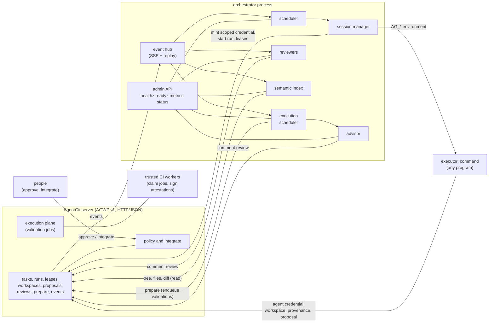

# AgentGit Agent Platform (`agent-orchestrator`)

A Go service that sits **beside** the AgentGit server and makes a fleet of agents manageable: it schedules
tasks onto agent sessions, keeps proposals prepared for the trusted execution plane, suggests resolutions for
conflicting changes and leaves automated review comments. It speaks only the public
[AGWP v1](../../docs/protocol/agwp-v1.md) HTTP/JSON protocol, under its own identity (`service:orchestrator`),
with least-privilege credentials.

> **Trust boundary** ([ADR-0001 §3](../../docs/adr/0001-final-architecture.md)). The orchestrator may *propose*. It can
> never bypass the SCM core or policy: it does not integrate, change policy, move streams, approve, or touch
> storage. Agents it runs get short-lived (at most one hour), narrowly scoped credentials, and everything an
> agent produces still goes through proposals, reviews, validation and policy. A structural test
> (`TestOrchestratorNeverIntegrates`) fails if service code calls an integrating, policy or administration
> operation of the client library.

- Go 1.24, Apache-2.0. Standard library only, plus `gopkg.in/yaml.v3` (MIT and Apache-2.0).
- Operator guide with a complete example and a worked run: [docs/guides/orchestrator.md](../../docs/guides/orchestrator.md).

## What it does

| Component | Job | Package |
|---|---|---|
| Scheduler | per-repository view of tasks; event-driven plus a periodic reconcile; concurrency limits; oldest ready task first; **conflict-aware placement** (leases, running sessions, work that has not landed, open proposals' files, the server's overlap prediction); retries with backoff | `internal/scheduler` |
| Sessions | register the agent and its key, start a run on its behalf, mint a scoped credential, take a lease on the task scope, launch an executor, supervise it (heartbeats, timeout, capped output, SIGTERM then kill of the whole process group), complete the run, release leases, revoke the credential | `internal/session` |
| Execution scheduler | keeps every open proposal prepared (`integration.prepare` with validations enqueued), tracks four independent states per proposal (mergeable, validated, approved, integrated) | `internal/execsched` |
| Advisor | for conflicting proposals, suggestions posted as one `comment` review; never applied automatically. `advisor.mode: heuristic` (default): deterministic rules (whitespace only, both sides extended the same list, neighbouring edits, ...). `model`: a language model proposes a resolution for what the rules are not sure of ([model mode](#model-mode-optional)) | `internal/advisor` |
| Reviewers | checks on each proposal head posted as `comment` reviews. Always: likely secrets, protected paths, oversized change, source without tests, generated or binary churn (heuristics). `review.mode: model` adds a clearly separated section with a language model's reading of the diff | `internal/review` |
| Semantic index | incremental symbol index of the stream (Go, Rust, Python, TypeScript, JavaScript), an HTTP query API, and symbol-level overlap between open proposals; bounded memory and disk. `index.mode: model` adds a language model's assessment (conflict or compatible) beside the static severity of each overlap | `internal/semindex` |
| Model client | provider-agnostic OpenAI-compatible chat-completions client shared by the three above: configurable endpoint, model and key variable name, timeouts, retries, request and token budgets, fenced prompts, validated answers | `internal/llm` |
| Admin | `/healthz`, `/readyz`, `/metrics`, `/status`, structured logs, graceful shutdown, `check` and `ops` commands | `internal/app`, `cmd/orchestrator` |



Nothing in the box on the left of the orchestrator is changed by it except through the same proposal, review
and task operations any agent or person uses; the right-hand arrows into `policy` come from **people**, never
from the orchestrator.

## Layout

```
services/agent-orchestrator/
  cmd/orchestrator/        main: run, check, ops, config, version
  internal/
    agwp/                  typed AGWP v1 client: retries, Retry-After, idempotency keys, SSE follower,
                           provenance signing bytes (admin.go holds the operations only tests may use)
    agentkey/              Ed25519 agent keys, same file format as the Rust CLI
    app/                   wiring, admin/observability API, check, required operations
    config/                YAML/JSON configuration, validation
    events/                per-repository event hub (replay + SSE, resume by sequence number)
    scheduler/ session/    task scheduling and agent sessions (command executors)
    execsched/ advisor/ review/ semindex/
    llm/                   OpenAI-compatible chat client (budgets, retries, fenced prompts, strict JSON answers)
    textdiff/ glob/ secret/ metrics/ clock/ loop/   small support packages
    testutil/              shared test harness: the REAL ag-server, a world on it (repository, people, CI worker),
                           a fault-injecting forwarding proxy; testutil/testagent is a test-only agent program
  integration/             end-to-end tests against the real ag-server binary
  Dockerfile  go.mod  go.sum
```

## Run it

```bash
go build -o orchestrator ./cmd/orchestrator

orchestrator ops   -config orchestrator.yaml -for orchestrator -flags   # what to request when minting its credential
orchestrator check -config orchestrator.yaml                            # verify config, credentials, server; changes nothing
orchestrator run   -config orchestrator.yaml                            # run (the default command)
orchestrator config -config orchestrator.yaml                           # effective configuration (no secrets)
```

| Command | What it does | Exit code |
|---|---|---|
| `run` | runs until SIGINT/SIGTERM, then shuts down as configured; a second signal exits at once | 0 clean, 1 error, 2 bad usage or configuration |
| `check` | negotiates the protocol, authenticates all three service credentials, compares their roles and scopes with what the configuration needs, reads every repository and stream, looks for executors; `-json` for machines | 0 all fine (warnings allowed), 1 an error item, 2 bad configuration |
| `ops` | prints the operations each service credential must carry; `-for orchestrator`, `reviewer`, `advisor` or `agent` with `-flags` prints `--operation` flags for `ag-server admin mint` | 0 |
| `config` | prints the effective configuration; neither `config` nor `ops` needs the credentials to be set | 0 |

The configuration file path comes from `-config` or `AG_ORCH_CONFIG`.

### Credentials the service needs

Three identities, each with its own token in its own environment variable (the configuration names the
variable, never the value):

| Identity | Variable (default) | Role on the repositories | Operations (`orchestrator ops`) |
|---|---|---|---|
| `service:orchestrator` | `AG_ORCH_TOKEN` | `delegator` (mints credentials for `agent:*` subjects only and operates their tasks and runs; no administrative power) | scoped to exactly what the configuration needs, never integrate, policy, review or stream operations |
| `service:reviewer` | `AG_REVIEWER_TOKEN` | `reviewer` | read plus `proposal.review` |
| `service:advisor` | `AG_ADVISOR_TOKEN` | `reviewer` | read plus `proposal.review` |

Agents get their own role bindings (for example `agent:docs-bot` as `writer` on the repository); the
orchestrator mints their short-lived credentials but cannot grant roles, and what it mints is never more than
it could do itself (the server clamps a delegated credential to the intersection of the agent's roles, the
delegator's roles and the orchestrator's own scope). If the reviewer or advisor variable is
unset those components fall back to the orchestrator's credential, which by design cannot post reviews;
`check` reports this as an error with the reason.

## Configuration

YAML (JSON also works). **Unknown keys are rejected**, so a typo cannot silently weaken a setting. The file
can never carry a token: it only names environment variables. `orchestrator config` prints the result with
all defaults applied.

```yaml
server:
  url: https://agentgit.example.com        # required (or AG_SERVER); plain http is refused for non-loopback hosts
  token_env: AG_ORCH_TOKEN                 # default
  reviewer_token_env: AG_REVIEWER_TOKEN    # default
  advisor_token_env: AG_ADVISOR_TOKEN      # default
  ca_file: /etc/ssl/agentgit-ca.pem        # optional extra CA for a private server certificate
  timeout: 30s                             # per request
  retries: 4                               # attempts per request, 1..10
  stream_idle: 60s                         # reconnect an event stream silent for this long
  max_response_bytes: 67108864             # bound on one response body the client reads (64 MiB)
  allow_insecure_remote: false             # permit plain http to a non-loopback host (credentials in the clear!)

llm:                                       # only read when a component below has mode: model (see "Model mode")
  base_url: https://openrouter.ai/api/v1   # API root; "/chat/completions" is appended. No default: the endpoint is yours
  model: vendor/model-id                   # required in model mode. No default
  api_key_env: AG_LLM_KEY                  # the NAME of the variable holding the key; empty: no Authorization header (a gateway adds it)
  timeout: 60s                             # per attempt
  retries: 3                               # after the first attempt, 0..8 (honours Retry-After; backoff with jitter)
  max_output_tokens: 1500
  max_input_bytes: 120000                  # a larger request is refused before anything is sent
  temperature: 0
  json_mode: false                         # ask for response_format json_object (not every model supports it)
  concurrency: 2
  budget: {requests_per_hour: 200, tokens_per_day: 2000000}   # 0 = unlimited; counters restart with the process
  # ca_file, headers (non-secret only; never Authorization), allow_insecure_remote (plain http to a non-loopback host)

listen: 127.0.0.1:9090                     # admin API (AG_ORCH_LISTEN)
admin:
  token_env: AG_ORCH_ADMIN                 # bearer token for /status, /metrics, /advisor, /index; REQUIRED when listen is not loopback
state_dir: /var/lib/orchestrator           # agent keys, index, session work directories (AG_ORCH_STATE_DIR)
log: {format: text, level: info}           # text|json; debug|info|warn|error (AG_ORCH_LOG_FORMAT, AG_ORCH_LOG_LEVEL)
loop: {reconcile: 30s, debounce: 500ms}    # the safety-net interval and the event coalescing window
shutdown: {mode: wait, grace: 30s}         # wait: let sessions finish; cancel: stop them (SIGTERM, then kill)

repos:
  - name: acme/web                         # owner/name
    stream: main                           # the stream the work is for
    schedule:
      enabled: true
      slots: 2                             # concurrent sessions in this repository
      placement: avoid                     # avoid: defer overlapping work; allow: only exclusive leases defer
      lease: soft                          # soft | exclusive | none: the lease a session takes on the task scope
      lease_ttl: 30m                       # renewed on every heartbeat
      attempts: 1                          # tries per task, 1..10
      backoff: 30s                         # doubles per attempt, capped at 1h
      on_predict_error: start              # start | defer: what placement does when the server's conflict prediction cannot be read
                                           # (either way it is counted, logged and shown in /status as predict_error)
      default_executor: docs-bot           # implicit when there is exactly one executor
      routes:                              # first match wins; all given matchers must match
        - {executor: docs-bot, title: "^docs:", scope: "docs/**"}
    validations: {enabled: true, enqueue: true, refresh: 15s, recent: 20, jobs_limit: 200}   # execution scheduler; enqueue asks the server to queue validation jobs
    advisor: {enabled: true, mode: heuristic, inline_bytes: 16384, max_file_bytes: 1048576, max_paths: 20, model_file_bytes: 24000}   # mode: heuristic | model
    review:
      enabled: true
      mode: heuristic                      # heuristic | model (adds a model section; the checks below always run)
      model_diff_bytes: 40000              # model mode: bound on the diff text in the prompt
      model_max_findings: 8                # model mode: findings taken from one answer
      max_files: 40
      max_lines: 1500
      secrets: true
      tests: true
      protected: [".github/**", "**/.env", "**/.env.*", "**/*.pem", "**/id_rsa*", "**/secrets/**", "SECURITY.md"]
      generated: ["**/*.lock", "**/package-lock.json", "**/go.sum", "**/dist/**", "**/*.min.js", "**/*.pb.go", "**/vendor/**"]
      sources: ["**/*.go", "**/*.rs", "**/*.py", "**/*.ts", "**/*.tsx", "**/*.js", "**/*.jsx", "**/*.java", "**/*.kt", "**/*.rb"]
      allow_secrets: []                    # regular expressions for lines that are not secrets; "ag:allow-secret" on a line also works
      import_files: 60                     # an initial import (a proposal into an empty stream) is read file by file: at most this many files ...
      import_file_bytes: 131072            # ... of at most this size; the rest is reported as "not inspected" in the comment
    index:
      enabled: true
      mode: heuristic                      # heuristic | model (a model assesses the overlaps the static analysis finds)
      judge_patch_bytes: 30000             # model mode: bound on the diff text in the prompt
      judge_pairs_per_pass: 3              # model mode: pairs assessed per pass
      max_file_bytes: 262144               # larger files are not indexed (nor read when analysing an open proposal)
      max_files: 5000
      proposal_max_files: 30               # files of one open proposal that are read for the symbol analysis (the rest: partial)
      proposals_per_pass: 10               # open proposals analysed per pass
      skip: ["vendor/**", "node_modules/**", "target/**", "dist/**", ".git/**", "**/*.min.js", "**/testdata/**"]   # abbreviated; the default list is longer

executors:
  - name: docs-bot                         # also the default agent name (agent:docs-bot); one agent per executor
    type: command                          # the only kind: any program, run directly
    agent: docs-bot
    slots: 1                               # concurrent sessions of this executor (see the security model before raising it)
    timeout: 30m                           # at most 55m: agent credentials last at most an hour and cannot be renewed in a running process
    grace: 10s                             # SIGTERM to SIGKILL
    heartbeat: 15s                         # run heartbeat and lease renewal
    credential_ttl: 35m10s                 # default timeout+grace+5m, at most 1h
    output_bytes: 262144                   # bounded window kept of stdout and stderr each
    # operations: [...]                    # default list below; forbidden operations are refused
    command: ["/usr/local/bin/my-agent", "--non-interactive"]   # argv, no shell
    dir: "{workdir}"                       # working directory; default the session's private work directory
    env: {MODE: batch}                     # fixed variables (AG_* is reserved)
    pass_env: [PATH, LANG, TZ]             # variables copied from the orchestrator's environment (default)
```

The default agent operations (capabilities of the server's authorization model) are
`repo.read objects.read objects.write publish operation.read history.read tree.read stream.read workspace.read
workspace.write proposal.read proposal.create proposal.update integrate.prepare agent.read agent.run task.read
task.write lease.read lease.write provenance.read provenance.write predict events.read`. These are refused
whatever the file says, and may be neither listed nor reached through `pass_env`: the integration, queue,
review, close, policy, stream compare-and-swap, garbage collection, credential and role operations, job claiming
and attestation, repository administration, agent registration and validation enqueueing. Service credential
variables cannot be passed to executors either.

### Operator pause from the Web UI

The repository's **Task execution** control pauses new task-bound runs without interrupting existing sessions. The scheduler reads this persisted server decision, leaves ready tasks queued with `operator_pause`, and resumes placement after an operator permits launches again. It continues to observe completed/cancelled tasks during a pause.

The server independently enforces the gate in the run-creation transaction. Use a server advertising `task.scheduling`; older servers without the endpoint keep their previous behavior. A failed read from a server that implements the endpoint defers the scheduling pass. This control does not install an executor or change its command/model configuration.

## Executor contract

An executor is how an agent runs: a real program. (There is no built-in simulated agent: it was removed from the
product; tests and demos use the test-only agent program `internal/testutil/testagent`, which is never part of
the shipped binary or image.)

**`command`**: any program, started directly (no shell) in its own process group, in a private working
directory, with an environment built from scratch: `HOME` (the work directory), the `pass_env` variables, the
configured `env`, and:

| Variable | Meaning |
|---|---|
| `AG_SERVER` | base URL of the AGWP server |
| `AG_TOKEN` | the agent's credential for this session, **bound to the run** (at most an hour; revoked when the run ends) |
| `AG_RUN` | the run id. The credential already acts as `agent:<name>#<run>`; sending it as the `ag-run` header is accepted and changes nothing |
| `AG_REPO`, `AG_STREAM` | the repository (`owner/name`) and stream the work is meant for |
| `AG_TASK` | the task id |
| `AG_TASK_FILE` | path of a JSON file with the task (title, description, scope and optional `source_task` / `source_run` links). The text is **untrusted input**: it is written by whoever filed the task |
| `AG_AGENT`, `AG_IDENTITY` | the agent name and `agent:<name>#<run>` |
| `AG_KEY_FILE` | the agent's Ed25519 key (mode 0600), for signing provenance; the file format is the Rust CLI's |
| `AG_WORKDIR` | private scratch directory |
| `AG_RESULT_FILE` | optional: write `{"summary": "..."}` here to put a line in the run record |

The credential's scope is the repository and stream of the task and the configured operations. What a
well-behaved agent does: create a workspace on the stream, change files,
sign a provenance record with its key, and open a proposal for the task. It never integrates; policy and
people decide what lands.

**Exit codes**: `0` the agent finished (the task is done, or waits for its proposals to land); `75`
(`EX_TEMPFAIL`) a temporary failure: the task is tried again after the backoff without spending the attempt
budget (at most ten times in a row); anything else, or death by signal, is a failure: retried within
`attempts`, then the task is cancelled. If the failed session had already opened proposals, the task waits for
them instead.

**Output**: stdout and stderr are each kept in a bounded in-memory window (`output_bytes`); stdout is not
logged or forwarded. When a session fails, times out or is cancelled, a one-line tail of stderr becomes part of
the run's summary on the server and appears in `/status` while the session runs. Everything is scrubbed of the
session's own token first.

**Lifecycle**: the session registers the agent (once; a different key already registered under that name
refuses to start), starts the run (claiming the task for the agent), takes the lease, heartbeats the run and
renews leases, enforces `timeout`, on stop sends SIGTERM to the process group and SIGKILL after `grace`, then
completes the run (`completed` or `failed` with a summary), finishes the task if the scheduler decided so, and
revokes the credential. A run whose supervisor is gone (orchestrator crash) is found by its stale heartbeat
and ended by the server (`agent.reap_runs`, audited under the orchestrator) as abandoned; the server
releases its leases and revokes its credentials when a run ends.

## Model mode (optional)

Each of the advisor, the reviewers and the semantic index has a `mode`. **`heuristic` is the default**: fixed
rules and keyword matching, deterministic, free, and honest about what they are (the comments and `/status` say
`rules/1` / "heuristic"). `model` puts a language model behind the *same interface* in addition to them; nothing
else in the service changes. It needs no vendor: the `llm` section names any **OpenAI-compatible
`/chat/completions` endpoint**, the model, and the **name** of the environment variable that holds the key. There
is no default endpoint, model or key, and a key pasted into the file is refused (and never echoed).

What a model is, and is not, allowed to do:

- **It only proposes.** Its output is text in a `comment` review (the advisor's suggested file, the reviewer's
  findings, the index's assessment). It cannot approve, request changes, integrate, close or change anything; the
  structural test that forbids those calls covers the model-backed code too.
- **Repository text is untrusted.** Every piece of it (titles, descriptions, diffs, file versions) is placed in the
  prompt between delimiters with a random per-request id, the system prompt says that nothing inside them is an
  instruction, and the id is removed from the content so it cannot forge an end marker
  (`TestThePromptFencesRepositoryTextAsUntrusted`).
- **Bounded.** A prompt is cut to configured bounds (`model_file_bytes`, `model_diff_bytes`, `judge_patch_bytes`),
  refused outright above `llm.max_input_bytes`, limited by concurrency, a requests-per-hour and a tokens-per-day
  budget, a timeout per attempt and a bounded number of retries (429 and 5xx, `Retry-After` honoured, jittered
  backoff). A budget that is used up is an error with an honest note, not a silent retry loop.
- **Secrets stay home.** Text that looks like a secret is masked before it leaves the machine, and a file
  containing one is not sent to the advisor at all. The key is read from its variable into a type that never
  prints, goes only into the `Authorization` header, and is scrubbed from every error, log and `/status`.
- **Answers are validated.** One JSON object of a fixed shape; unknown verdicts, severities or paths, a
  resolution with conflict markers or over the size bound, an empty explanation, a reply cut off by the output
  bound: all are rejected, and the heuristic answer stands with a note saying that the model was asked and why its
  answer was not used. A model's confidence is never rated above `medium`; its suggestion lists the lines it dropped
  from either side or invented.
- **Honest labels.** The comment says which parts were written by which model and that nothing has verified them.
  The advisor still decides with its rules which files are worth asking about (a mechanical resolution the rules
  are sure of is never put to the model), and the index keeps its static severity next to the model's assessment.
- **Repeatable.** A model's text differs from run to run, so its comments are recognised by what they answer
  (the conflict, or the heuristic findings plus the model's name), not by their text: a restart does not post
  the same advice twice.

`/status` shows the model, the endpoint and the totals (requests, failures, tokens, last hour and day);
`/metrics` has `orchestrator_llm_requests_total{purpose,outcome}`, `orchestrator_llm_tokens_total` and
`orchestrator_llm_request_seconds_total`.

How it is tested, in three layers:

1. **Test double of a third-party API** (`testutil.LLMServer`, an `httptest` server): scripted answers to check what
   is *sent* (fencing, bounds, masking, no key in the body) and what is done with what *comes back* (validation,
   fallbacks, retries, budgets, the stable markers). It is named here because a model cannot run in a test; it is not
   evidence of what a real model does. The proposals, conflicts and diffs in these tests are the real server's.
2. **Live, opt-in** (`AG_LLM_LIVE=1` and `AG_LLM_LIVE_MODEL`, optionally `AG_LLM_LIVE_BASE_URL` and
   `AG_LLM_LIVE_KEY_ENV`): the client, the advisor on a real conflicting proposal, the reviewer on a real defective
   proposal, the index judge on two real overlapping proposals and the whole application, against a real endpoint
   and a real `ag-server`. The transcript (prompt shapes, replies, token use) is logged. CI runs them on a push
   when the repository defines the `OPENROUTER_API_KEY` secret and the `AG_LLM_MODEL` variable.
3. The exact record of a live run is in [the guide](../../docs/guides/orchestrator.md#model-backed-components-optional).

## Security model

- **Identity.** The service authenticates as `service:orchestrator` (and `service:reviewer`,
  `service:advisor`); every agent action is attributable to `agent:<name>#<run>`. The orchestrator holds the
  `delegator` role on its repositories: it can mint credentials for agents (never for a person, a service or an
  administrator) and finish or reap their tasks and runs, and nothing administrative. The credential it
  actually uses is *scoped* to the operations `orchestrator ops` lists, which exclude integration, policy,
  review, stream and role operations, and `check` warns when the credential is broader than needed (and errors
  when the role is not `delegator` or `admin`, or the server predates delegation).
- **Agents.** Credentials are minted per session for `agent:<name>`, **bound to the run of the session**,
  limited to the task's repository and stream, to the configured operations, and to the lifetime the executor
  needs (never more than one hour; the server also refuses a credential that outlives its parent). A credential
  acts only as its own run and stops working the moment the run ends, however it ends. They are revoked as soon as the session ends,
  passed to the executor only in its environment, and scrubbed from captured output, run summaries, logs and
  `/status`. No service credential reaches an executor.
- **What the orchestrator cannot do.** It cannot land a change, approve one, change a policy, grant a role,
  create a repository or a task, or close a proposal; the structural test and the scoped credential both
  enforce that. Its reviews are always `comment`; whether any automated review could ever count toward an
  approval requirement is up to the stream's policy.
- **Admin API.** `/healthz` and `/readyz` are open; everything else requires the admin bearer token when one is
  configured, and a non-loopback listener refuses to start without one. The configuration refuses plain http to
  non-loopback servers.
- **Concurrent sessions of one agent are isolated.** The credential of a session is bound to its run
  ([ADR-0010](../../docs/adr/0010-run-bound-credentials.md)), so two sessions of the same agent (an executor
  with `slots` above 1) cannot act as each other's run, finish each other's task or touch each other's
  workspaces, proposals and leases (`TestConcurrentSessionsOfOneAgentCannotActForEachOther`). Sessions of
  *different* agents are isolated as before (`TestFailingCommandExecutorGetsTheContractAndLeaksNothing`). The
  orchestrator refuses a credential the server did not bind to the run (a server that predates the feature
  would mint a name-bound one and say nothing). Agent credentials the orchestrator does *not* mint (a hand-minted
  token, `ag-mcp --run-credentials off`) are still bound to the name only.
- **Untrusted text.** Task titles and descriptions are never interpolated into commands; they reach an
  executor as data in `AG_TASK_FILE`. What the executor does with them is the executor's business.

## Admin and observability

| Endpoint | Auth | Content |
|---|---|---|
| `GET /healthz` | none | liveness |
| `GET /readyz` | none | 200 once authenticated and every repository's event stream is connected, else 503 with the reasons |
| `GET /metrics` | admin token | Prometheus text: sessions, deferrals (by reason), reconcile loops and errors, events, SSE reconnects, AGWP requests, errors and retries (by code), validations queued, advisor suggestions, reviews posted, index size, credentials minted, service credential expiry |
| `GET /status` | admin token | identities, per repository: event stream, scheduler (running, waiting to land, deferred with reasons, retrying), per-proposal four-state view with blockers, validation and integration queues, advisor and reviewer records, index |
| `GET /advisor/suggestions?repo=&proposal=` | admin token | the stored advice, including the suggested files |
| `GET /index/symbols`, `/index/files`, `/index/overlaps`, `/index/changes`, `/index/status` | admin token | the semantic index |

Logs are `log/slog` (text, or JSON with `log.format: json`) on stderr. SIGINT/SIGTERM start a graceful
shutdown: no new sessions, then running ones finish (`wait`) or are cancelled (`cancel`) within `shutdown.grace`,
and the admin API is the last thing to stop.

## Tests

```bash
go vet ./...
go test -race ./...            # unit tests for every package, plus the integration suite
```

- **No imitation of the server.** Every package's tests run against the **real `ag-server` binary**
  (`internal/testutil`: a real server per test, a real repository, real roles and credentials, a CI worker that
  signs real attestations). Two kinds of test double remain, both named here: the **test-only agent program**
  (`internal/testutil/testagent`, built by the tests and run as an ordinary `type: command` executor; it is not a
  model and is never shipped) and a **forwarding proxy** in front of the real server that records requests and
  injects the failures a healthy server cannot produce on demand (a 500, a dropped connection, a cut event
  stream, an older server's capability answer). Everything the proxy does not break reaches the real server.
  The fake clock (for backoff and refresh timers) is the only other substitute, apart from the model double
  described under [Model mode](#model-mode-optional) (`testutil.LLMServer`, a double of a third-party API; live
  tests with a real model are opt-in via `AG_LLM_LIVE=1`).
- **Integration suite** (`integration/`, Linux): starts the **real `ag-server` binary** for every test on a
  free loopback port in a temporary directory (`AG_BOOTSTRAP_TOKEN=... ag-server serve --data-dir ... --listen
  ...`), always kills it, and drives the orchestrator through it. The binary is taken from `$AG_SERVER_BIN`, then
  `PATH`, then `target/{debug,release}/ag-server` of the checkout (`cargo build -p agentgit-server`); without one the
  tests skip with a message, and fail instead when `$CI` or `$AG_REQUIRE_SERVER` is set. Scenarios:
  dependency-ordered tasks under a provenance-plus-approval policy (the real server verifies the agent's
  signature), overlap deferral and `allow` placement, a failing shell executor (environment, credential
  isolation and revocation, no secret in logs, status or run records), a killed executor and an orphaned run,
  the advisor on two really conflicting workspaces, the reviewers on a planted fake secret / an oversized
  change / a protected path (and silence on clean code), the semantic index after integrations, the execution
  scheduler against real queued validation jobs completed by a test CI worker with signed attestations, and
  graceful shutdown in both modes (including restart adoption and a process that ignores SIGTERM).

## Server behaviour this service works around (observed against `ag-server`)

These are findings, not complaints; each is covered or handled as described.

1. **Idempotency keys are honoured only for some mutations** (repository, task and run creation, lease
   acquisition, object publishing, proposal creation and integration). The client sends a key on every
   mutation and repeats a lost response only for those; for the rest (`stream.create`, credential minting, ...)
   a transport failure is reported as an *unknown outcome* and the callers reconcile instead of repeating
   (an orphaned run is found by heartbeat staleness).
2. **A credential was bound to an agent, not a run.** Fixed: the orchestrator mints run-bound credentials
   (see the security model).
3. **Minting credentials needed the `admin` role.** Fixed: the `delegator` role mints for `agent:*` only and
   cannot escalate; the orchestrator no longer needs `admin`.
4. **A task could only be finished by its owner.** Fixed: `agent.operate` finishes (and reaps) on the
   operator's behalf, audited as the orchestrator with the owner it overrode. The orchestrator no longer mints
   a credential as the owner for this.
5. **`integration.prepare` was not read-consistent around a job's completion.** Fixed on the server: the
   verdict, the attestations and the jobs are read in one transaction. The scheduler still re-prepares on the
   job and attestation events, which is how it learns that something changed.
6. **Per-credential rate limiting applies to every operation**; the client waits out `rate_limited` using
   `retry_after_ms`.

## What has not been verified

- The Docker image is built in CI on every push (it must print the version it was given and read the example
  configuration). It has not been run against a real server inside a container, and no multi-architecture image is
  published from here.
- Non-Linux platforms: the packages compile for macOS and Windows (`go build` with `GOOS` set), but sessions
  there are untested; process-group handling is Unix-specific and the integration suite is Linux-only.
- Credential renewal of a very long session is not implemented (an agent session is capped at 55 minutes by
  design); a service credential expiring while the service runs is detected and logged, not renewed.
- In `heuristic` mode (the default) the advisor and reviewers are **deterministic heuristics**. They are useful
  and explainable, not exhaustive: the secret detector can miss a secret and can flag a non-secret; the semantic
  index is a line-based extractor, not a language server.
- Model mode was exercised live with **one cheap model** through **one provider** (see the guide for the record). The
  quality of the advice of other models, long files (above `model_file_bytes` the advisor falls back to the rules),
  non-English repositories and adversarial repository content beyond the unit-tested prompt injection was not
  measured. A model's answer can be wrong; every comment says so. The key-in-header path was not exercised live
  (the sandbox proxy that ran the live tests adds the credential itself); it is covered by the test double only.
- Behaviour against a server other than the `ag-server` revision the suite ran against, and at scale
  (many repositories, thousands of open proposals), has not been measured.

## License

Apache-2.0. Direct dependency: `gopkg.in/yaml.v3` (MIT and Apache-2.0, dual).

### Private token file

The development build accepts `-token-file FILE` for `run` and `check`. It reads the
orchestrator credential from a separate file instead of putting its value into a
command line or YAML/JSON configuration. On Unix the file must be private (`chmod
600`); the file must contain a single token and be at most 16 KiB. The configuration
uses `server.token_env: AG_ORCH_TOKEN` (the default). Other environment variables
continue to come from the process environment. `config` and `ops` do not read this
secret file. See [Web UI connection](../../docs/guides/orchestrator.md#connect-from-the-web-ui-development)
for the repository-scoped setup wizard.

### Opt-in saved output (development)

An executor's `publish_output: true` saves the last 32 KiB of stdout and stderr to
AgentGit when a session ends. The default remains false. With capture enabled, set
`output_interval: 2s` to publish progress while the command is running; 1s–1m is
accepted and `0s` keeps final-only capture. Only changed snapshots are sent, and the
output worker cannot delay heartbeat supervision. The session credential,
private signing-key hex encodings and known inherited/configured environment
values are scrubbed before upload. Interim snapshots withhold an incomplete trailing
prefix of a known credential until the following bytes resolve it. This is best-effort redaction, not a guarantee
that arbitrary output is safe to share; repository readers can inspect the result.

The server must advertise `agents.run_output`. Operators can delete saved text;
a deletion marker prevents a delayed retry from recreating it. Output capture is
independent of the task outcome, does not grant agent credentials extra powers,
and cannot produce a successful check or approval. Failure to upload output is
reported by the supervisor and does not turn a failed task into a successful one.

### Retry budgets after restart

The scheduler recovers a task's spent attempts from its stored run history. On
servers advertising `tasks.history`, it follows task-filtered continuation pages;
activity on other tasks does not reset the budget. Retrieval rejects incomplete or
inconsistent pages and is bounded at 10,000 task runs. Recovery errors defer the
task and appear in scheduler status; they never grant a fresh budget.

Older servers can still recover from fewer than 200 agent runs. A full legacy
200-run result may be truncated, so recovery waits with a diagnostic asking for a
server update. Cancelling or finishing a task remains a separate operator action.


### Durable per-task attempt limits (development)

A task with `max_attempts > 0` uses its server-side limit instead of `schedule.attempts`.
`attempts_started` counts all admitted runs, including temporary failures. At the limit the
scheduler reports `attempt_limit` and leaves the task in progress. An operator can extend the
limit through `ag task attempts TASK --remote origin --max N --expected OLD`; no task or run is
recreated. Restart recovers the backoff and server count. Tasks with `max_attempts = 0` retain
the existing repository-level productive-attempt behavior.
