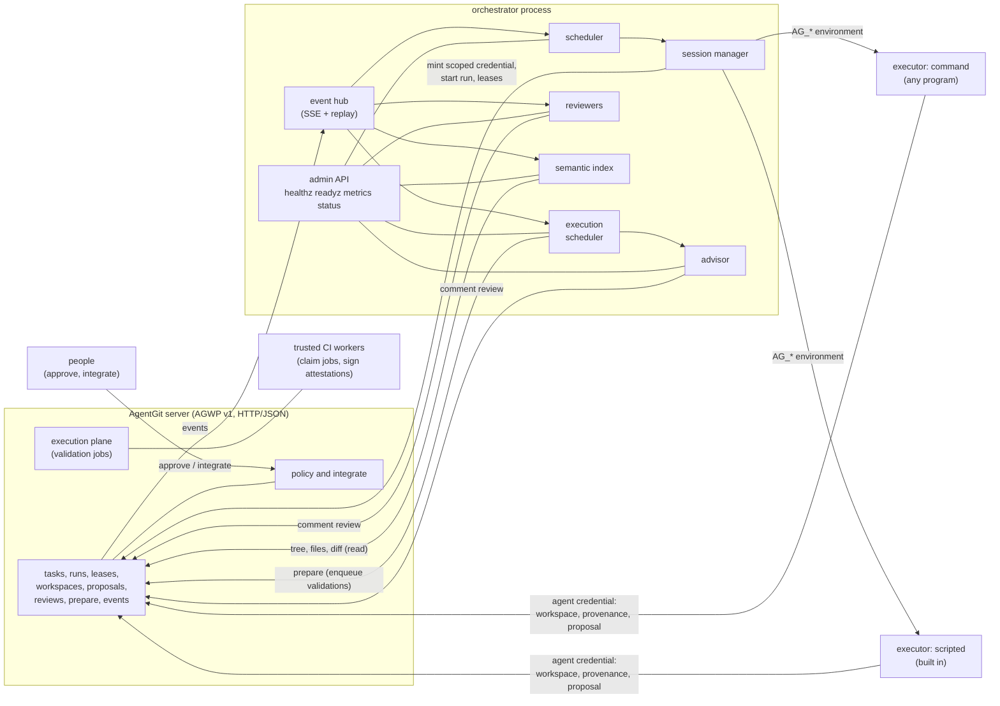

# AgentGit Agent Platform (`agent-orchestrator`)

A Go service that sits **beside** the AgentGit server and makes a fleet of agents manageable: it schedules
tasks onto agent sessions, keeps proposals prepared for the trusted execution plane, suggests resolutions for
conflicting changes and leaves automated review comments. It speaks only the public
[AGWP v1](../../docs/protocol/agwp-v1.md) HTTP/JSON protocol, under its own identity (`service:orchestrator`),
with least-privilege credentials.

> **Trust boundary** ([ADR-0001 §3](../../docs/adr/0001-final-architecture.md)). The orchestrator may *propose*. It can
> never bypass the SCM core or policy: it does not integrate, change policy, move streams, approve, or touch
> storage. Agents it runs get short-lived (at most one hour), narrowly scoped credentials, and everything an
> agent produces still goes through proposals, reviews, validation and policy. A structural test
> (`TestOrchestratorNeverIntegrates`) fails if service code calls an integrating, policy or administration
> operation of the client library.

- Go 1.24, Apache-2.0. Standard library only, plus `gopkg.in/yaml.v3` (MIT and Apache-2.0).
- Operator guide with a complete example and a worked run: [docs/guides/orchestrator.md](../../docs/guides/orchestrator.md).

## What it does

| Component | Job | Package |
|---|---|---|
| Scheduler | per-repository view of tasks; event-driven plus a periodic reconcile; concurrency limits; oldest ready task first; **conflict-aware placement** (leases, running sessions, work that has not landed, open proposals' files, the server's overlap prediction); retries with backoff | `internal/scheduler` |
| Sessions | register the agent and its key, start a run on its behalf, mint a scoped credential, take a lease on the task scope, launch an executor, supervise it (heartbeats, timeout, capped output, SIGTERM then kill of the whole process group), complete the run, release leases, revoke the credential | `internal/session` |
| Execution scheduler | keeps every open proposal prepared (`integration.prepare` with validations enqueued), tracks four independent states per proposal (mergeable, validated, approved, integrated) | `internal/execsched` |
| Advisor | for conflicting proposals, deterministic rule-based suggestions (whitespace only, both sides extended the same list, neighbouring edits, ...) posted as one `comment` review; behind an `Advisor` interface so a smarter one can replace it; never applied automatically | `internal/advisor` |
| Reviewers | deterministic checks on each proposal head posted as `comment` reviews: likely secrets, protected paths, oversized change, source without tests, generated or binary churn | `internal/review` |
| Semantic index | incremental symbol index of the stream (Go, Rust, Python, TypeScript, JavaScript), an HTTP query API, and symbol-level overlap between open proposals; bounded memory and disk | `internal/semindex` |
| Admin | `/healthz`, `/readyz`, `/metrics`, `/status`, structured logs, graceful shutdown, `check` and `ops` commands | `internal/app`, `cmd/orchestrator` |



Nothing in the box on the left of the orchestrator is changed by it except through the same proposal, review
and task operations any agent or person uses; the right-hand arrows into `policy` come from **people**, never
from the orchestrator.

## Layout

```
services/agent-orchestrator/
  cmd/orchestrator/        main: run, check, ops, config, version
  internal/
    agwp/                  typed AGWP v1 client: retries, Retry-After, idempotency keys, SSE follower,
                           provenance signing bytes (admin.go holds the operations only tests may use)
    agentkey/              Ed25519 agent keys, same file format as the Rust CLI
    app/                   wiring, admin/observability API, check, required operations
    config/                YAML/JSON configuration, validation
    events/                per-repository event hub (replay + SSE, resume by sequence number)
    scheduler/ session/    task scheduling and agent sessions (command and scripted executors)
    execsched/ advisor/ review/ semindex/
    textdiff/ glob/ secret/ metrics/ clock/ loop/   small support packages
    testutil/fakeagwp/     in-memory fake AGWP server used by the unit tests
  integration/             end-to-end tests against the real ag-server binary
  Dockerfile  go.mod  go.sum
```

## Run it

```bash
go build -o orchestrator ./cmd/orchestrator

orchestrator ops   -config orchestrator.yaml -for orchestrator -flags   # what to request when minting its credential
orchestrator check -config orchestrator.yaml                            # verify config, credentials, server; changes nothing
orchestrator run   -config orchestrator.yaml                            # run (the default command)
orchestrator config -config orchestrator.yaml                           # effective configuration (no secrets)
```

| Command | What it does | Exit code |
|---|---|---|
| `run` | runs until SIGINT/SIGTERM, then shuts down as configured; a second signal exits at once | 0 clean, 1 error, 2 bad usage or configuration |
| `check` | negotiates the protocol, authenticates all three service credentials, compares their roles and scopes with what the configuration needs, reads every repository and stream, looks for executors; `-json` for machines | 0 all fine (warnings allowed), 1 an error item, 2 bad configuration |
| `ops` | prints the operations each service credential must carry; `-for orchestrator`, `reviewer`, `advisor` or `agent` with `-flags` prints `--operation` flags for `ag-server admin mint` | 0 |
| `config` | prints the effective configuration; neither `config` nor `ops` needs the credentials to be set | 0 |

The configuration file path comes from `-config` or `AG_ORCH_CONFIG`.

### Credentials the service needs

Three identities, each with its own token in its own environment variable (the configuration names the
variable, never the value):

| Identity | Variable (default) | Role on the repositories | Operations (`orchestrator ops`) |
|---|---|---|---|
| `service:orchestrator` | `AG_ORCH_TOKEN` | `delegator` (mints credentials for `agent:*` subjects only and operates their tasks and runs; no administrative power) | scoped to exactly what the configuration needs, never integrate, policy, review or stream operations |
| `service:reviewer` | `AG_REVIEWER_TOKEN` | `reviewer` | read plus `proposal.review` |
| `service:advisor` | `AG_ADVISOR_TOKEN` | `reviewer` | read plus `proposal.review` |

Agents get their own role bindings (for example `agent:docs-bot` as `writer` on the repository); the
orchestrator mints their short-lived credentials but cannot grant roles, and what it mints is never more than
it could do itself (the server clamps a delegated credential to the intersection of the agent's roles, the
delegator's roles and the orchestrator's own scope). If the reviewer or advisor variable is
unset those components fall back to the orchestrator's credential, which by design cannot post reviews;
`check` reports this as an error with the reason.

## Configuration

YAML (JSON also works). **Unknown keys are rejected**, so a typo cannot silently weaken a setting. The file
can never carry a token: it only names environment variables. `orchestrator config` prints the result with
all defaults applied.

```yaml
server:
  url: https://agentgit.example.com        # required (or AG_SERVER); plain http is refused for non-loopback hosts
  token_env: AG_ORCH_TOKEN                 # default
  reviewer_token_env: AG_REVIEWER_TOKEN    # default
  advisor_token_env: AG_ADVISOR_TOKEN      # default
  ca_file: /etc/ssl/agentgit-ca.pem        # optional extra CA for a private server certificate
  timeout: 30s                             # per request
  retries: 4                               # attempts per request, 1..10
  stream_idle: 60s                         # reconnect an event stream silent for this long
  allow_insecure_remote: false             # permit plain http to a non-loopback host (credentials in the clear!)

listen: 127.0.0.1:9090                     # admin API (AG_ORCH_LISTEN)
admin:
  token_env: AG_ORCH_ADMIN                 # bearer token for /status, /metrics, /advisor, /index; REQUIRED when listen is not loopback
state_dir: /var/lib/orchestrator           # agent keys, index, session work directories (AG_ORCH_STATE_DIR)
log: {format: text, level: info}           # text|json; debug|info|warn|error (AG_ORCH_LOG_FORMAT, AG_ORCH_LOG_LEVEL)
loop: {reconcile: 30s, debounce: 500ms}    # the safety-net interval and the event coalescing window
shutdown: {mode: wait, grace: 30s}         # wait: let sessions finish; cancel: stop them (SIGTERM, then kill)

repos:
  - name: acme/web                         # owner/name
    stream: main                           # the stream the work is for
    schedule:
      enabled: true
      slots: 2                             # concurrent sessions in this repository
      placement: avoid                     # avoid: defer overlapping work; allow: only exclusive leases defer
      lease: soft                          # soft | exclusive | none: the lease a session takes on the task scope
      lease_ttl: 30m                       # renewed on every heartbeat
      attempts: 1                          # tries per task, 1..10
      backoff: 30s                         # doubles per attempt, capped at 1h
      default_executor: docs-bot           # implicit when there is exactly one executor
      routes:                              # first match wins; all given matchers must match
        - {executor: docs-bot, title: "^docs:", scope: "docs/**"}
    validations: {enabled: true, enqueue: true}   # execution scheduler; enqueue asks the server to queue validation jobs
    advisor: {enabled: true, inline_bytes: 16384, max_file_bytes: 1048576, max_paths: 20}
    review:
      enabled: true
      max_files: 40
      max_lines: 1500
      secrets: true
      tests: true
      protected: [".github/**", "**/.env", "**/.env.*", "**/*.pem", "**/id_rsa*", "**/secrets/**", "SECURITY.md"]
      generated: ["**/*.lock", "**/package-lock.json", "**/go.sum", "**/dist/**", "**/*.min.js", "**/*.pb.go", "**/vendor/**"]
      sources: ["**/*.go", "**/*.rs", "**/*.py", "**/*.ts", "**/*.tsx", "**/*.js", "**/*.jsx", "**/*.java", "**/*.kt", "**/*.rb"]
      allow_secrets: []                    # regular expressions for lines that are not secrets; "ag:allow-secret" on a line also works
    index:
      enabled: true
      max_file_bytes: 262144               # larger files are not indexed
      max_files: 5000
      skip: ["vendor/**", "node_modules/**", "target/**", "dist/**", ".git/**", "**/*.min.js", "**/testdata/**"]   # abbreviated; the default list is longer

executors:
  - name: docs-bot                         # also the default agent name (agent:docs-bot); one agent per executor
    type: command                          # command | scripted
    agent: docs-bot
    slots: 1                               # concurrent sessions of this executor (see the security model before raising it)
    timeout: 30m                           # at most 55m: agent credentials last at most an hour and cannot be renewed in a running process
    grace: 10s                             # SIGTERM to SIGKILL
    heartbeat: 15s                         # run heartbeat and lease renewal
    credential_ttl: 35m10s                 # default timeout+grace+5m, at most 1h
    output_bytes: 262144                   # bounded window kept of stdout and stderr each
    # operations: [...]                    # default list below; forbidden operations are refused
    command: ["/usr/local/bin/my-agent", "--non-interactive"]   # argv, no shell
    dir: "{workdir}"                       # working directory; default the session's private work directory
    env: {MODE: batch}                     # fixed variables (AG_* is reserved)
    pass_env: [PATH, LANG, TZ]             # variables copied from the orchestrator's environment (default)
    scripted: {}                           # for type scripted: files, task_files, message, title, model, rationale, delay
```

The default agent operations (capabilities of the server's authorization model) are
`repo.read objects.read objects.write publish operation.read history.read tree.read stream.read workspace.read
workspace.write proposal.read proposal.create proposal.update integrate.prepare agent.read agent.run task.read
task.write lease.read lease.write provenance.read provenance.write predict events.read`. These are refused
whatever the file says, and may be neither listed nor reached through `pass_env`: the integration, queue,
review, close, policy, stream compare-and-swap, garbage collection, credential and role operations, job claiming
and attestation, repository administration, agent registration and validation enqueueing. Service credential
variables cannot be passed to executors either.

## Executor contract

An executor is how an agent runs. Two kinds exist.

**`command`**: any program, started directly (no shell) in its own process group, in a private working
directory, with an environment built from scratch: `HOME` (the work directory), the `pass_env` variables, the
configured `env`, and:

| Variable | Meaning |
|---|---|
| `AG_SERVER` | base URL of the AGWP server |
| `AG_TOKEN` | the agent's credential for this session, **bound to the run** (at most an hour; revoked when the run ends) |
| `AG_RUN` | the run id. The credential already acts as `agent:<name>#<run>`; sending it as the `ag-run` header is accepted and changes nothing |
| `AG_REPO`, `AG_STREAM` | the repository (`owner/name`) and stream the work is meant for |
| `AG_TASK` | the task id |
| `AG_TASK_FILE` | path of a JSON file with the task (title, description, scope). The text is **untrusted input**: it is written by whoever filed the task |
| `AG_AGENT`, `AG_IDENTITY` | the agent name and `agent:<name>#<run>` |
| `AG_KEY_FILE` | the agent's Ed25519 key (mode 0600), for signing provenance; the file format is the Rust CLI's |
| `AG_WORKDIR` | private scratch directory |
| `AG_RESULT_FILE` | optional: write `{"summary": "..."}` here to put a line in the run record |

The credential's scope is the repository and stream of the task and the configured operations. What a
well-behaved agent does is what the scripted executor does: create a workspace on the stream, change files,
sign a provenance record with its key, and open a proposal for the task. It never integrates; policy and
people decide what lands.

**Exit codes**: `0` the agent finished (the task is done, or waits for its proposals to land); `75`
(`EX_TEMPFAIL`) a temporary failure: the task is tried again after the backoff without spending the attempt
budget (at most ten times in a row); anything else, or death by signal, is a failure: retried within
`attempts`, then the task is cancelled. If the failed session had already opened proposals, the task waits for
them instead.

**Output**: stdout and stderr are each kept in a bounded in-memory window (`output_bytes`); stdout is not
logged or forwarded. When a session fails, times out or is cancelled, a one-line tail of stderr becomes part of
the run's summary on the server and appears in `/status` while the session runs. Everything is scrubbed of the
session's own token first.

**Lifecycle**: the session registers the agent (once; a different key already registered under that name
refuses to start), starts the run (claiming the task for the agent), takes the lease, heartbeats the run and
renews leases, enforces `timeout`, on stop sends SIGTERM to the process group and SIGKILL after `grace`, then
completes the run (`completed` or `failed` with a summary), finishes the task if the scheduler decided so, and
revokes the credential. A run whose supervisor is gone (orchestrator crash) is found by its stale heartbeat
and ended by the server (`agent.reap_runs`, audited under the orchestrator) as abandoned; the server
releases its leases and revokes its credentials when a run ends.

**`scripted`**: a built-in stand-in for an agent for tests and demos. It writes the files given in the
configuration (or, with `task_files: true`, in a line `ag-script:{"files":{...},"title":"..."}` of the task
description), signs provenance and opens a proposal.

## Security model

- **Identity.** The service authenticates as `service:orchestrator` (and `service:reviewer`,
  `service:advisor`); every agent action is attributable to `agent:<name>#<run>`. The orchestrator holds the
  `delegator` role on its repositories: it can mint credentials for agents (never for a person, a service or an
  administrator) and finish or reap their tasks and runs, and nothing administrative. The credential it
  actually uses is *scoped* to the operations `orchestrator ops` lists, which exclude integration, policy,
  review, stream and role operations, and `check` warns when the credential is broader than needed (and errors
  when the role is not `delegator` or `admin`, or the server predates delegation).
- **Agents.** Credentials are minted per session for `agent:<name>`, **bound to the run of the session**,
  limited to the task's repository and stream, to the configured operations, and to the lifetime the executor
  needs (never more than one hour; the server also refuses a credential that outlives its parent). A credential
  acts only as its own run and stops working the moment the run ends, however it ends. They are revoked as soon as the session ends,
  passed to the executor only in its environment, and scrubbed from captured output, run summaries, logs and
  `/status`. No service credential reaches an executor.
- **What the orchestrator cannot do.** It cannot land a change, approve one, change a policy, grant a role,
  create a repository or a task, or close a proposal; the structural test and the scoped credential both
  enforce that. Its reviews are always `comment`; whether any automated review could ever count toward an
  approval requirement is up to the stream's policy.
- **Admin API.** `/healthz` and `/readyz` are open; everything else requires the admin bearer token when one is
  configured, and a non-loopback listener refuses to start without one. The configuration refuses plain http to
  non-loopback servers.
- **Concurrent sessions of one agent are isolated.** The credential of a session is bound to its run
  ([ADR-0010](../../docs/adr/0010-run-bound-credentials.md)), so two sessions of the same agent (an executor
  with `slots` above 1) cannot act as each other's run, finish each other's task or touch each other's
  workspaces, proposals and leases (`TestConcurrentSessionsOfOneAgentCannotActForEachOther`). Sessions of
  *different* agents are isolated as before (`TestFailingCommandExecutorGetsTheContractAndLeaksNothing`). The
  orchestrator refuses a credential the server did not bind to the run (a server that predates the feature
  would mint a name-bound one and say nothing). Agent credentials the orchestrator does *not* mint (a hand-minted
  token, `ag-mcp --run-credentials off`) are still bound to the name only.
- **Untrusted text.** Task titles and descriptions are never interpolated into commands; they reach an
  executor as data in `AG_TASK_FILE`. What the executor does with them is the executor's business.

## Admin and observability

| Endpoint | Auth | Content |
|---|---|---|
| `GET /healthz` | none | liveness |
| `GET /readyz` | none | 200 once authenticated and every repository's event stream is connected, else 503 with the reasons |
| `GET /metrics` | admin token | Prometheus text: sessions, deferrals (by reason), reconcile loops and errors, events, SSE reconnects, AGWP requests, errors and retries (by code), validations queued, advisor suggestions, reviews posted, index size, credentials minted, service credential expiry |
| `GET /status` | admin token | identities, per repository: event stream, scheduler (running, waiting to land, deferred with reasons, retrying), per-proposal four-state view with blockers, validation and integration queues, advisor and reviewer records, index |
| `GET /advisor/suggestions?repo=&proposal=` | admin token | the stored advice, including the suggested files |
| `GET /index/symbols`, `/index/files`, `/index/overlaps`, `/index/changes`, `/index/status` | admin token | the semantic index |

Logs are `log/slog` (text, or JSON with `log.format: json`) on stderr. SIGINT/SIGTERM start a graceful
shutdown: no new sessions, then running ones finish (`wait`) or are cancelled (`cancel`) within `shutdown.grace`,
and the admin API is the last thing to stop.

## Tests

```bash
go vet ./...
go test -race ./...            # unit tests for every package, plus the integration suite
```

- **Unit tests** are table-driven, use a fake clock and an in-memory fake AGWP server
  (`internal/testutil/fakeagwp`) that mimics the real error model, injected failures, SSE and dedup of
  validation jobs.
- **Integration suite** (`integration/`, Linux): starts the **real `ag-server` binary** for every test on a
  free loopback port in a temporary directory (`AG_BOOTSTRAP_TOKEN=... ag-server serve --data-dir ... --listen
  ...`), always kills it, and drives the orchestrator through it. The binary is taken from `$AG_SERVER_BIN`, then
  `PATH`, then `/home/user/bin/ag-server`; the tests skip with a message when there is none. Scenarios:
  dependency-ordered tasks under a provenance-plus-approval policy (the real server verifies the agent's
  signature), overlap deferral and `allow` placement, a failing shell executor (environment, credential
  isolation and revocation, no secret in logs, status or run records), a killed executor and an orphaned run,
  the advisor on two really conflicting workspaces, the reviewers on a planted fake secret / an oversized
  change / a protected path (and silence on clean code), the semantic index after integrations, the execution
  scheduler against real queued validation jobs completed by a test CI worker with signed attestations, and
  graceful shutdown in both modes (including restart adoption and a process that ignores SIGTERM).

## Server behaviour this service works around (observed against `ag-server`)

These are findings, not complaints; each is covered or handled as described.

1. **Idempotency keys are honoured only for some mutations** (repository, task and run creation, lease
   acquisition, object publishing, proposal creation and integration). The client sends a key on every
   mutation and repeats a lost response only for those; for the rest (`stream.create`, credential minting, ...)
   a transport failure is reported as an *unknown outcome* and the callers reconcile instead of repeating
   (an orphaned run is found by heartbeat staleness).
2. **A credential was bound to an agent, not a run.** Fixed: the orchestrator mints run-bound credentials
   (see the security model).
3. **Minting credentials needed the `admin` role.** Fixed: the `delegator` role mints for `agent:*` only and
   cannot escalate; the orchestrator no longer needs `admin`.
4. **A task could only be finished by its owner.** Fixed: `agent.operate` finishes (and reaps) on the
   operator's behalf, audited as the orchestrator with the owner it overrode. The orchestrator no longer mints
   a credential as the owner for this.
5. **`integration.prepare` was not read-consistent around a job's completion.** Fixed on the server: the
   verdict, the attestations and the jobs are read in one transaction. The scheduler still re-prepares on the
   job and attestation events, which is how it learns that something changed.
6. **Per-credential rate limiting applies to every operation**; the client waits out `rate_limited` using
   `retry_after_ms`.

## What has not been verified

- The Dockerfile has **not been built**: the machine it was written on has a Docker client but no daemon. The
  Go build it runs is the one the tests exercise.
- Non-Linux platforms: the packages compile for macOS and Windows (`go build` with `GOOS` set), but sessions
  there are untested; process-group handling is Unix-specific and the integration suite is Linux-only.
- Credential renewal of a very long session is not implemented (an agent session is capped at 55 minutes by
  design); a service credential expiring while the service runs is detected and logged, not renewed.
- The advisor and reviewers are **deterministic heuristics**. They are useful and explainable, not
  exhaustive: the secret detector can miss a secret and can flag a non-secret; the semantic index is a
  line-based extractor, not a language server. No model-backed advisor exists; the `Advisor` interface is
  where one would plug in.
- Behaviour against a server other than the `ag-server` revision the suite ran against, and at scale
  (many repositories, thousands of open proposals), has not been measured.

## License

Apache-2.0. Direct dependency: `gopkg.in/yaml.v3` (MIT and Apache-2.0, dual).
